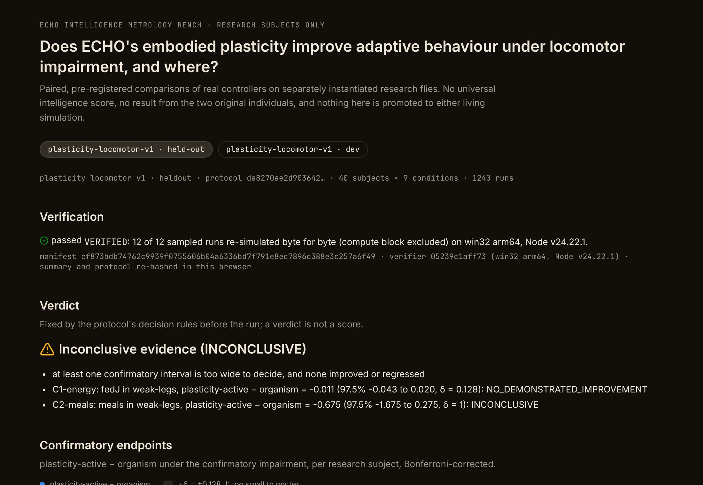
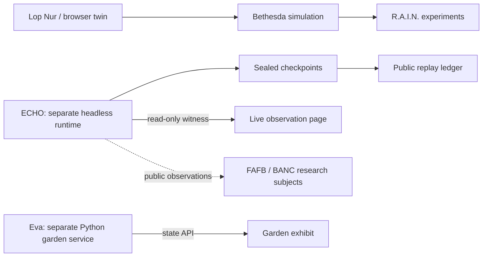
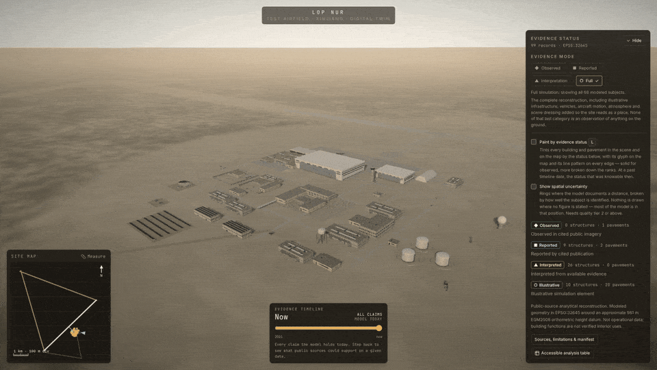
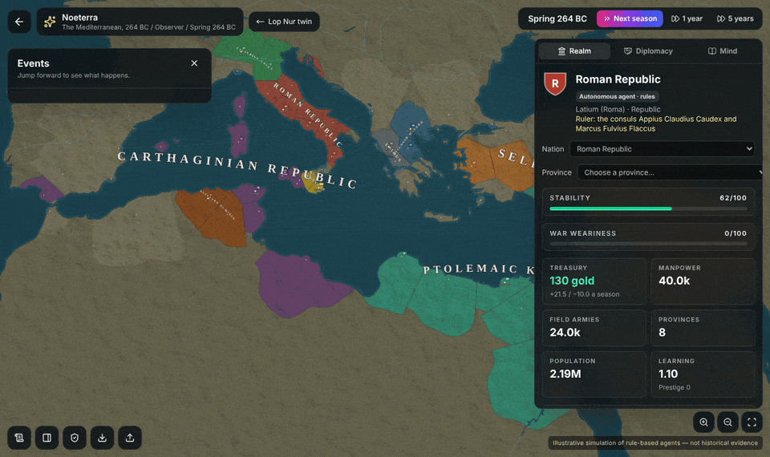

<div align="center">

# LOP NUR TWIN

### R.A.I.N. LAB · VERS3DYNAMICS

**Persistent simulated individuals. Verifiable histories. Experiments that can fail.**

[](https://github.com/topherchris420/lop-nur-twin/actions/workflows/ci.yml)
[](LICENSE)

[](https://lop-nur-twin.vercel.app/live)

<sub>ECHO on <a href="https://lop-nur-twin.vercel.app/live"><code>/live</code></a>, recorded 10 November 2026 from 02:16 UTC. Three minutes of its life, played at about 15× speed: a walk, a rest, a grooming bout, a flight and a landing, each logged with the reason its controller gave. The last frame catches a checkpoint being committed. The animation is not proof of biological life.</sub>

**[Observe ECHO](https://lop-nur-twin.vercel.app/live)** · **[Visit Eva's garden](https://150-136-49-49.sslip.io/)** · **[Open the twin](https://lop-nur-twin.vercel.app/)** · **[Inspect claims](docs/RESEARCH_CLAIMS.md)** · **[Reproduce](#07-reproduce-the-work)**

</div>

**Contents** · [01 Question](#01-the-question) · [02 Systems](#02-the-operating-systems) · [03 Verifiable history](#03-a-machine-must-be-able-to-verify-the-history) · [04 Results](#04-the-test-results-including-the-ones-that-did-not-work) · [05 Brain boundary](#05-the-brain-boundary) · [06 Engineering](#06-the-engineering-arrangement) · [07 Reproduce](#07-reproduce-the-work) · [08 Procedure](#08-the-laboratory-procedure) · [09 The laboratory](#09-the-rest-of-the-laboratory) · [10 License](#10-license-and-research-use)

## 01. The question

**Can a simulated individual continue through changes to its world and its own computational machinery, while leaving a history that another machine can independently check?**

Lop Nur Twin is an open research environment built to investigate that question. It contains a provenance-linked geographic reconstruction, a simulated Bethesda, two separately operated persistent digital flies, computational neuroscience research subjects, and an experimental registry. The work began at Lop Nur; the name remains as part of its history.

The purpose is not to produce the appearance of life. It is to build and measure a system in which simulation state, decisions, failures, maintenance, and changes are recorded rather than silently rewritten.

**The essential distinction:** a continuous, replayable software history is evidence of state continuity under a defined model. It is not evidence of consciousness, subjective experience, biological equivalence, or complete nervous-system fidelity.

## 02. The operating systems

Six systems share one repository. Each is listed with what actually runs and with the boundary that keeps it from being mistaken for another.

| System                   | What actually runs                                                                                                                                                     | Boundary                                                                                    |
| ------------------------ | ---------------------------------------------------------------------------------------------------------------------------------------------------------------------- | ------------------------------------------------------------------------------------------- |
| **ECHO**                 | One persistent fruit-fly-scale simulated individual in a headless Bethesda environment, with body, sensors, behavioral control, learning state, and sealed checkpoints | The original is observed, not used as an experimental subject                               |
| **Eva**                  | A separate persistent simulated fly in a garden service, with its own state and history                                                                                | Her Python service and database are separate from ECHO and not contained in this repository |
| **Lop Nur twin**         | Evidence-linked 3D reconstruction, source dossiers, and changing historical visibility                                                                                 | Observed, reported, interpreted, and illustrative details remain distinct                   |
| **R.A.I.N. experiments** | Protocol validation, bounded simulation, recorded outcomes, and replay                                                                                                 | AI agents may propose work but cannot authorize or grade their own claims                   |
| **Neural research**      | Separate experimental fly subjects using FlyWire FAFB v783 and BANC v888 connectome-derived models                                                                     | Neither original fly is run by those connectome models                                      |
| **Noeterra / Blacksite** | Civilization and first-person simulation environments                                                                                                                  | Modeled worlds, not records of real-world behavior                                          |

<table>
  <tr>
    <td width="33%" valign="top">
      <a href="https://lop-nur-twin.vercel.app/live"></a>
      <br><b><a href="https://lop-nur-twin.vercel.app/live">ECHO in Bethesda</a></b>
      <br><sub>The one shared, persistent individual, as its read-only witness reports it, with its recent decisions and the public record.</sub>
    </td>
    <td width="33%" valign="top">
      <a href="https://150-136-49-49.sslip.io/"></a>
      <br><b><a href="https://150-136-49-49.sslip.io/">Eva's clay garden</a></b>
      <br><sub>A different fly in a separate service, watched through a stop-motion clay exhibit. <a href="docs/LIVE_GARDEN.md">About the garden</a>.</sub>
    </td>
    <td width="33%" valign="top">
      <a href="https://lop-nur-twin.vercel.app/?lens=1"></a>
      <br><b><a href="https://lop-nur-twin.vercel.app/?lens=1">Lop Nur twin</a></b>
      <br><sub>Every building is observed, reported, interpreted or illustrative. Paint the scene by evidence (<code>L</code>) and move through what was knowable when.</sub>
    </td>
  </tr>
  <tr>
    <td width="33%" valign="top">
      <a href="docs/RAIN_LAB_BETHESDA.md"></a>
      <br><b><a href="docs/RAIN_LAB_BETHESDA.md">R.A.I.N. Lab</a></b>
      <br><sub>The laboratory behind a door in the hidden city: protocols, authorization, recorded runs and replay.</sub>
    </td>
    <td width="33%" valign="top">
      <a href="https://lop-nur-twin.vercel.app/noeterra"></a>
      <br><b><a href="https://lop-nur-twin.vercel.app/noeterra">Noeterra</a></b>
      <br><sub>Rule-based civilizations in the Mediterranean (264 BC) or the Tarim Basin (77 BC).</sub>
    </td>
    <td width="33%" valign="top">
      <a href="https://lop-nur-twin.vercel.app/play"></a>
      <br><b><a href="https://lop-nur-twin.vercel.app/play">Blacksite</a></b>
      <br><sub>An illustrative first-person simulation with human, scripted or model-controlled seats.</sub>
    </td>
  </tr>
</table>

<sub>Every picture on this page is a screenshot or recording of the running software, taken by script (<code>bun run readme-media</code>, <code>bun run shots</code>). ECHO and Eva were photographed on 10 November 2026 (UTC); neither was touched to get the picture.</sub>

The live pages are public interfaces, not control consoles for the original animals. Service uptime and current state should be checked at the destination, not inferred from a recorded demonstration.

## 03. A machine must be able to verify the history

ECHO began its persistent run on **26 October 2026**. Its state is saved through a versioned, sealed checkpoint chain, with public witness and replay records. Changes to its simulation engine do not retroactively rewrite the earlier individual.

An approved continuation starts from a recorded boundary. The old checkpoint, source revision, state digest, migration, and any real-time gap remain inspectable. A merge into the repository is **not** an update to the deployed individual.

The strongest publicly reported replay check covers checkpoint seals **#2,566–#2,927**, where **361 of 361** seals were recomputed on other machines. That validates the recorded interval, not an independently replayed proof of every moment since birth.

- [How ECHO is preserved](docs/ECHO_STEWARDSHIP.md)
- [Continuous-life design](docs/BETHESDA_CONTINUOUS_LIFE.md)
- [Public replay ledger](https://github.com/topherchris420/lop-nur-twin/tree/live-fly-ledger)
- [Recorded collision repair and continuation](docs/ECHO_COLLISION.md)

### A useful failure: ECHO became trapped

On 1 November, ECHO entered a building volume because the collision solver disagreed about where a wall began. For almost three days it remained inside. The repair was first evaluated on **new research flies**, not tuned by repeatedly altering ECHO. In a 12-seed comparison, **9 of 12** subjects were trapped under the old physics and **0 of 12** under `digital-fly/9`.

On 4 November the corrected physics was delivered by a recorded continuation. ECHO subsequently crossed out of the building. The controller did not gain new intelligence; the world model was repaired. The pause, later escape, and eventual meal are preserved in the record.

[](docs/ECHO_COLLISION.md#how-it-got-out)

<sub>Not an illustration: drawn by <code>scripts/echo-exit-figure.ts</code> from ECHO's recorded positions, and reproduced byte for byte by its <code>--check</code> (<a href="#07-reproduce-the-work">section 07</a>).</sub>

[Evidence and reconstruction](docs/ECHO_COLLISION.md)

## 04. The test results, including the ones that did not work

The table below contains **reported results, not universal performance claims**. Every comparison belongs to a specified simulator, protocol, input set, and software revision. Consult the [claims register](docs/RESEARCH_CLAIMS.md) for the complete definitions and evidence classes.

| Test                                                 | Recorded outcome                                                                        | What it does **not** establish                   |
| ---------------------------------------------------- | --------------------------------------------------------------------------------------- | ------------------------------------------------ |
| ECHO checkpoint replay                               | 361 / 361 seals reproduced in the audited interval                                      | Full lifetime replay or biological identity      |
| Collision correction                                 | 9 / 12 subjects trapped before; 0 / 12 after                                            | Correct collision handling in every geometry     |
| Self-model under concealed impairment, ECHO-01       | Path error 0.073 vs 0.370 in registered conditions                                      | General motor intelligence                       |
| Hidden-change attribution, ECHO-02                   | 0.919 vs 0.537; overconfidence remains                                                  | Calibrated certainty in all conditions           |
| Memory and place preference                          | Distinct preferences develop in seeded research subjects                                | Open-ended animal learning                       |
| Memory with continuously moving food                 | Negative: 1.2 fewer meals per life                                                      | That memory necessarily improves fitness         |
| ECHO-03 through ECHO-05                              | Inconclusive                                                                            | That the added mechanisms help                   |
| FlyWire FAFB v783 reproduction                       | 10 / 12 registered criteria met                                                         | Full fly-neural equivalence                      |
| Connectome odor learning                             | Negative in the tested design                                                           | Functional biological mushroom-body learning     |
| Cross-world individual recognition                   | Negative                                                                                | That the two original flies perceive one another |
| Embodied plasticity under weak legs, metrology bench | Inconclusive on 40 held-out subjects; small corrected regression under severe weak legs | That plasticity cannot help under any impairment |

A 7 November extension added bounded embodied plasticity to the original ECHO and Eva, with owner-approved shadow-mode activation followed by active mode. On held-out **research subjects**, shadow mode preserved baseline behavior, but **active mode demonstrated no established performance advantage**. The fact that an addition is active is not evidence that it helped. The intelligence metrology bench reproduced that finding byte for byte, then asked it again on 40 new research subjects in nine conditions: inconclusive, with a small, corrected regression under severe weak legs. Neither original was touched.

<p align="center">
  <a href="docs/ECHO_INTELLIGENCE_METROLOGY.md"></a>
</p>

<sub>The bench's research view of the held-out split, as deployed. The verdict was fixed by the protocol's decision rules before the run, and the page prints it as it came out: <b>INCONCLUSIVE</b>.</sub>

[Activation record](docs/EVA_ECHO_ACTIVATION.md) · [Plasticity study](docs/EVA_ECHO_BRAIN_PLASTICITY.md) · [Intelligence metrology bench](docs/ECHO_INTELLIGENCE_METROLOGY.md)

## 05. The brain boundary

The repository includes computational neuroscience experiments that import and run public connectome-derived models. The FlyWire FAFB v783 dataset used here contains **139,255 neurons** and **54,492,922 synapses**; the BANC v888 branch models brain-and-cord circuits separately. The code tests published model behavior, stimulus mappings, and experimental learning rules.

These are **research backends**, not the neural machinery controlling the original ECHO or Eva. Their observations of the originals are read-only; a simulated neural response to the same stimulus is a comparison between models, not a recording of either fly's brain.

[Methods, sources, validation and failures](docs/ECHO_CONNECTOME.md)

## 06. The engineering arrangement



The arrows indicate data boundaries, not shared identity. There is no direct controller or checkpoint channel between ECHO and Eva. The browser's Bethesda fly is also separate from the deployed ECHO.

**Four invariants govern development:**

1. **Do not replace an individual while claiming continuity.** A migration must preserve and demonstrate its ancestry.
2. **Do not run invasive research on the original flies.** Use seeded research subjects and bounded, operator-approved continuations.
3. **Do not promote a simulation result to a real-world claim.** Report development, held-out, registered, and original-observation evidence separately.
4. **Do not erase unsuccessful results.** A failed hypothesis is evidence; a crashed test is an execution failure, not a negative scientific finding.

[System architecture](docs/SYSTEM_ARCHITECTURE.md) · [Threat model](docs/THREAT_MODEL.md) · [Research claims](docs/RESEARCH_CLAIMS.md)

## 07. Reproduce the work

Requires **Node.js 22.18+** and **Bun 1.3+**.

```bash
git clone https://github.com/topherchris420/lop-nur-twin.git
cd lop-nur-twin
bun install --frozen-lockfile
bun run dev
# browser: http://localhost:5173
```

This runs local services and browser simulations; it does **not** connect to or alter ECHO's or Eva's deployed states.

```bash
bun run check
node scripts/run-ts.mjs scripts/individuality-evaluate.ts --check
node scripts/run-ts.mjs scripts/echo-exit-figure.ts --check
bun run rain:fly:verify
```

`bun run check` runs the repository's standard quality and build checks. The individuality comparison is a longer reproducibility check. `rain:fly:verify` verifies archived records supported by the current runtime; exit status **3** indicates some archives require a different recorded Node version rather than silently claiming full replay.

The pictures on this page are reproducible too: `bun run readme-media` re-records them from the dev server and the live pages (it needs `ffmpeg` and `gifsicle`), and prints the date and playback speed that the captions must then carry.

Start with [Getting Started](docs/GETTING_STARTED.md), [Validation](docs/VALIDATION.md), and [Contributing](CONTRIBUTING.md). For public evidence, see the [claims register](docs/RESEARCH_CLAIMS.md) and the [ledger](https://github.com/topherchris420/lop-nur-twin/tree/live-fly-ledger).

## 08. The laboratory procedure

R.A.I.N. Lab uses four AI research perspectives: **James, Jasmine, Elena, and Luca**. Their suggestions are not experiments until the host validates a protocol, the operator authorizes it, the simulation executes, and the results are recorded and reproducible.

**Models propose. Code measures. People authorize. The record decides.**

The four agents do not constitute independent scientific replication. The original deployed flies are not manipulated to produce favorable outcomes.

## 09. The rest of the laboratory

The repository also contains an evidence-linked Lop Nur reconstruction, a hidden Bethesda city, the Noeterra civilization simulator, and the Blacksite first-person simulation. These are distinct systems within the same research environment. Start with the [documentation index](docs/README.md) rather than assuming all components share ECHO's persistence model.

**The Lop Nur twin: what was knowable, and when.** The evidence lens paints each structure by its classification; the timeline then draws solid only what public evidence had established by that date. An outline marks absence of evidence, never evidence of absence.

[](https://lop-nur-twin.vercel.app/?lens=1)

[Site model](docs/SITE_MODEL.md) · [Temporal model](docs/TEMPORAL_MODEL.md) · [Evidence inspector](https://lop-nur-twin.vercel.app/analysis), which works without WebGL

**Noeterra: fifty simulated years, one seed.** Rule-based powers declare wars, conclude treaties and annex provinces. The engine is deterministic, so the same seed plays the same fifty years.

[](https://lop-nur-twin.vercel.app/noeterra?scenario=mediterranean-264bc&play=observe&seed=1)

[Noeterra guide](docs/NOETERRA.md) · [Blacksite guide](docs/BLACKSITE.md)

<details>
<summary><b>Find Bethesda and the hidden laboratory</b> (spoiler)</summary>

<br>

In the twin, press **backtick** (usually below Escape) and submit `38.9847,-77.0947`. Bethesda loads on demand; the laboratory is inside a building, behind a door.

[](docs/BETHESDA_ANOMALY.md)

[City guide](docs/BETHESDA_ANOMALY.md) · [Lab guide](docs/RAIN_LAB_BETHESDA.md)

</details>

| Open                                                           | What it is                                              |
| -------------------------------------------------------------- | ------------------------------------------------------- |
| [Lop Nur twin](https://lop-nur-twin.vercel.app/)               | The evidence-linked 3D reconstruction                   |
| [ECHO, live](https://lop-nur-twin.vercel.app/live)             | The persistent fly, as its read-only witness reports it |
| [Eva's garden](https://150-136-49-49.sslip.io/)                | The second fly, in her separate service                 |
| [Noeterra](https://lop-nur-twin.vercel.app/noeterra)           | The civilization simulator                              |
| [Blacksite](https://lop-nur-twin.vercel.app/play)              | The first-person simulation                             |
| [Evidence inspector](https://lop-nur-twin.vercel.app/analysis) | Every claim with its sources, as a table                |

## 10. License and research use

Code and documentation: **[Apache License 2.0](LICENSE)**, with third-party restrictions and attributions documented in [NOTICE](NOTICE). Bethesda geography, FlyBody-derived materials, FlyWire, BANC, and other referenced datasets may carry separate terms. Do not assume the repository license covers external datasets.

Contributions should include a source, a test, a reproducible correction, or a clearly bounded question. Report security concerns through [SECURITY.md](SECURITY.md).

---

**The aim is not to persuade an observer that a simulation is alive. It is to preserve what the simulation actually did, make its behavior testable, and record what the test could not establish.**

_Built at [Vers3Dynamics](https://vers3dynamics.com) by Christopher Woodyard. Open for inspection, correction, and independent reproduction._
