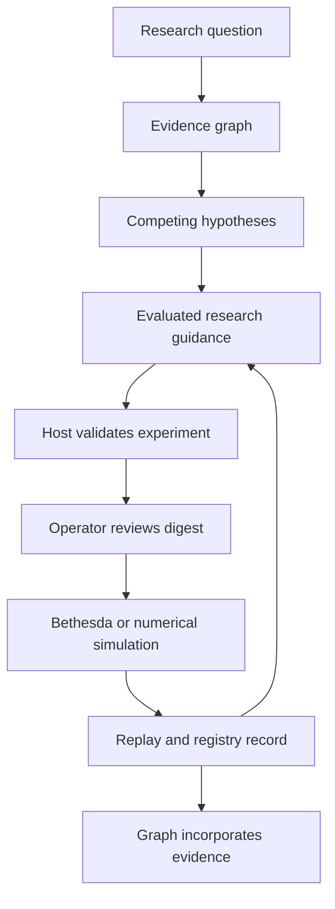

<div align="center">

# R.A.I.N. Lab

### A laboratory you can enter. A world that can answer back.

[](https://github.com/topherchris420/lop-nur-twin/actions/workflows/ci.yml)
[](LICENSE)
[](https://lop-nur-twin.vercel.app/)

[Live site](https://lop-nur-twin.vercel.app/) ·
[Evidence](https://lop-nur-twin.vercel.app/analysis) ·
[Evaluation](https://lop-nur-twin.vercel.app/evaluation) ·
[Meet R.A.I.N.](https://rainlabteam.vercel.app/)

</div>


R.A.I.N. Lab is Vers3Dynamics' project to build **a digital Bell Labs inside simulated
worlds**. James, Jasmine, Luca, and Elena bring distinct research perspectives to shared
questions. The lab connects Christopher Woodyard's research papers and mathematical
context with executable experiments, so each investigation can inform the next.

The model may imagine the experiment. The laboratory must determine whether it is valid.
The simulation produces the evidence. The evidence determines what can reasonably be
concluded.

## Explore

| Start with                                                     | What you can inspect                                                                                                                                     |
| -------------------------------------------------------------- | -------------------------------------------------------------------------------------------------------------------------------------------------------- |
| [Lop Nur reconstruction](https://lop-nur-twin.vercel.app/)     | A source-linked reconstruction of the airfield and its documented evidence.                                                                              |
| [Evidence inspector](https://lop-nur-twin.vercel.app/analysis) | Claims, source references, classifications, uncertainty, and revisions.                                                                                  |
| [Blacksite](https://lop-nur-twin.vercel.app/play)              | Human, scripted, and model-driven play under the same simulation rules.                                                                                  |
| [Evaluation](https://lop-nur-twin.vercel.app/evaluation)       | Recorded decisions and experiment comparisons.                                                                                                           |
| Bethesda and the Lab                                           | A walkable city, four research perspectives, and a local research workbench. Start at the live site and [read the Lab guide](docs/RAIN_LAB_BETHESDA.md). |

The public reconstruction and scripted experiences need no credentials. Local model
research needs a running LM Studio server. The deployed site cannot connect to a model
server on your computer.

## How the research loop works

A question leads to evidence, competing explanations, a testable design, a reviewed run,
and a retained result.



- **Scientific Knowledge Graph:** reconstructs typed relationships from the approved
  paper corpus, research journal, and experiment registry. Source context, model
  suggestions, and verified measurements retain different evidence labels.
- **Research Learning Engine:** finds repeated procedural errors, proposes versioned
  guidance, and compares candidates on frozen held-out tasks. Evaluated guidance stays
  inactive until an operator approves it. Scientifically valid negative results are not
  treated as process failures.
- **Experiment compiler:** validates versioned experiment designs before execution. The
  Bethesda backend preserves the existing simulation workflow. The numerical physics
  backend runs a bounded, driven damped oscillator and checks results against an
  independent analytic reference.
- **Host authority:** model proposals cannot authorize execution or edit evaluation
  rules after results. An operator reviews the plan digest; execution, replay, and
  registry admission remain in the host.

The simulator models are illustrative. They do not measure the real airfield, human
behavior, or physical laboratory equipment.

The separate [Project Inception workbench](docs/RAIN_INCEPTION.md) is experimental. It
explores versioned researcher profiles and reviewed follow-up investigations; it does
not establish recursive scientific improvement.

## Try it locally

The public site runs without model credentials. To start the local application, use
Node.js 22.18 or later:

```sh
npm ci
npm run dev
```

For local research, start the LM Studio server at its default address, 127.0.0.1:1234.
Set RAIN_MODEL to an identifier returned by that server's /v1/models endpoint. The
current lab installation uses Gemma, with the identifier gemma-4-e4b-it.

```powershell
$env:RAIN_AUTONOMY_ENABLED = "true"
$env:RAIN_MODEL_PROVIDER = "lmstudio"
$env:RAIN_MODEL = "gemma-4-e4b-it"
npm run dev
```

Open Bethesda from the application and enter the Lab. A model can draft a protocol; the
host validates it and shows the plan digest for operator review. Research runs locally.
Failed and incomplete calls remain in the journal, and the app does not silently switch
to a remote model.

For the deterministic integration demonstration, use a separate journal:

```sh
npm run rain:scientific:demo -- --dir .rain-research/readme-demo
```

This fixture uses a scripted designer and an explicitly scripted operator. Its simulated
approval does not authorize a live experiment.

## What has been measured

**A narrow procedural improvement:** on eight scripted held out compiler tasks, valid
proposals increased from 0/8 in the baseline arm to 8/8 with the tested parameter grid
guidance. Wilson 95% intervals are [0, 0.324] and [0.676, 1]. These related fixtures
exercise one known error class; they do not establish general scientific intelligence.

**Bethesda simulation:** two experiments ran with three paired seeds each and passed
deterministic replay. A scripted designer produced the second design after inspecting
the first result. These are simulation outputs, not observations of people.
[Methods, results, and limits](docs/benchmarks/rain-discovery-validation/README.md).

**Live Gemma experiment:** an operator approved the exact plan before it ran. The
two-arm oscillator simulation replayed and entered the native registry, but its
scientific verdict is inconclusive: position and velocity errors exceeded the
preregistered analytic accuracy limits. The drafts, measurements, journal, and
independent verification command are in the
[Gemma evidence record](docs/rea-research/evaluations/gemma-live/README.md).

## Development

```sh
npm run format:check
npm run lint
npm run test:run
npm run build
node scripts/run-ts.mjs scripts/verify-scientific-evidence.ts
```

The tests and reports cover the TypeScript application, scientific authority boundaries,
deterministic replay, and the public research evidence. See the
[evaluation philosophy](docs/EVALUATION_PHILOSOPHY.md) before interpreting a result.

## Documentation

- [Scientific intelligence architecture and limits](docs/RAIN_SCIENTIFIC_INTELLIGENCE.md)
- [REA investigation matrix](docs/rea-research/capability-matrix.md)
- [Mirrors findings](docs/rea-research/mirrors/observations.md) ·
  [Poth Labs findings](docs/rea-research/poth-labs/observations.md) ·
  [Infera findings](docs/rea-research/infera/observations.md)
- [Research programs](docs/RAIN_RESEARCH_PROGRAM.md) ·
  [Experiment authorization and recovery](docs/RAIN_EXPERIMENTAL_DISCOVERY.md)
- [Inception prototype](docs/RAIN_INCEPTION.md) ·
  [System architecture](docs/SYSTEM_ARCHITECTURE.md)
- [Evidence and source provenance](docs/DATA_PROVENANCE.md) ·
  [Threat model](docs/THREAT_MODEL.md) · [Security](SECURITY.md)
- [Evaluation philosophy](docs/EVALUATION_PHILOSOPHY.md) ·
  [Government evaluation guide](docs/GOVERNMENT_EVALUATION.md)

REA helped investigate the public behavior and available client code of Mirrors, Poth
Labs, and Infera. The reports distinguish direct observation, public documentation,
supported inference, and unknown details. They guide an original implementation; no
proprietary code was copied.

## License and attribution

Source code and documentation are licensed under [Apache 2.0](LICENSE). Lop Nur sources
and attributions are listed in [NOTICE](NOTICE). Bundled Bethesda geographic data has
additional terms; see its [data license](src/bethesda/data/LICENSE.md) and source
registers.
