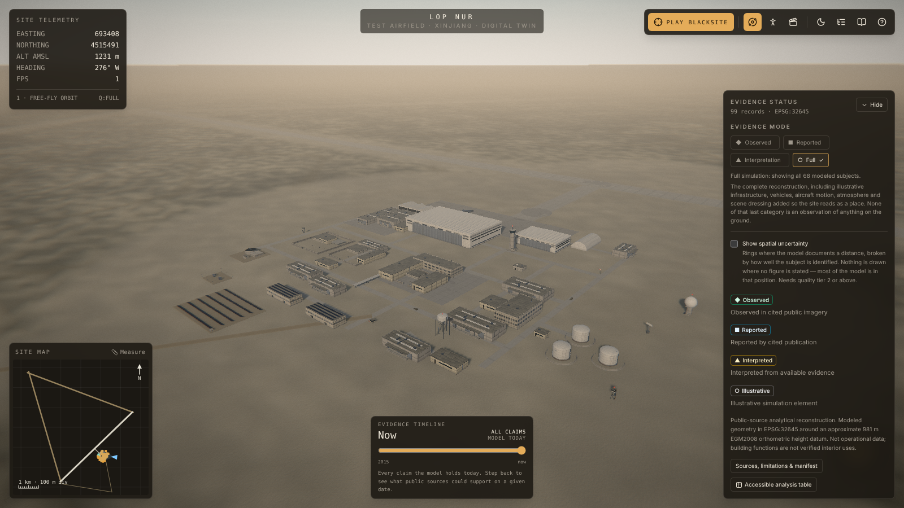
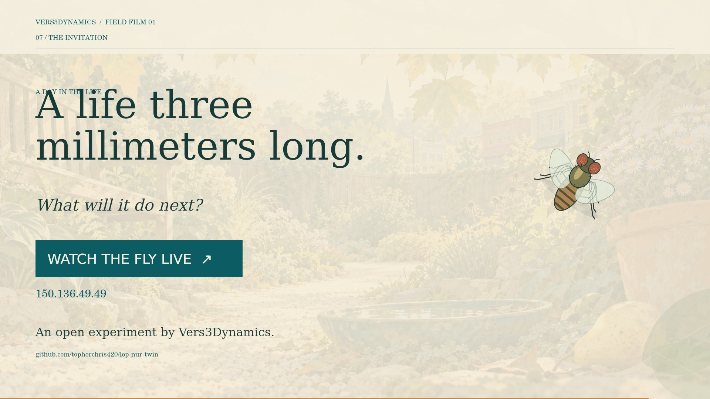
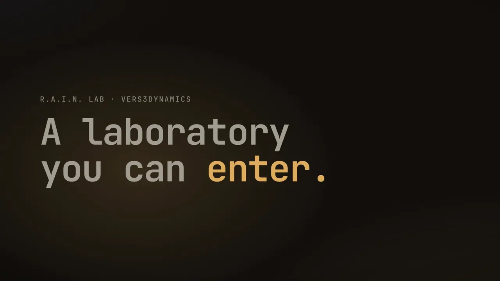
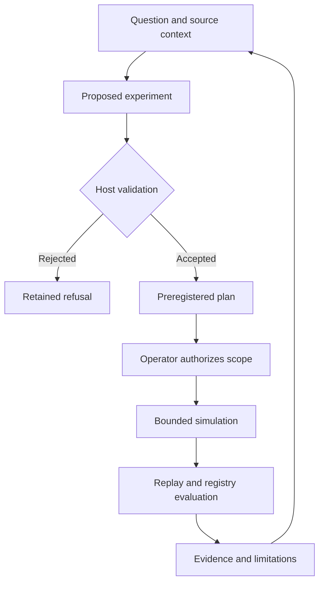

<div align="center">

# R.A.I.N. Lab

### Simulated worlds. Testable questions. Inspectable evidence.

**An open-source research environment from [Vers3Dynamics](https://vers3dynamics.com), created by Christopher Woodyard.**

[](https://github.com/topherchris420/lop-nur-twin/actions/workflows/ci.yml)
[](LICENSE)
[](https://lop-nur-twin.vercel.app/)

**[Explore the twin](https://lop-nur-twin.vercel.app/)** ·
**[Inspect the evidence](https://lop-nur-twin.vercel.app/analysis)** ·
**[Watch the fly film](https://lop-nur-twin.vercel.app/film/)** ·
**[Meet R.A.I.N.](https://rainlabteam.vercel.app/)**

</div>

R.A.I.N. Lab turns simulated worlds into places where ideas can be tested and
their limits examined. Walk through a **source-linked reconstruction of Lop
Nur**, discover a research laboratory in **Bethesda, Maryland**, study a
**digital fly that models its own movement**, or run experiments in a
**civilization simulator**.

The aim is a small, open digital Bell Labs: a place to ask difficult
questions, design bounded tests, preserve the attempts that fail, and leave
enough evidence for someone else to check the answer.

> **Models propose. Host code validates. Simulations produce observations.
> The evidence—not the model's confidence—determines what can be concluded.**

[](https://lop-nur-twin.vercel.app/)

## Choose your entrance

No account, database or model API key is needed for the public reconstruction
and scripted experiences. Some 3D routes need WebGL; the evidence tables do not.

| Enter                                                                  | What you will find                                                                                                                 |
| ---------------------------------------------------------------------- | ---------------------------------------------------------------------------------------------------------------------------------- |
| **[Lop Nur · 3D twin](https://lop-nur-twin.vercel.app/)**              | Explore the reconstructed airfield, inspect structures, measure modeled distances and scrub the evidence timeline.                 |
| **[Evidence inspector](https://lop-nur-twin.vercel.app/analysis)**     | Read the underlying claims, sources, classifications and uncertainty—even without WebGL.                                           |
| **[Compare model revisions](https://lop-nur-twin.vercel.app/compare)** | See how placement, sourcing and uncertainty changed between recorded releases.                                                     |
| **[Bethesda · R.A.I.N. Lab](docs/BETHESDA_ANOMALY.md)**                | Find the hidden, walkable city and enter the laboratory where James, Jasmine, Luca and Elena represent four research perspectives. |
| **[Project ECHO · digital fly](docs/PROJECT_ECHO.md)**                 | Examine a fly controller that predicts its own movement, detects discrepancies and updates its functional self-model.              |
| **[Noeterra](https://lop-nur-twin.vercel.app/noeterra)**               | Explore rule-based civilizations in the Mediterranean (264 BC) or Tarim Basin (77 BC), including Loulan.                           |
| **[Blacksite](https://lop-nur-twin.vercel.app/play)**                  | Try an illustrative first-person simulation with human, scripted and optionally configured model-controlled player seats.          |
| **[Evaluation](https://lop-nur-twin.vercel.app/evaluation)**           | Inspect recorded decisions, experiment outcomes and comparisons.                                                                   |

**First five minutes:** [open the twin](https://lop-nur-twin.vercel.app/),
select a structure to read its dossier, press `L` to show the evidence lens,
then [open the inspector](https://lop-nur-twin.vercel.app/analysis) to trace a
claim to its sources. Press `H` for help, or `1` / `2` / `3` to change
camera mode. [Full controls](docs/CONTROLS.md).

<details>
<summary>How to find Bethesda and the hidden lab (spoiler)</summary>

In the twin, press **backtick** (usually below Escape) and submit
`38.9847,-77.0947` or `resolve bethesda`. Or press `I` to open the
Site Index and search for those coordinates. The city loads on demand; the
lab is inside a building, behind a door.

See the [Bethesda guide](docs/BETHESDA_ANOMALY.md) and
[R.A.I.N. Lab guide](docs/RAIN_LAB_BETHESDA.md).

</details>

## Featured research · Project ECHO

### Can a simulated organism learn what _it_ can do?

ECHO (**Emergent Computational Self-Modeling**) extends the digital fly with
a functional model of its own sensorimotor capabilities. Every 50 ms in the
research protocol, it compares the movement it expected after an action with
the movement its simulated senses reported. When those disagree, it can test
whether the cause seems to be **its body, its environment or its sensing**,
revise its estimates, act more cautiously under uncertainty and retain
bounded memories of earlier changes.

The experimenter knows the hidden causes. **The fly does not receive its true
position, heading or the perturbation labels.** ECHO is evaluated against
simpler controllers and versions with parts of its self-model removed.

| Preregistered experiment                                  | Recorded finding                                                                                                                                                  | Verdict                                 |
| --------------------------------------------------------- | ----------------------------------------------------------------------------------------------------------------------------------------------------------------- | --------------------------------------- |
| **ECHO-01 · compensate for a hidden impairment**          | Path error rose from **0.036 with the self-model to 0.399 without it**, across nine paired seeds.                                                                 | **Supported** under its frozen criteria |
| **ECHO-02 · distinguish self-change from outside change** | Attribution accuracy was **0.891 vs. 0.567** for a simpler motion-gated rule, but missed the prespecified minimum effect; held-out calibration also deteriorated. | **Inconclusive**                        |
| **ECHO-03 · recognize a returning impairment**            | Memory shortened re-identification by **0.82 seconds** in the registered comparison, below the required effect; it did not establish better subsequent movement.  | **Inconclusive**                        |

These are **results inside a reduced-order simulator**, not measurements
of living fruit flies. Functional self-modeling is **not evidence of
consciousness, subjective experience, neural fidelity or biological
equivalence**. Reproducible negative and inconclusive results remain part
of the record.

**[Read the ECHO design and limitations](docs/PROJECT_ECHO.md)** ·
[Inspect the seeded evaluation](docs/benchmarks/fly-echo/README.md) ·
[Study the digital fly](docs/DIGITAL_FLY.md)

### A life three millimeters long

[](https://lop-nur-twin.vercel.app/film/)

**[Watch the 58-second film with sound](https://lop-nur-twin.vercel.app/film/)** ·
[Open the live fly garden](http://150.136.49.49/) ·
[Download the MP4](https://raw.githubusercontent.com/topherchris420/lop-nur-twin/main/docs/media/fly-film/a-life-three-millimeters-long.mp4) ·
[Vertical edition](https://raw.githubusercontent.com/topherchris420/lop-nur-twin/main/docs/media/fly-film/a-life-three-millimeters-long-vertical.mp4)

The film is an illustrated interpretation, not footage of a living insect or
a continuous recording of the Bethesda simulator. Its garden inset uses a
recorded observation from the deployed garden.
[Credits, playback options and production notes](docs/media/fly-film/README.md).

#### Two fly experiences, different runtimes

|                  | **Live garden**                                                                                                                        | **Bethesda research fly**                                                                                                              |
| ---------------- | -------------------------------------------------------------------------------------------------------------------------------------- | -------------------------------------------------------------------------------------------------------------------------------------- |
| Where            | [Separate server-side garden](http://150.136.49.49/)                                                                                   | The interactive 3D Bethesda simulation                                                                                                 |
| Continuity       | Server-side state can advance without a viewer while the service is running; availability and restart recovery are **not guaranteed**. | Runs as part of the simulator; replacing or restoring ECHO does **not** establish the same persistent individual.                      |
| Purpose          | An observable, stylized ongoing digital life experiment.                                                                               | Controlled studies of sensing, behavior, locomotion and functional self-modeling.                                                      |
| Scientific scope | Not a validated biological or consciousness model.                                                                                     | Reduced-order behavior using FlyBody-derived anatomy and Virtual Fly Brain reference regions; it simulates **no neurons or synapses**. |

The garden currently uses a plain-HTTP address, which some browsers or
networks may block. The [hosted film page](https://lop-nur-twin.vercel.app/film/)
is a separate viewing option, not the live garden.

## One lab, four experiment backends

| Backend               | Question it can investigate                                                                           | Boundary                                                        |
| --------------------- | ----------------------------------------------------------------------------------------------------- | --------------------------------------------------------------- |
| **Bethesda**          | How do specified interventions change programmed city behavior?                                       | Simulated pedestrians and rules, not observations of residents. |
| **Numerical physics** | Does a driven, damped oscillator match its analytic reference within stated tolerances?               | A bounded equation system, not a physical apparatus.            |
| **Noeterra**          | How do memory, diplomacy and rule changes affect simulated civilizations?                             | Deterministic agents in illustrative historical settings.       |
| **Digital fly**       | How do sensing, avoidance, adaptation and self-model variants compare under controlled perturbations? | A reduced-order controller, not a neural simulation.            |

Noeterra's core runs in Rust/WebAssembly in the browser. Optional model
rulers require its local workbench; public seats use human, rule-based or
random control. [Noeterra guide](docs/NOETERRA.md).

### Meet the research team

James, Jasmine, Luca and Elena are four computational research perspectives
that work with a shared set of papers, mathematical context, protocol
definitions and retained results. Their suggestions are **proposals**, not
authoritative findings. The laboratory uses a validation gate, explicit
authorization and replay before results enter the research registry.

<details>
<summary>Watch the 15-second R.A.I.N. Lab introduction</summary>



[Watch with sound (MP4)](docs/media/rain-lab-ad.mp4).
Music: “Supernova” by Scott Buckley,
[CC BY 4.0](https://creativecommons.org/licenses/by/4.0/),
[scottbuckley.com.au](https://www.scottbuckley.com.au).

</details>

**Next:** [Run locally](#run-locally) ·
[Research method](#how-the-research-loop-works) ·
[Recorded results](#recorded-results) ·
[Validation](#validation) ·
[Documentation](#documentation)

## Run locally

Use **Node.js 22.18+**. **Bun 1.3+** is the preferred package manager; CI installs from
`bun.lock`. An npm alternative is included below. A WebGL-capable browser is needed for
the 3D environments; `/analysis` and `/compare` provide access to the evidence without it.

```sh
git clone https://github.com/topherchris420/lop-nur-twin.git
cd lop-nur-twin
bun install --frozen-lockfile
bun run dev
```

Open **http://localhost:5173**. No environment file or model server is needed to start.

<details>
<summary>Use npm instead</summary>

After cloning and entering the repository:

```sh
npm ci
npm run dev
```

Individual scripts such as `npm run build` work with Node. The aggregate
`check` script invokes Bun internally, so it requires Bun even when dependencies were
installed with npm.

</details>

### Include Noeterra

Install [Rust stable](https://rustup.rs), then build the civilization engine **before
starting or restarting the dev server**:

```sh
rustup target add wasm32-unknown-unknown
bun run noeterra:wasm
bun run dev
```

Open **http://localhost:5173/noeterra**. Without this optional build, the rest of the
site still works and Noeterra reports that its engine is unavailable.

For the separate local workbench, run `bun run noeterra:serve` and open
**http://127.0.0.1:7878**. Its [guide](docs/NOETERRA.md) covers model rulers and replay.

### Connect a local research model

Start LM Studio's model server at `http://127.0.0.1:1234`, load a model, and replace
`your-loaded-model-id` below with the exact identifier returned by `/v1/models`.
Run these commands from the repository in a new terminal, or stop the existing dev
server first.

**macOS / Linux**

```sh
export RAIN_AUTONOMY_ENABLED=true
export RAIN_MODEL_PROVIDER=lmstudio
export RAIN_MODEL=your-loaded-model-id
npm run dev
```

**Windows PowerShell**

```powershell
$env:RAIN_AUTONOMY_ENABLED = "true"
$env:RAIN_MODEL_PROVIDER = "lmstudio"
$env:RAIN_MODEL = "your-loaded-model-id"
npm run dev
```

Enter Bethesda and open the lab's discovery workbench. Drafting, validation,
authorization, and execution are separate steps: enabling the service does not authorize
an experiment. Review the actual plan or bounded charter before a run. The hosted site
cannot reach the model server on your computer through its server-side runtime.

Model-generated **meetings** use a separate configuration, documented in
[Model meetings](docs/RAIN_LAB_BETHESDA.md#model-meetings-qwen-or-another-local-model).
The [autonomous research CLI](docs/RAIN_LAB_BETHESDA.md#autonomous-research) also supports
Ollama. Failed and incomplete research calls remain in the journal; there is no silent
switch to a remote model.

### Try the research pipeline without a model

```sh
npm run rain:scientific:demo -- --dir .rain-research/readme-demo
```

This uses a **scripted designer and scripted operator**, executes a numerical simulation,
and retains its research artifacts in the selected directory. Its fixture authorization
does not authorize a live experiment. Use a fresh directory for a separate demonstration.

All optional settings are documented in [`.env.example`](.env.example). For the dev
server, copy it to the git-ignored `.env.local` and set only what you need. Provider keys
stay server-side: never prefix a key with `VITE_`, which would expose it in the browser
bundle. The optional `/play?brain=jev|glide|llm` seats require their own provider settings;
missing configuration is shown as `UNAVAILABLE`.

## How the research loop works

The lab connects source material and competing explanations to a testable design, then
keeps the execution and evaluation trace available for inspection.



- **Keep origins visible.** The knowledge graph derives links from the approved paper
  corpus, journal, and experiment registry. Source context, model suggestions, and
  verified simulation measurements retain separate labels. Mathematical context can
  inform a design; it cannot stand in for experimental evidence.
- **Fix the rules before the result.** The host validates the design and binds its scope
  to a plan or charter digest. Models cannot approve their own execution or rewrite
  evaluation criteria after seeing outcomes.
- **Verify before admitting evidence.** Replay checks the recorded run; the registry
  evaluates its preregistered criteria. A reproducible result can still be inconclusive.
- **Evaluate changes to research procedure.** The learning engine proposes versioned
  guidance for recurring procedural errors and compares it on frozen held-out tasks.
  Evaluated guidance remains inactive until operator approval. Valid negative results
  are retained as results, not treated as procedural mistakes.

Project Inception adds experimental researcher profiles and reviewed follow-up
investigations. It is a prototype for studying research workflows; recursive scientific
improvement has not been established. See the [Inception guide](docs/RAIN_INCEPTION.md)
and [scientific workflow](docs/RAIN_SCIENTIFIC_INTELLIGENCE.md).

## Recorded results

These are bounded demonstrations of the implemented systems. Follow each record for
its exact design, producing revision, authorship, measurements, and limitations.

| Record                                                                                                    | What happened                                                                                                                                            | What it establishes                                                                                                         |
| --------------------------------------------------------------------------------------------------------- | -------------------------------------------------------------------------------------------------------------------------------------------------------- | --------------------------------------------------------------------------------------------------------------------------- |
| [Scripted compiler comparison](docs/rea-research/evaluations/README.md)                                   | Valid proposals increased from **0/8 to 8/8** on eight related held-out fixtures after parameter-grid guidance.                                          | A correction for one known procedural error class; no general scientific-intelligence claim.                                |
| [Bethesda discovery](docs/benchmarks/rain-discovery-validation/README.md)                                 | Two experiments, each with three paired seeds, passed deterministic replay. A scripted designer used the first result to construct a follow-up.          | Result-linked revision through the native pipeline; no live model reasoning or observations of residents.                   |
| [Live Gemma experiment](docs/rea-research/evaluations/gemma-live/README.md)                               | An operator-approved, two-arm oscillator run replayed and entered the registry with an **inconclusive** verdict because analytic accuracy guards failed. | A completed live-model workflow that preserved an insufficient-evidence result.                                             |
| [Noeterra memory experiment](docs/benchmarks/noeterra-civilization/CV-11b7adb76f31fa3d4307bd0b/report.md) | Withholding agents' memory of past treatment reduced mean wars declared from **6.50 to 2.83** over 40 seasons across six matched seeds.                  | Behavior of rule-based simulator agents under a scripted design and authorization; no inference about historical societies. |
| [Digital-fly experiments](docs/benchmarks/fly-behavior/README.md)                                         | The archive retains scripted demonstrations with supported and inconclusive outcomes, compiler refusals, and earlier exploratory records.                | Controller behavior under specified arena protocols; no neural or biological validation.                                    |
| [Project ECHO](docs/PROJECT_ECHO.md)                                                                      | ECHO-01 supported (path error **0.036 → 0.399** without the self-model); ECHO-02 and ECHO-03 inconclusive by their frozen criteria.                      | A functional self-model's value in a reduced-order simulator; not motor-control validation, not awareness.                  |

The compiler comparison's Wilson 95% intervals are `[0, 0.324]` and `[0.676, 1]`.
Its deliberately related fixtures do not establish representative sampling. Archived
live Qwen attempts and an incomplete learning pilot are retained alongside the completed
runs in the [scientific evidence collection](docs/rea-research/evaluations/README.md).

**Scope matters:** the reconstruction distinguishes observed, reported, interpreted,
and illustrative claims. Simulation results describe their models, not the real airfield,
Bethesda residents, ancient societies, or living flies. The lab does not control physical
laboratory equipment, and these records do not establish broad autonomous discovery.

## Validation

`bun run build` is the integration gate: data and evidence validation, Bethesda and lab
artifact checks, release-manifest generation and history validation, production bundling,
strict TypeScript checking, and a scan of `dist/` for credentials.

```sh
bun run check  # formatting, lint, unit tests, evidence tests, and build
```

| Command                                               | Purpose                                                                                    |
| ----------------------------------------------------- | ------------------------------------------------------------------------------------------ |
| `bun run rain:conformance`                            | Pass lab drafts and submissions through the research runtime's registry.                   |
| `bun run rain:scientific:verify`                      | Recheck archived journals, numerical replay, graphs, and learning evaluations.             |
| `bun run rain:civilization:verify`                    | Verify the civilization archive against the available engine. Build Noeterra first.        |
| `bun run rain:fly:verify`                             | Check archived fly records and replay those compatible with the current engine and source. |
| `bun run noeterra:test`                               | Run the Rust engine's tests.                                                               |
| `bun run a11y` / `bun run routes`                     | Check accessibility, security headers, deep links, and URL handling.                       |
| `bun run verify:bethesda` / `bun run verify:rain-lab` | Exercise the hidden city and lab end to end.                                               |

Browser checks have server prerequisites; use [CONTRIBUTING.md](CONTRIBUTING.md) for the
commands appropriate to a change. Build the Noeterra engine before testing its backend:
its unit tests skip when the module is absent. Verification reports older-engine records
separately; fly verification exits with code `3` if incompatible records remain unchecked.
See [validation](docs/VALIDATION.md) and the
[evaluation philosophy](docs/EVALUATION_PHILOSOPHY.md) for what each check proves.

## Repository map

| Path                             | Responsibility                                                                          |
| -------------------------------- | --------------------------------------------------------------------------------------- |
| `src/lib/`                       | Site layout, source register, evidence ledger, uncertainty, and temporal/spatial rules. |
| `src/components/`, `src/routes/` | 3D presentation, controls, and application routes.                                      |
| `src/game/`                      | Blacksite, player controls, model seats, and evaluation.                                |
| `src/bethesda/`                  | City simulation, digital fly, and the lab's browser interface.                          |
| `src/rain/`                      | Research corpus, meetings, autonomy, experiment backends, and registry.                 |
| `src/noeterra/`, `noeterra/`     | Civilization browser interface, Rust engine, scenarios, and local workbench.            |
| `server/`, `api/`                | Server-side research and decision endpoints.                                            |
| `scripts/`, `tools/`             | Validators, importers, research commands, and browser checks.                           |
| `model-history/`                 | Recorded release manifests for reproducible model comparisons.                          |
| `docs/`                          | Guides, design records, source investigations, and archived experiments.                |
| `deploy/`, `Dockerfile`          | Self-hosted evaluation deployment.                                                      |

## Documentation

| I want to…                        | Start here                                                                                                                                                                                                    |
| --------------------------------- | ------------------------------------------------------------------------------------------------------------------------------------------------------------------------------------------------------------- |
| Understand the reconstruction     | [Site model](docs/SITE_MODEL.md), [provenance](docs/DATA_PROVENANCE.md), [white paper](docs/WHITE_PAPER.md)                                                                                                   |
| Assess a claim                    | [Uncertainty](docs/UNCERTAINTY_MODEL.md), [temporal model](docs/TEMPORAL_MODEL.md), [spatial analysis](docs/SPATIAL_ANALYSIS.md), [model comparison](docs/MODEL_COMPARISON.md)                                |
| Navigate the app                  | [Controls](docs/CONTROLS.md), [accessibility](docs/ACCESSIBILITY.md), [Bethesda](docs/BETHESDA_ANOMALY.md)                                                                                                    |
| Work in the lab                   | [Lab guide](docs/RAIN_LAB_BETHESDA.md), [scientific workflow](docs/RAIN_SCIENTIFIC_INTELLIGENCE.md), [authorization and recovery](docs/RAIN_EXPERIMENTAL_DISCOVERY.md)                                        |
| Study research over multiple runs | [Learning](docs/RAIN_RESEARCH_LEARNING.md), [programs](docs/RAIN_RESEARCH_PROGRAM.md), [lineage](docs/RAIN_RESEARCH_LINEAGE.md), [Inception](docs/RAIN_INCEPTION.md)                                          |
| Explore the other simulations     | [Blacksite](docs/BLACKSITE.md), [model seats](docs/JEV_BLACKSITE.md), [Noeterra](docs/NOETERRA.md), [digital fly](docs/DIGITAL_FLY.md), [Project ECHO](docs/PROJECT_ECHO.md)                                  |
| Run or evaluate a deployment      | [Architecture](docs/SYSTEM_ARCHITECTURE.md), [deployment](docs/DEPLOYMENT.md), [validation](docs/VALIDATION.md), [threat model](docs/THREAT_MODEL.md), [government evaluation](docs/GOVERNMENT_EVALUATION.md) |

<details>
<summary>Implementation lineage and reference investigations</summary>

The research runtime was consolidated from `james_library`; see the
[migration record](docs/RAIN_MIGRATION.md). Public-product investigations informed the
lab's original implementation: [capability matrix](docs/rea-research/capability-matrix.md),
[Mirrors](docs/rea-research/mirrors/observations.md),
[Poth Labs](docs/rea-research/poth-labs/observations.md), and
[Infera](docs/rea-research/infera/observations.md).

Noeterra's design also draws on studies of
[Open Historia](docs/research/OPEN_HISTORIA_ANALYSIS.md) and
[Pax Historia](docs/research/PAX_HISTORIA_ANALYSIS.md). These reports distinguish
observations, documented behavior, inference, and unknowns. No proprietary implementation
was copied, and no code from either Historia project is used.

</details>

## Contribute

Useful contributions include sourced corrections to the reconstruction, clearer evidence
inspection, accessibility improvements, reproducible experiments, and fixes with a
documented failure case. Start with [CONTRIBUTING.md](CONTRIBUTING.md) and the architecture
rules in [AGENTS.md](AGENTS.md), or [open an issue](https://github.com/topherchris420/lop-nur-twin/issues).

Never invent a source, date, measurement, or confidence value. Preserve unsuccessful
results and label scripted and model-generated work accurately. Report vulnerabilities
through the process in [SECURITY.md](SECURITY.md).

## License and attribution

Source code and documentation are licensed under [Apache 2.0](LICENSE). See [NOTICE](NOTICE)
for sources and attributions. Bundled Bethesda geography has
[additional data terms](src/bethesda/data/LICENSE.md); Noeterra's coastlines come from
[Natural Earth](https://www.naturalearthdata.com), recorded in
[`geography.source.json`](noeterra/data/geography.source.json). FlyBody-derived anatomy
and Virtual Fly Brain reference material retain the licenses and limitations listed in
the [digital-fly source register](docs/DIGITAL_FLY.md#sources-and-licences).
