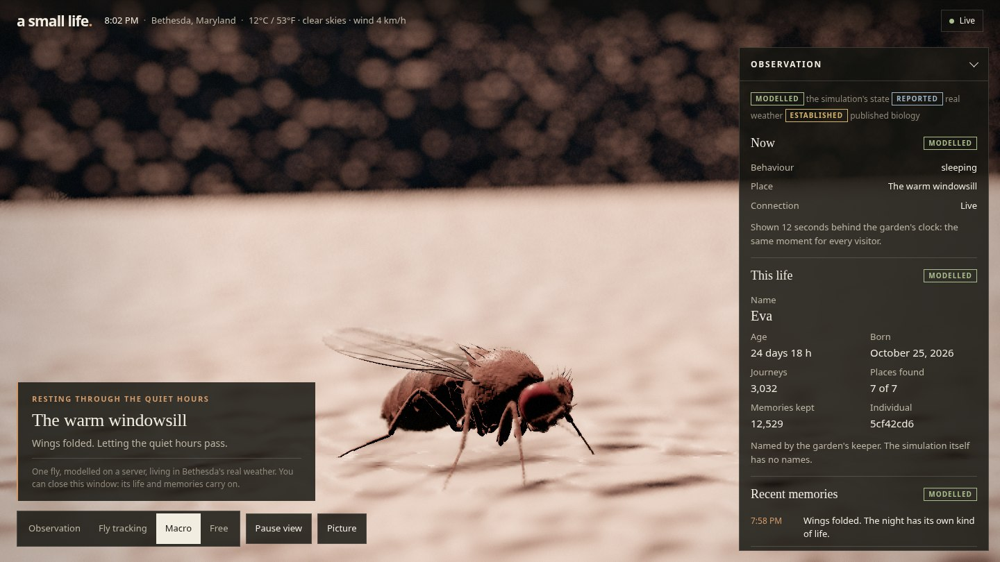
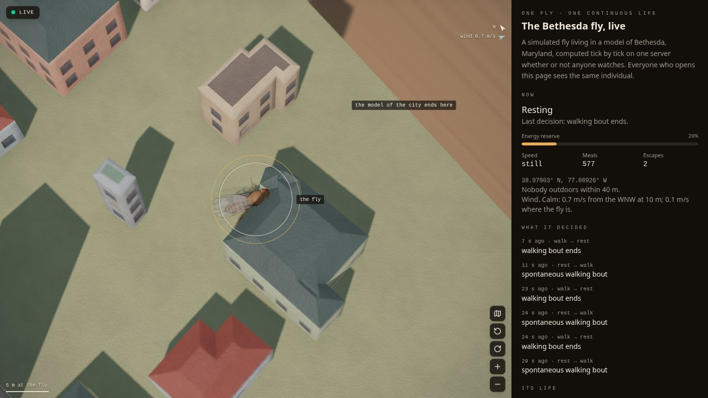
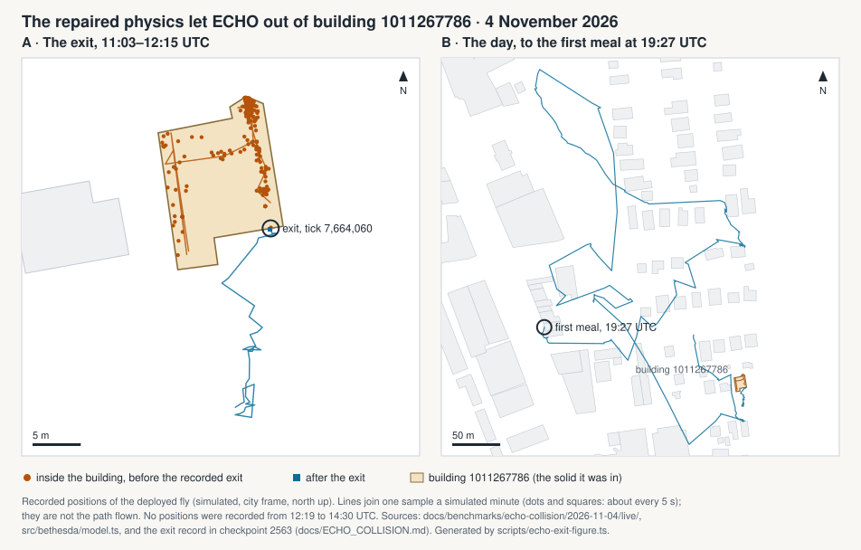
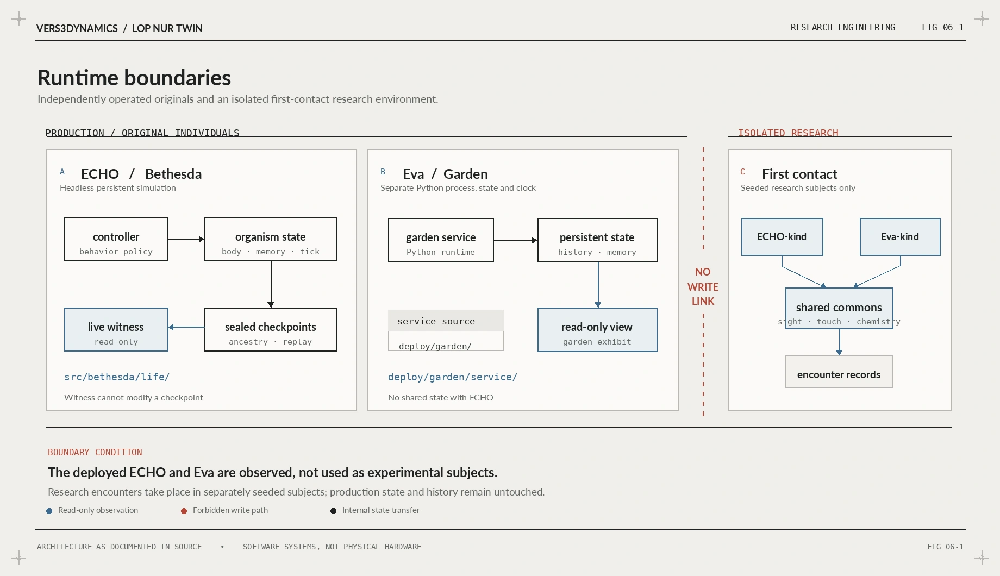
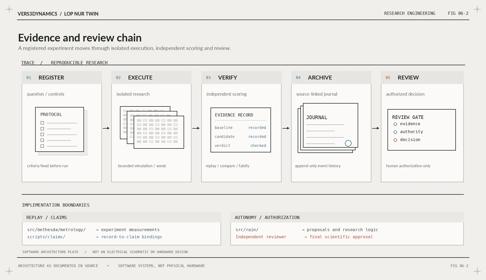
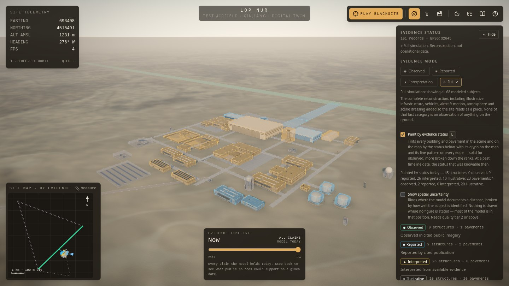
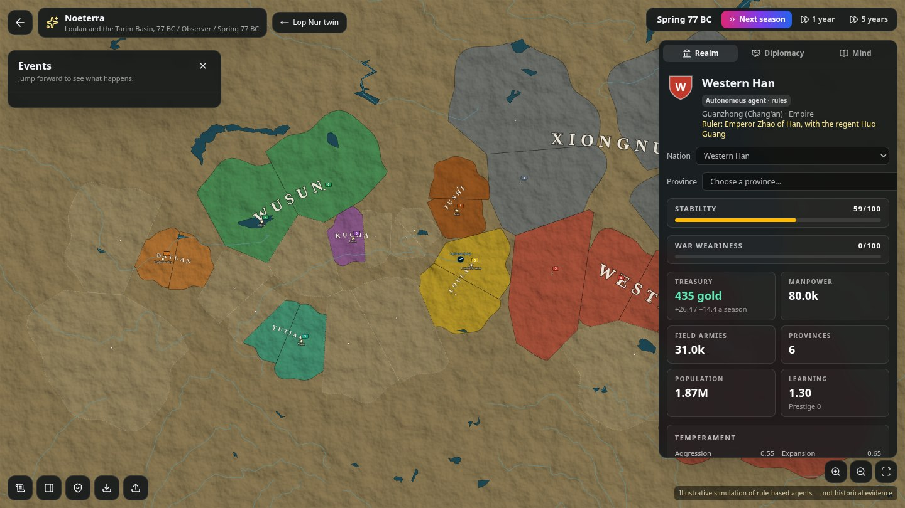
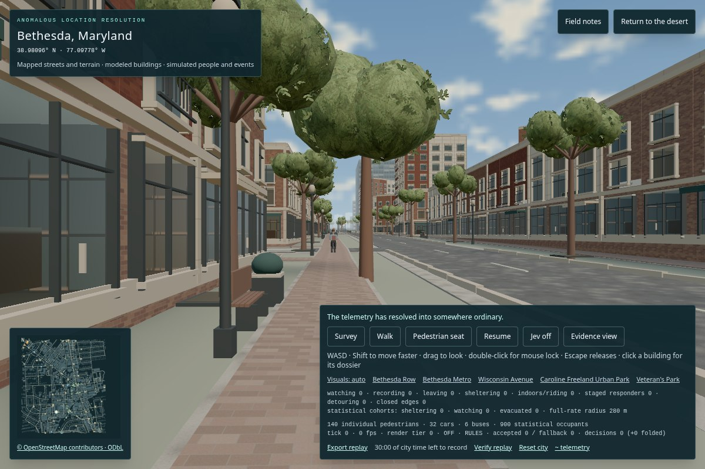
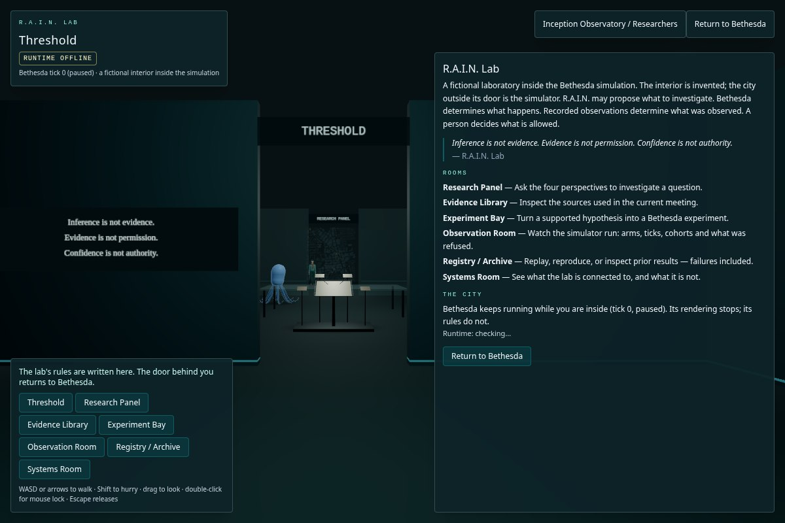

# Lop Nur Twin

Eva lives in a garden. ECHO lives in a model of Bethesda, Maryland. Both are simulated flies whose lives continue on their own servers after you close the tab. Open either viewer and you join an individual already partway through its day.

**[Visit Eva’s garden](https://150-136-49-49.sslip.io/)** · **[Observe ECHO](https://lop-nur-twin.vercel.app/live)** · **[Explore Lop Nur](https://lop-nur-twin.vercel.app/)** · **[Run locally](#07-reproduce-the-work)**

<picture>
  <source media="(max-width: 600px)" srcset="docs/media/readme/gallery/garden-mobile.jpg">
  
</picture>

_Eva on the warm windowsill, 18 November 2026. At 8:02 p.m. in Bethesda her service reported that she was sleeping. In the phone view recorded later that evening, she was cleaning her legs and wings. [Desktop capture](docs/media/readme/gallery/garden.jpg) · [Phone capture](docs/media/readme/gallery/garden-mobile.jpg) · [Garden guide](docs/LIVE_GARDEN.md)._

## 01. The question

What would count as evidence that the fly you return to is the same one you left? ECHO’s service saves its state and links each checkpoint to the one before it. Eva’s garden keeps its own clock, learned movement, and memories. Both viewers let you watch without steering either fly. Vers3Dynamics publishes the controllers and verification tools here.

Lop Nur Twin began with a related question about a place. Which features of the airfield can a reader trace to public evidence, and when did that evidence become available? The geographic twin keeps those sources alongside the model. Its [evidence inspector](https://lop-nur-twin.vercel.app/analysis) also works without WebGL.

[First-contact research](#first-contact-research) · [Research results](#04-the-test-results-including-the-ones-that-did-not-work) · [Screenshot gallery](#09-the-rest-of-the-laboratory) · [Documentation index](docs/README.md)

## 02. The operating systems

[](docs/media/readme/gallery/live-fly.jpg)

_ECHO at 8:01 p.m. in Bethesda on 18 November 2026. The enlarged fly marks its position. In the decision log, “walking bout ends” explains the transition from walking to resting. [Open the live observer](https://lop-nur-twin.vercel.app/live)._

| Where to look                                                                               | What you can inspect                                                                            |
| ------------------------------------------------------------------------------------------- | ----------------------------------------------------------------------------------------------- |
| [ECHO’s public record](https://github.com/topherchris420/lop-nur-twin/tree/live-fly-ledger) | Checkpoints and replay records for the individual in Bethesda.                                  |
| [Eva’s garden service](deploy/garden/service/)                                              | The Python controller behind the garden. Eva’s running process and memories stay on her server. |
| [First-contact commons](docs/FIRST_CONTACT.md)                                              | Encounters between separately seeded research flies in a shared environment.                    |
| [R.A.I.N. Lab](docs/RAIN_LAB_BETHESDA.md)                                                   | The research system that turns a question into a protocol, a recorded run, and a replay.        |

### First-contact research

Can a fly distinguish a chemical cue it has encountered before? Two research flies can meet in the commons, see and touch one another, and sample contact chemistry. On held-out trials, the familiarity signal followed the chemistry even when a stranger carried the familiar profile. That leaves individual recognition and a behavioural benefit unestablished.

The original Eva and ECHO still inhabit separate worlds. The published plan records a restore-checked copy of each. Making separately identified research twins and rehearsing a visit are later steps. [Held-out results](docs/benchmarks/first-contact/familiarity-held-out.md) · [Eva controller parity](src/bethesda/firstContact/eva/README.md) · [Plan for the originals](docs/FIRST_CONTACT.md#stage-4-a-gated-plan-for-the-originals-steps-1-and-2-taken).

## 03. A machine must be able to verify the history

ECHO’s persistent run began on **26 October 2026**. Each checkpoint names its parent and the engine version that produced it. At an approved change of engine, the record preserves the old state, the migration, and any gap in elapsed time. One published audit independently recomputed **361 of 361** seals across the interval between checkpoints **#2,566 and #2,927**. [Audit and records](docs/RESEARCH_CLAIMS.md) · [How to verify ECHO’s history](docs/ECHO_STEWARDSHIP.md#how-anyone-can-check-it-is-still-itself).

### A useful failure: ECHO became trapped

On 1 November, ECHO entered a building it should never have been able to enter. It stayed there for almost three days. Before changing the deployed world, the lab tested a repair on new research flies. In a 12-seed comparison, **9 of 12** subjects were trapped under the old physics and **0 of 12** under `digital-fly/9`. After the recorded continuation on 4 November, ECHO crossed back outside and eventually ate again.

[](docs/ECHO_COLLISION.md#how-it-got-out)

_The line is drawn from ECHO’s recorded positions. [Read the incident and reconstruct the exit](docs/ECHO_COLLISION.md#how-it-got-out)._

## 04. The test results, including the ones that did not work

Each result belongs to the protocol, inputs, and software revision in its record. The test suite rebuilds **246 of the 352 quantities** stated in the claims register from committed records. [Claims and evidence](docs/RESEARCH_CLAIMS.md) · [Which quantities are checked](docs/claims/README.md).

| Test                                                  | Recorded outcome                                                                        | Evidence                                                                                         |
| ----------------------------------------------------- | --------------------------------------------------------------------------------------- | ------------------------------------------------------------------------------------------------ |
| ECHO checkpoint replay                                | 361 / 361 seals reproduced in the audited interval                                      | [Replay audit](docs/RESEARCH_CLAIMS.md#1-echos-recent-history-can-be-recomputed-independently)   |
| Collision correction                                  | 9 / 12 subjects trapped before; 0 / 12 after                                            | [Collision trials](docs/benchmarks/echo-collision/2026-11-03/README.md)                          |
| Self-model under concealed impairment, ECHO-01        | Path error 0.073 vs 0.370 in registered conditions                                      | [Registered run](docs/benchmarks/fly-behavior/FLY-3dedfd1e08238befa3a2cd09/report.md)            |
| Hidden-change attribution, ECHO-02                    | 0.919 vs 0.537; overconfidence remains                                                  | [Registered run](docs/benchmarks/fly-behavior/FLY-ea1f81b92313cd532b36b4a8/report.md)            |
| Memory and place preference                           | Distinct preferences develop in seeded research subjects                                | [Distinct histories](docs/INDIVIDUAL_CONTINUITY.md#study-a-distinct-histories-from-one-genesis)  |
| Memory with continuously moving food                  | Negative: 1.2 fewer meals per life                                                      | [Moving-food study](docs/INDIVIDUAL_CONTINUITY.md#study-b-open-ended-adaptation)                 |
| ECHO-03 through ECHO-05                               | Inconclusive                                                                            | [Registered outcomes](docs/benchmarks/fly-behavior/README.md)                                    |
| FlyWire FAFB v783 reproduction                        | 10 / 12 registered criteria met                                                         | [Reproduction record](docs/benchmarks/fly-neural/README.md)                                      |
| Connectome odor learning                              | Negative in the tested design                                                           | [Odour-learning study](docs/ECHO_ADAPTIVE_INTELLIGENCE.md#odour-specific-learning-plasticity-v2) |
| Cross-world individual recognition, visual-only study | Negative                                                                                | [Encounter trials](docs/benchmarks/first-contact/README.md)                                      |
| Contact-chemistry familiarity, commons study          | Supported as a sensory-memory effect; behavioral effect unresolved                      | [Held-out study](docs/benchmarks/first-contact/familiarity-held-out.md)                          |
| Embodied plasticity under weak legs, metrology bench  | Inconclusive on 40 held-out subjects; small corrected regression under severe weak legs | [Held-out report](docs/benchmarks/echo-metrology/plasticity-locomotor-v1/heldout/README.md)      |

The intelligence metrology bench reproduced the original plasticity study, then asked it again on 40 new research subjects in nine conditions: inconclusive, with a small regression under severe leg impairment after correction for multiple comparisons. The held-out report includes the protocol, sampled replays, and verdict. [Open the bench](https://lop-nur-twin.vercel.app/metrology) · [Bench screenshot](docs/media/readme/metrology.png) · [Activation record](docs/EVA_ECHO_ACTIVATION.md) · [Study methods](docs/ECHO_INTELLIGENCE_METROLOGY.md).

## 05. The brain boundary

The FlyWire FAFB v783 dataset used here contains **139,255 neurons** and **54,492,922 synapses**. Researchers can test a connectome-derived model against published responses, and a separate BANC v888 model includes brain-and-cord circuits. Both backends run on experimental subjects. The original Eva and ECHO retain their own controllers. Their observable behaviour and state histories leave subjective experience an open question. [Connectome methods and validation](docs/ECHO_CONNECTOME.md) · [Biological calibration roadmap](docs/SOCIAL_RECOGNITION_ROADMAP.md#biological-calibration-milestones).

## 06. The engineering arrangement

| Component                                                     | Implementation                                                                                                |
| ------------------------------------------------------------- | ------------------------------------------------------------------------------------------------------------- |
| ECHO’s headless simulation, checkpoints, and read-only viewer | [Life runtime](src/bethesda/life/) · [Public observer](src/bethesda/live/)                                    |
| Eva’s controller and its TypeScript research port             | [Python service](deploy/garden/service/) · [Parity fixtures and port](src/bethesda/firstContact/eva/)         |
| Research encounters, controller evaluation, and neural models | [Commons](src/bethesda/firstContact/) · [Metrology](src/bethesda/metrology/) · [Neural backends](fly-neural/) |
| Geographic evidence and experiment execution                  | [Twin data and evidence](src/lib/) · [R.A.I.N. runtime](src/rain/) · [Claims checks](scripts/claims/)         |

<details>
<summary>View the runtime and evidence diagrams</summary>





[System architecture](docs/SYSTEM_ARCHITECTURE.md) · [Figure source](scripts/render-readme-engineering-figures.py) · [Threat model](docs/THREAT_MODEL.md)

</details>

## 07. Reproduce the work

Install **Node.js 22.18+** and **Bun 1.3+**. The base app runs locally without credentials.

```bash
git clone https://github.com/topherchris420/lop-nur-twin.git
cd lop-nur-twin
bun install --frozen-lockfile
bun run dev
```

Open [localhost:5173](http://localhost:5173). The browser’s Bethesda simulation has its own local fly. The `/live` route reads the hosted observer. For an npm setup, use `npm ci` and `npm run dev`. To run Noeterra locally, [build its WebAssembly engine](docs/GETTING_STARTED.md#build-noeterras-civilization-engine) before starting the app.

### Check the app and its records

| To reproduce                                                        | Command                                                       |
| ------------------------------------------------------------------- | ------------------------------------------------------------- |
| Formatting, lint, unit tests, evidence checks, and production build | `bun run check`                                               |
| Published claim bindings and their generated reports                | `bun run claims:check`                                        |
| Collision figure from ECHO’s recorded positions                     | `node scripts/run-ts.mjs scripts/echo-exit-figure.ts --check` |
| Adaptation report from archived records                             | `bun run echo:adaptation:check`                               |
| First-contact and Eva parity tests                                  | `bunx vitest run src/bethesda/firstContact`                   |

With the dev server running, `node tools/readme-media.mjs --only gallery` captures the README stills. The evidence lens comes from the local dev server. The other views come from the public pages. The script repeats the framing. Each observation reflects what the fly is doing at capture time. The full animation command, `bun run readme-media`, also needs FFmpeg and gifsicle.

[Setup and optional services](docs/GETTING_STARTED.md) · [Validation guide](docs/VALIDATION.md) · [CI runs](https://github.com/topherchris420/lop-nur-twin/actions/workflows/ci.yml) · [Study-specific replay commands](docs/FIRST_CONTACT.md#reproducing-everything) · [Contribution guide](CONTRIBUTING.md)

## 08. The laboratory procedure

R.A.I.N. is the research system within Vers3Dynamics. James, Jasmine, Elena, and Luca contribute different perspectives. A proposal goes through protocol validation and operator authorization before execution. Recorded measurements and independent checks determine what the lab can report.

### Institutional memory and scientific correction

The local journal keeps proposals, evidence, disagreements, and review decisions. In one CIRCLE and ATLAS study, delayed beat detections gave inaccurate estimates even with adequate beat coverage. A freshness check withheld those estimates. The proposed correction awaits scientific review. Another study retained a failed replication when a model’s revised explanation broke on a second waveform and unseen seeds. [Institutional-memory study](docs/RAIN_INSTITUTIONAL_MEMORY.md) · [Assumption challenge and negative replications](experiments/crosslab/assumptions/README.md).

### Research collaboration and the James interface

In a preregistered oscillator comparison, both a single self-checking agent and the multi-seat protocol avoided errors made by a fixed template. Adding an independent critic cost more and produced no further reduction in errors. Those seats used rule-based policies. The optional James desktop interface can read sealed evidence and queue proposals for an operator. [Study and results](docs/benchmarks/rain-collaboration/README.md) · [Collaboration protocol](docs/RAIN_COLLABORATION.md) · [James interface](docs/interop/agent-interop-v1/README.md).

## 09. The rest of the laboratory

### Lop Nur through the evidence lens

[](docs/media/readme/gallery/twin.jpg)

The colours distinguish observed, reported, interpreted, and illustrative features. Move the timeline to an earlier date to see which claims had public support by then. [Explore the lens](https://lop-nur-twin.vercel.app/?lens=1) · [Open the text inspector](https://lop-nur-twin.vercel.app/analysis) · [Watch the recorded timeline](docs/media/readme/evidence-timeline.gif).

### Noeterra

[](docs/media/readme/gallery/noeterra.jpg)

Open the Tarim Basin in 77 BC, advance one season, and read what the simulated nations did. Reopening the same seed returns you to the same starting world. [Open this scenario](https://lop-nur-twin.vercel.app/noeterra?scenario=tarim-77bc&play=observe&seed=1) · [Noeterra guide](docs/NOETERRA.md) · [Mediterranean time-lapse](docs/media/readme/noeterra.gif).

<details>
<summary><strong>Bethesda and the hidden R.A.I.N. Lab</strong> · includes how to find them</summary>

In the twin, press **backtick** and enter `38.9847,-77.0947`. From Bethesda, open **~ telemetry** and enter `resolve r.a.i.n.` to visit the lab.

[](docs/media/readme/gallery/bethesda.jpg)

[](docs/media/readme/gallery/rain-lab.jpg)

From this entrance, choose **Research Panel** to explore a prerecorded meeting. [City guide](docs/BETHESDA_ANOMALY.md) · [Lab guide](docs/RAIN_LAB_BETHESDA.md) · [Recorded city reveal](docs/media/readme/bethesda-reveal.gif)

</details>

<details>
<summary><strong>Blacksite</strong> · first-person simulation</summary>

[](docs/media/readme/gallery/blacksite.jpg)

[Open Blacksite](https://lop-nur-twin.vercel.app/play) · [Simulation guide](docs/BLACKSITE.md)

</details>

### Recorded observations and film

[Watch ECHO’s recorded walk, grooming, flight, and landing](docs/media/readme/live-fly.gif). The capture began on 10 November 2026 at 02:16 UTC and plays at about 15× speed. [A Life Three Millimeters Long](https://lop-nur-twin.vercel.app/film/) is the project’s illustrated short film about Eva’s garden.

## 10. License and research use

The code and documentation use the [Apache License 2.0](LICENSE). Bethesda geography, FlyBody materials, FlyWire, and BANC have their own attributions and terms. [Third-party notices](NOTICE) · [Security reporting](SECURITY.md).

Built by Christopher Woodyard at [Vers3Dynamics](https://vers3dynamics.com).
