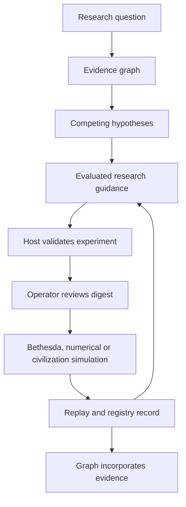

<div align="center">

# R.A.I.N. Lab

### A laboratory you can enter. A world that can answer back.

[](https://github.com/topherchris420/lop-nur-twin/actions/workflows/ci.yml)
[](LICENSE)
[](https://lop-nur-twin.vercel.app/)

[Live site](https://lop-nur-twin.vercel.app/) ·
[Evidence](https://lop-nur-twin.vercel.app/analysis) ·
[Noeterra](https://lop-nur-twin.vercel.app/noeterra) ·
[Evaluation](https://lop-nur-twin.vercel.app/evaluation) ·
[Meet R.A.I.N.](https://rainlabteam.vercel.app/)


<sub>[With sound (MP4)](docs/media/rain-lab-ad.mp4). Music: "Supernova" by Scott Buckley,
CC BY 4.0, [scottbuckley.com.au](https://www.scottbuckley.com.au).</sub>

</div>


R.A.I.N. Lab is Vers3Dynamics' project to build **a digital Bell Labs inside simulated
worlds**. James, Jasmine, Luca, and Elena bring distinct research perspectives to shared
questions. The lab connects Christopher Woodyard's research papers and mathematical
context with executable experiments, so each investigation can inform the next.

The model may imagine the experiment. The laboratory must determine whether it is valid.
The simulation produces the evidence. The evidence determines what can reasonably be
concluded.

**Contents:** [Explore](#explore) · [Research loop](#how-the-research-loop-works) ·
[Results](#what-has-been-measured) · [Civilizations](#autonomous-civilizations) ·
[Quick start](#quick-start) · [Verify a change](#verify-a-change) ·
[Layout](#repository-layout) · [Documentation](#documentation) ·
[Contributing](#contributing-and-security)

## Explore

Everything below runs in the browser from data committed to this repository, with no
account and no database.

| Start with                                                     | What you can inspect                                                                                                                         |
| -------------------------------------------------------------- | -------------------------------------------------------------------------------------------------------------------------------------------- |
| [Lop Nur reconstruction](https://lop-nur-twin.vercel.app/)     | A source-linked 3D reconstruction of the airfield. Every claim carries its classification, uncertainty, and the date it became knowable.     |
| [Evidence inspector](https://lop-nur-twin.vercel.app/analysis) | The same model as an accessible table: claims, source references, classifications, uncertainty, and revisions. It works without WebGL.       |
| [Model comparison](https://lop-nur-twin.vercel.app/compare)    | What changed between two builds, separated into placement, evidence, wording, and uncertainty.                                               |
| [Blacksite](https://lop-nur-twin.vercel.app/play)              | An illustrative first-person simulation on the same geometry. Humans, scripted policies, and models take the same seat under the same rules. |
| [Noeterra](https://lop-nur-twin.vercel.app/noeterra)           | Rule an ancient nation among autonomous civilizations, including Loulan, the kingdom of Lop Nur, in 77 BC.                                   |
| [Evaluation](https://lop-nur-twin.vercel.app/evaluation)       | Recorded decisions and experiment comparisons.                                                                                               |
| Bethesda and the Lab                                           | A walkable city, four research perspectives, and a local research workbench. It is hidden in the twin; see below.                            |

<details>
<summary>How to find Bethesda and the R.A.I.N. Lab (spoiler)</summary>

There is no button. In the twin at `/`, press **backtick** (the key below Escape), enter
`38.9847,-77.0947` or `resolve bethesda`, and submit. Alternatively, open the **Site
Index** (`I`) and type those coordinates into its search. The city loads lazily; the Lab
is behind a door inside it. The [Bethesda guide](docs/BETHESDA_ANOMALY.md) and the
[Lab guide](docs/RAIN_LAB_BETHESDA.md) cover the rest.

</details>

The public reconstruction and scripted experiences need no credentials. Local model
research needs a model server on your own machine, such as LM Studio. The deployed site
cannot connect to a model server on your computer.

## How the research loop works

A question leads to evidence, competing explanations, a testable design, a reviewed run,
and a retained result.



- **Scientific Knowledge Graph:** reconstructs typed relationships from the approved
  paper corpus, research journal, and experiment registry. Source context, model
  suggestions, and verified measurements retain different evidence labels.
- **Research Learning Engine:** finds repeated procedural errors, proposes versioned
  guidance, and compares candidates on frozen held-out tasks. Evaluated guidance stays
  inactive until an operator approves it. Scientifically valid negative results are not
  treated as process failures.
- **Experiment compiler:** validates versioned experiment designs before execution. The
  Bethesda backend preserves the existing simulation workflow. The numerical physics
  backend runs a bounded, driven damped oscillator and checks results against an
  independent analytic reference. The civilization backend runs the
  [Noeterra](#autonomous-civilizations) engine with rule-based agents.
- **Host authority:** model proposals cannot authorize execution or edit evaluation
  rules after results. An operator reviews the plan digest; execution, replay, and
  registry admission remain in the host.

The simulator models are illustrative. They do not measure the real airfield, human
behavior, historical states, or physical laboratory equipment.

The separate [Project Inception workbench](docs/RAIN_INCEPTION.md) is experimental. It
explores versioned researcher profiles and reviewed follow-up investigations; it does
not establish recursive scientific improvement.

## What has been measured

**A narrow procedural improvement:** on eight scripted held out compiler tasks, valid
proposals increased from 0/8 in the baseline arm to 8/8 with the tested parameter grid
guidance. Wilson 95% intervals are [0, 0.324] and [0.676, 1]. These related fixtures
exercise one known error class; they do not establish general scientific intelligence.

**Bethesda simulation:** two experiments ran with three paired seeds each and passed
deterministic replay. A scripted designer produced the second design after inspecting
the first result. These are simulation outputs, not observations of people.
[Methods, results, and limits](docs/benchmarks/rain-discovery-validation/README.md).

**Live Gemma experiment:** an operator approved the exact plan before it ran. The
two-arm oscillator simulation replayed and entered the native registry, but its
scientific verdict is inconclusive: position and velocity errors exceeded the
preregistered analytic accuracy limits. The drafts, measurements, journal, and
independent verification command are in the
[Gemma evidence record](docs/rea-research/evaluations/gemma-live/README.md).

**Civilization simulation:** with rule-based agents on six matched seeds of the
Mediterranean scenario, withholding the agents' memory of how others treated them cut
wars declared from a mean of 6.50 to 2.83 per 40-season history, fewer in every seed.
The lab preregistered the hypothesis, re-simulated every run, and admitted the result. A
second design with an implausible threshold was judged insufficient evidence and kept
beside it. These describe the simulator's agents, not ancient states.
[Archived experiments](docs/benchmarks/noeterra-civilization/README.md).

## Autonomous civilizations

[Noeterra](docs/NOETERRA.md) is a deterministic Rust simulation of rival civilizations,
each ruled by an autonomous agent with its own memory, beliefs, and goals. Play it at
[/noeterra](https://lop-nur-twin.vercel.app/noeterra), where it runs in your browser as
WebAssembly. Rule a nation of the Mediterranean in 264 BC, or Loulan, the ancient kingdom
of Lop Nur, in 77 BC: its ruins lie about 60 km from the twin's runway, and the twin's
Research panel and Site Index (search _loulan_) lead straight there.

Every other nation decides for itself. Rust code validates every choice and resolves the
consequences, and every season ends in a state hash that a replay must reproduce. In the
R.A.I.N. Lab the same engine is a third experimental substrate for preregistered,
replay-verified civilization experiments. Model rulers (Claude, or a local model in LM
Studio) run only in the local workbench; the public site never calls a model.

Its design draws on studies of [Open Historia](docs/research/OPEN_HISTORIA_ANALYSIS.md)
and [Pax Historia](docs/research/PAX_HISTORIA_ANALYSIS.md); no code from either is used.

## Quick start

### Requirements

| Tool                                                                      | Needed for                                                                                                                                     |
| ------------------------------------------------------------------------- | ---------------------------------------------------------------------------------------------------------------------------------------------- |
| [Node.js](https://nodejs.org) 22.18+ or [Bun](https://bun.sh) 1.3+        | Everything. Bun is the project's package manager and `bun.lock` is what CI installs from; the npm path is also supported.                      |
| [Rust](https://rustup.rs) stable with the `wasm32-unknown-unknown` target | Optional: `/noeterra`, the civilization backend, and the Noeterra workbench. Without it, `/noeterra` says its engine is not part of the build. |
| A local model server (LM Studio or Ollama)                                | Optional: live model research in the Lab. Nothing in the public site or the test suites needs one.                                             |

### Run the site

```sh
bun install            # or: npm ci
bun run dev            # or: npm run dev  ->  http://localhost:5173
```

To include the civilization engine, build it once before starting the dev server:

```sh
rustup target add wasm32-unknown-unknown
bun run noeterra:wasm  # then open http://localhost:5173/noeterra
```

Other Noeterra entry points:

```sh
bun run noeterra:serve          # the local workbench, with model rulers (http://127.0.0.1:7878)
bun run noeterra:test           # the engine's Rust tests
bun run rain:civilization:demo  # preregister, run, replay, and admit scripted designs
```

### Connect a local model

For live research in the Lab, start LM Studio's server at its default address,
`127.0.0.1:1234`, and set `RAIN_MODEL` to an identifier returned by that server's
`/v1/models` endpoint. The current lab installation uses Gemma, with the identifier
`gemma-4-e4b-it`.

```sh
# macOS / Linux
export RAIN_AUTONOMY_ENABLED=true RAIN_MODEL_PROVIDER=lmstudio RAIN_MODEL=gemma-4-e4b-it
npm run dev
```

```powershell
# Windows PowerShell
$env:RAIN_AUTONOMY_ENABLED = "true"
$env:RAIN_MODEL_PROVIDER = "lmstudio"
$env:RAIN_MODEL = "gemma-4-e4b-it"
npm run dev
```

Open Bethesda from the application and enter the Lab. A model can draft a protocol; the
host validates it and shows the plan digest for operator review. Research runs locally.
Failed and incomplete calls remain in the journal, and the app does not silently switch
to a remote model. The autonomous research loop (`npm run rain:autonomous`) also accepts
Ollama; see [autonomous research](docs/RAIN_LAB_BETHESDA.md#autonomous-research).

For the deterministic integration demonstration, use a separate journal:

```sh
npm run rain:scientific:demo -- --dir .rain-research/readme-demo
```

This fixture uses a scripted designer and an explicitly scripted operator. Its simulated
approval does not authorize a live experiment.

### Configuration

Nothing is required. Every server-side setting is optional and documented in
[`.env.example`](.env.example); copy it to `.env.local`, which git ignores. The decision
endpoints behind `/play?brain=jev|glide|llm` read their keys on the server only. Never
prefix a key with `VITE_`, because Vite inlines `VITE_*` values into the browser bundle.
Without a key, each seat says `UNAVAILABLE` and the rest of the site is unaffected.

## Verify a change

`bun run build` is the authoritative gate. It validates the twin's data and evidence
rules, validates Bethesda's data and the Lab's recordings against their hashes,
regenerates the release manifest, checks it against the recorded model history, bundles,
runs a strict `tsc --noEmit`, and scans `dist/` for credentials.

```sh
bun run check   # format:check, lint, test:run, test:evidence, then build
```

| Command                                          | What it covers                                                                  |
| ------------------------------------------------ | ------------------------------------------------------------------------------- |
| `bun run test:run`                               | Vitest unit tests for the twin, Blacksite, the Lab, the runtime, and the server |
| `bun run noeterra:test`                          | The Noeterra engine's Rust tests                                                |
| `bun run rain:conformance`                       | The Lab's drafts and submissions through the research runtime's registry        |
| `bun run rain:scientific:verify`                 | Re-checks the archived scientific evidence                                      |
| `bun run smoke`, `gait`, `audio`, `jev`, `glide` | Blacksite in a headless browser against `bun run dev` (no API calls)            |
| `bun run a11y`, `routes`                         | Accessibility, CSP, deep links, and hostile URL parameters against `preview`    |
| `bun run verify:bethesda`, `verify:rain-lab`     | The hidden city and the Lab end to end, on their own previews                   |

[CONTRIBUTING.md](CONTRIBUTING.md) says when to run each, and
[docs/VALIDATION.md](docs/VALIDATION.md) says what each one proves. See the
[evaluation philosophy](docs/EVALUATION_PHILOSOPHY.md) before interpreting a result.

## Repository layout

| Path                    | Contents                                                                                         |
| ----------------------- | ------------------------------------------------------------------------------------------------ |
| `src/lib/`              | The twin's single sources of truth: layout, sources, evidence ledger, temporal and spatial rules |
| `src/components/`       | The 3D scene and the HUD                                                                         |
| `src/routes/`           | `/`, `/analysis`, `/compare`, `/play`, `/evaluation`, `/noeterra`                                |
| `src/game/`             | Blacksite: simulation, characters, weapons, AI, the player seat, and evaluation                  |
| `src/bethesda/`         | The hidden city and the R.A.I.N. Lab's browser side                                              |
| `src/rain/`             | The R.A.I.N. research runtime: corpus, meetings, registry, autonomy, scientific backends         |
| `src/noeterra/`         | The `/noeterra` page, which drives the WebAssembly engine                                        |
| `noeterra/`             | The Noeterra Rust crate, scenarios, geography, and local workbench                               |
| `server/`, `api/`       | Optional server functions: decision endpoints and the R.A.I.N. runtime                           |
| `scripts/`, `tools/`    | Build-time validators and generators; headless browser and research tools                        |
| `model-history/`        | Every recorded release manifest of the model, reproduced byte for byte in CI                     |
| `docs/`                 | Design documents, evidence records, and archived benchmarks                                      |
| `deploy/`, `Dockerfile` | The container image for self-hosted evaluation                                                   |

## Documentation

**The Lop Nur twin:** [the modeled site](docs/SITE_MODEL.md) ·
[data provenance](docs/DATA_PROVENANCE.md) · [uncertainty](docs/UNCERTAINTY_MODEL.md) ·
[temporal model](docs/TEMPORAL_MODEL.md) · [spatial analysis](docs/SPATIAL_ANALYSIS.md) ·
[comparing manifests](docs/MODEL_COMPARISON.md) · [controls and URL
parameters](docs/CONTROLS.md) · [accessibility](docs/ACCESSIBILITY.md) ·
[white paper](docs/WHITE_PAPER.md)

**Blacksite:** [the simulation](docs/BLACKSITE.md) ·
[models in the player seat](docs/JEV_BLACKSITE.md)

**Bethesda and the R.A.I.N. Lab:** [the Bethesda anomaly](docs/BETHESDA_ANOMALY.md) ·
[the Lab](docs/RAIN_LAB_BETHESDA.md) ·
[scientific workflow and limits](docs/RAIN_SCIENTIFIC_INTELLIGENCE.md) ·
[research learning](docs/RAIN_RESEARCH_LEARNING.md) ·
[research programs](docs/RAIN_RESEARCH_PROGRAM.md) ·
[experiment authorization and recovery](docs/RAIN_EXPERIMENTAL_DISCOVERY.md) ·
[research lineage](docs/RAIN_RESEARCH_LINEAGE.md) ·
[Inception prototype](docs/RAIN_INCEPTION.md) ·
[runtime migration](docs/RAIN_MIGRATION.md)

**Noeterra:** [engine and civilization backend](docs/NOETERRA.md) ·
[Open Historia study](docs/research/OPEN_HISTORIA_ANALYSIS.md) ·
[Pax Historia study](docs/research/PAX_HISTORIA_ANALYSIS.md)

**REA investigations:** [capability matrix](docs/rea-research/capability-matrix.md) ·
[Mirrors](docs/rea-research/mirrors/observations.md) ·
[Poth Labs](docs/rea-research/poth-labs/observations.md) ·
[Infera](docs/rea-research/infera/observations.md)

**Operating it:** [system architecture](docs/SYSTEM_ARCHITECTURE.md) ·
[deployment](docs/DEPLOYMENT.md) · [validation](docs/VALIDATION.md) ·
[threat model](docs/THREAT_MODEL.md) · [evaluation philosophy](docs/EVALUATION_PHILOSOPHY.md) ·
[government evaluation guide](docs/GOVERNMENT_EVALUATION.md)

REA helped investigate the public behavior and available client code of Mirrors, Poth
Labs, and Infera. The reports distinguish direct observation, public documentation,
supported inference, and unknown details. They guide an original implementation; no
proprietary code was copied. The Open Historia (AGPL-3.0) and Pax Historia studies follow
the same rule: Noeterra takes ideas from them, not code.

## Contributing and security

Read [CONTRIBUTING.md](CONTRIBUTING.md) before opening a pull request. The project
publishes claims about a real place, so most of its rules are about honesty: never
fabricate a source, date, measurement, or confidence, and choose each claim's evidence
class truthfully. The build enforces many of these rules. [AGENTS.md](AGENTS.md) holds
the architecture rules and recipes, for coding agents and people alike. Report
vulnerabilities as described in [SECURITY.md](SECURITY.md).

## License and attribution

Source code and documentation are licensed under [Apache 2.0](LICENSE). Lop Nur sources
and attributions are listed in [NOTICE](NOTICE). Bundled Bethesda geographic data has
additional terms; see its [data license](src/bethesda/data/LICENSE.md) and source
registers. Noeterra's coastlines come from [Natural Earth](https://www.naturalearthdata.com)
(public domain), recorded in `noeterra/data/geography.source.json`.
