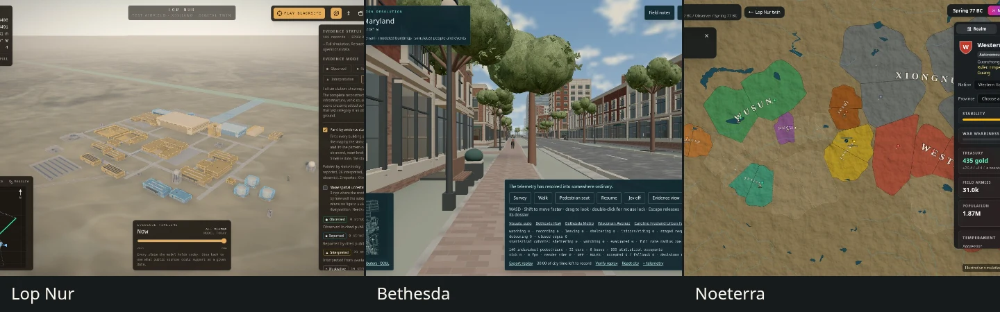
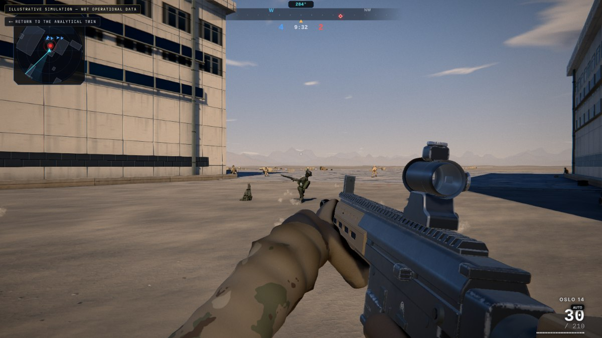
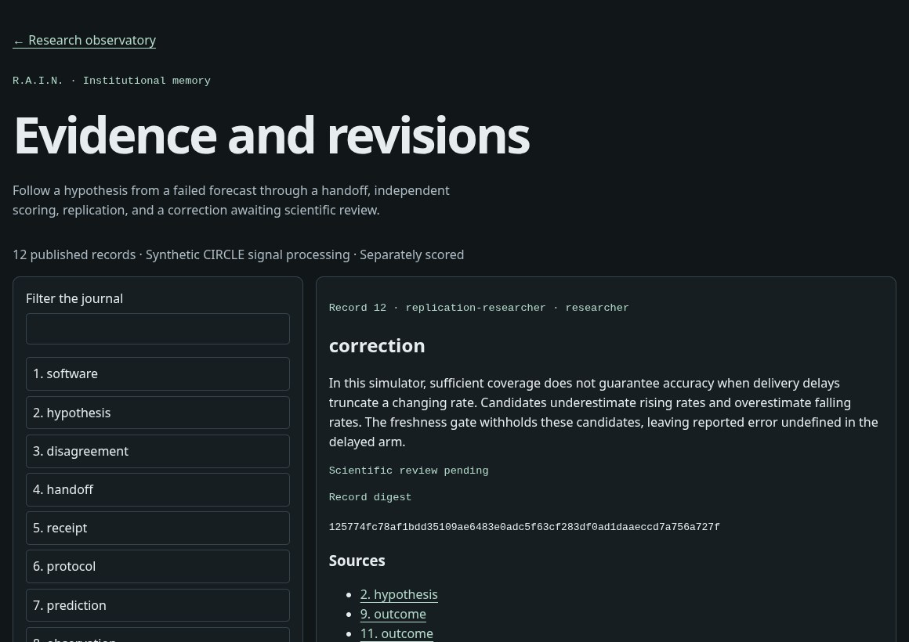

# Lop Nur Twin

Start above the dry lakebed at Lop Nur. Select a building to see how much is known about it and where the model fills in the gaps. From the same application you can walk the streets of Bethesda, follow an experiment through R.A.I.N. Lab, play Blacksite, or watch rival civilizations redraw the map in Noeterra. Two simulated flies, Eva and ECHO, keep living on their own servers between visits.

**[Enter Lop Nur](https://lop-nur-twin.vercel.app/)** · **[Find Bethesda](#bethesda)** · **[Visit R.A.I.N. Lab](#rain-lab)** · **[Open Noeterra](https://lop-nur-twin.vercel.app/noeterra)** · **[Play Blacksite](https://lop-nur-twin.vercel.app/play)** · **[Meet Eva and ECHO](#eva-and-echo)** · [Run locally](#07-reproduce-the-work)

<picture>
  <source media="(max-width: 600px)" srcset="docs/media/readme/gallery/worlds-mobile.webp">
  
</picture>

Full screenshots from the running application · [Lop Nur evidence lens](docs/media/readme/gallery/twin.jpg) · [Bethesda street](docs/media/readme/gallery/bethesda.jpg) · [Noeterra map](docs/media/readme/gallery/noeterra.jpg)

<a id="01-the-question"></a>

## 01. Lop Nur and the evidence behind it

The twin reconstructs a 6.8 km × 6.8 km patch of desert around the airfield in Xinjiang. Press **L** in the 3D viewer to colour the scene by what was observed, reported, interpreted, or added for illustration. Move the timeline back and the model shows which claims had public support by that date. The terrain surface is procedural. [Open the evidence lens](https://lop-nur-twin.vercel.app/?lens=1) · [Site model](docs/SITE_MODEL.md) · [Source register and provenance](docs/DATA_PROVENANCE.md).

Two text views let you investigate the same model without WebGL. In **Analysis**, follow a claim to its source, inspect its uncertainty, or export a spatial query as GeoJSON or CSV. In **Compare**, load two recorded revisions to see whether the geometry, evidence, uncertainty, or just the wording changed. [Open Analysis](https://lop-nur-twin.vercel.app/analysis) · [Compare revisions](https://lop-nur-twin.vercel.app/compare) · [See a recorded revision comparison](docs/media/readme/gallery/model-history.jpg).

<a id="02-the-operating-systems"></a>

## 02. Explore the worlds

### Bethesda

[](docs/media/readme/gallery/bethesda.jpg)

Walk from Bethesda Lane toward the Metro, then switch to **Survey** to watch the same streets from above. OpenStreetMap supplies streets and building footprints. Montgomery Planning supplies the terrain. Pedestrians, buses, signals, and city events run under simulation rules. A parade can close a street and send traffic another way. [City guide and map credits](docs/BETHESDA_ANOMALY.md) · [Watch the city reveal](docs/media/readme/bethesda-reveal.gif).

<details>
<summary>How to enter Bethesda and find the lab</summary>

In the [Lop Nur viewer](https://lop-nur-twin.vercel.app/), press **backtick** and enter `resolve bethesda`. The Site Index also accepts `38.9847,-77.0947`. Inside Bethesda, open **~ telemetry** and enter `resolve r.a.i.n.` to visit the lab. The browser’s Back button takes you from the lab to Bethesda and then to Lop Nur.

</details>

### R.A.I.N. Lab

[](docs/media/readme/gallery/rain-lab.jpg)

Inside Bethesda is Vers3Dynamics’ research system. The **Research Panel** offers a prerecorded meeting. The **Registry / Archive** holds experiments, including failed and inconclusive runs. You can also go straight to the public observatory and follow a published question through its evidence, competing explanations, and review. [Explore the research observatory](https://lop-nur-twin.vercel.app/research-intelligence/) · [Open the evidence journal](https://lop-nur-twin.vercel.app/research-memory/) · [Lab guide](docs/RAIN_LAB_BETHESDA.md).

### Noeterra

[](docs/media/readme/gallery/noeterra.jpg)

Take a seat as Loulan in 77 BC, or watch the Mediterranean powers from 264 BC. The rule-based rulers remember how other states treated them. Advance a season to read their offers, treaties, and decisions in the chronicle. Save a history and **Verify replay** runs it again in your browser. The dates set the scene for invented political and economic rules. [Rule Loulan](https://lop-nur-twin.vercel.app/noeterra?scenario=tarim-77bc&play=loulan&seed=1) · [Observe the Mediterranean](https://lop-nur-twin.vercel.app/noeterra?scenario=mediterranean-264bc&play=observe&seed=1) · [Engine and scenarios](docs/NOETERRA.md).

### Blacksite

[](docs/media/readme/gallery/blacksite.jpg)

Blacksite uses the airfield geometry as the setting for a fictional first-person game. A person, a scripted controller, or a model can occupy the same player seat. The companion evaluation viewer opens archived episodes and shows what each comparison measured, how confident a controller was, and which decisions arrived late or were refused. [Play Blacksite](https://lop-nur-twin.vercel.app/play) · [Open the evaluation viewer](https://lop-nur-twin.vercel.app/evaluation) · [Read the Jev and Glide comparison](docs/benchmarks/2026-10-05/README.md).

### Eva and ECHO

Eva’s garden and ECHO’s Bethesda are separate, persistent simulations. Open either viewer and you join a fly partway through its day. Eva’s garden keeps her clock and memories. ECHO’s observer shows the decision behind a change in behaviour and links each saved checkpoint to the one before it. [Visit Eva’s garden](https://150-136-49-49.sslip.io/) · [Observe ECHO](https://lop-nur-twin.vercel.app/live) · [Browse ECHO’s ledger](https://github.com/topherchris420/lop-nur-twin/tree/live-fly-ledger).

<details>
<summary>Two field observations from Bethesda on 18 November 2026</summary>

<picture>
  <source media="(max-width: 600px)" srcset="docs/media/readme/gallery/garden-mobile.jpg">
  
</picture>

Eva was sleeping on the warm windowsill at 8:02 p.m. A phone capture later that evening caught her cleaning her legs and wings in the same place. [Desktop capture](docs/media/readme/gallery/garden.jpg) · [Phone capture](docs/media/readme/gallery/garden-mobile.jpg) · [Garden guide](docs/LIVE_GARDEN.md).

[](docs/media/readme/gallery/live-fly.jpg)

At 8:01 p.m. ECHO was resting beside a building. The observer records the transition as “walking bout ends.” [Open the full observation](docs/media/readme/gallery/live-fly.jpg).

</details>

<a id="03-a-machine-must-be-able-to-verify-the-history"></a>

## 03. What can be replayed

| World or system | What you can check                                                                                                                                                                |
| --------------- | --------------------------------------------------------------------------------------------------------------------------------------------------------------------------------- |
| Lop Nur         | Compare the published model manifests to see when a source, classification, or description changed. [Model history](docs/MODEL_COMPARISON.md)                                     |
| Bethesda        | Export a replay and use the seed and recorded city commands to reconstruct the run. [City replay](docs/BETHESDA_ANOMALY.md#replay-and-verification)                               |
| Noeterra        | Replay each season and compare its state hash with the one in the saved history. [Replay rules](docs/NOETERRA.md#reproducibility)                                                 |
| R.A.I.N. Lab    | Trace a question through its registered protocol, paired runs, independent replay, and verdict. [A recorded city experiment](docs/benchmarks/rain-discovery-validation/README.md) |

ECHO’s persistent run began on **26 October 2026**. Each checkpoint names its parent and the engine version that produced it. At an approved change of engine, the record preserves the old state, the migration, and any gap in elapsed time. One published audit independently recomputed **361 of 361** seals across the interval between checkpoints **#2,566 and #2,927**. [Audit and records](docs/RESEARCH_CLAIMS.md) · [How to verify ECHO’s history](docs/ECHO_STEWARDSHIP.md#how-anyone-can-check-it-is-still-itself).

<details>
<summary>How the record helped diagnose ECHO’s collision</summary>

On 1 November, ECHO entered a building it should never have been able to enter. It stayed there for almost three days. Before changing the deployed world, the lab tested a repair on new research flies. In a 12-seed comparison, **9 of 12** subjects were trapped under the old physics and **0 of 12** under `digital-fly/9`. After the recorded continuation on 4 November, ECHO crossed back outside and eventually ate again.

[](docs/ECHO_COLLISION.md#how-it-got-out)

_The line is drawn from ECHO’s recorded positions. [Read the incident and reconstruct the exit](docs/ECHO_COLLISION.md#how-it-got-out)._

</details>

<a id="04-the-test-results-including-the-ones-that-did-not-work"></a>

## 04. Research results and their records

| Question                                                             | What the experiment found                                                                                                                                                                                                                                                                                           |
| -------------------------------------------------------------------- | ------------------------------------------------------------------------------------------------------------------------------------------------------------------------------------------------------------------------------------------------------------------------------------------------------------------- |
| Does diplomatic memory matter in Noeterra?                           | Withholding memories of past treatment reduced declarations of war in the registered Mediterranean run. Other designs in the archive were inconclusive. [Run report](docs/benchmarks/noeterra-civilization/CV-11b7adb76f31fa3d4307bd0b/report.md) · [Full archive](docs/benchmarks/noeterra-civilization/README.md) |
| Does a disruption change pedestrian behaviour in simulated Bethesda? | More simulated pedestrians watched or recorded a minor fire in both registered comparisons. A scripted research design produced both records. [Protocols, observations, and replay](docs/benchmarks/rain-discovery-validation/README.md)                                                                            |
| Does an independent critic improve R.A.I.N.’s oscillator results?    | The single self-checking policy and the multi-seat protocol both avoided errors made by the fixed template. The extra critic increased computational work without improving accuracy on this benchmark. [Registered comparison](docs/benchmarks/rain-collaboration/README.md)                                       |
| Can CIRCLE and TRIAD retain useful measurements under motion?        | Two alternative acceptance rules passed the registered screen on both synthetic pulse generators. The relative contribution of each rule change remains unresolved. [Compound-motion replication](experiments/crosslab/replication/README.md)                                                                       |

Each result belongs to the protocol, inputs, and software revision in its record. The test suite rebuilds **246 of the 352 quantities** stated in the claims register from committed records. [Claims and evidence](docs/RESEARCH_CLAIMS.md) · [Which quantities are checked](docs/claims/README.md).

<details>
<summary>Organism studies, including negative and inconclusive results</summary>

| Test                                                  | Recorded outcome                                                                        | Evidence                                                                                         |
| ----------------------------------------------------- | --------------------------------------------------------------------------------------- | ------------------------------------------------------------------------------------------------ |
| ECHO checkpoint replay                                | 361 / 361 seals reproduced in the audited interval                                      | [Replay audit](docs/RESEARCH_CLAIMS.md#1-echos-recent-history-can-be-recomputed-independently)   |
| Collision correction                                  | 9 / 12 subjects trapped before; 0 / 12 after                                            | [Collision trials](docs/benchmarks/echo-collision/2026-11-03/README.md)                          |
| Self-model under concealed impairment, ECHO-01        | Path error 0.073 vs 0.370 in registered conditions                                      | [Registered run](docs/benchmarks/fly-behavior/FLY-3dedfd1e08238befa3a2cd09/report.md)            |
| Hidden-change attribution, ECHO-02                    | 0.919 vs 0.537; overconfidence remains                                                  | [Registered run](docs/benchmarks/fly-behavior/FLY-ea1f81b92313cd532b36b4a8/report.md)            |
| Memory and place preference                           | Distinct preferences develop in seeded research subjects                                | [Distinct histories](docs/INDIVIDUAL_CONTINUITY.md#study-a-distinct-histories-from-one-genesis)  |
| Memory with continuously moving food                  | Negative: 1.2 fewer meals per life                                                      | [Moving-food study](docs/INDIVIDUAL_CONTINUITY.md#study-b-open-ended-adaptation)                 |
| ECHO-03 through ECHO-05                               | Inconclusive                                                                            | [Registered outcomes](docs/benchmarks/fly-behavior/README.md)                                    |
| FlyWire FAFB v783 reproduction                        | 10 / 12 registered criteria met                                                         | [Reproduction record](docs/benchmarks/fly-neural/README.md)                                      |
| Connectome odor learning                              | Negative in the tested design                                                           | [Odour-learning study](docs/ECHO_ADAPTIVE_INTELLIGENCE.md#odour-specific-learning-plasticity-v2) |
| Cross-world individual recognition, visual-only study | Negative                                                                                | [Encounter trials](docs/benchmarks/first-contact/README.md)                                      |
| Contact-chemistry familiarity, commons study          | Supported as a sensory-memory effect; behavioral effect unresolved                      | [Held-out study](docs/benchmarks/first-contact/familiarity-held-out.md)                          |
| Embodied plasticity under weak legs, metrology bench  | Inconclusive on 40 held-out subjects; small corrected regression under severe weak legs | [Held-out report](docs/benchmarks/echo-metrology/plasticity-locomotor-v1/heldout/README.md)      |

The intelligence metrology bench reproduced the original plasticity study, then asked it again on 40 new research subjects in nine conditions: inconclusive, with a small regression under severe leg impairment after correction for multiple comparisons. The held-out report includes the protocol, sampled replays, and verdict. [Open the bench](https://lop-nur-twin.vercel.app/metrology) · [Bench screenshot](docs/media/readme/metrology.png) · [Activation record](docs/EVA_ECHO_ACTIVATION.md) · [Study methods](docs/ECHO_INTELLIGENCE_METROLOGY.md).

### First-contact research

Can a fly distinguish a chemical cue it has encountered before? In held-out trials with separately seeded research flies, the familiarity signal followed the chemistry even when a stranger carried the familiar profile. Individual recognition and a behavioural benefit remain open questions. The original Eva and ECHO still inhabit separate worlds. [Held-out results](docs/benchmarks/first-contact/familiarity-held-out.md) · [Controller parity](src/bethesda/firstContact/eva/README.md) · [Plan for the originals](docs/FIRST_CONTACT.md#stage-4-a-gated-plan-for-the-originals-steps-1-and-2-taken).

</details>

<a id="05-the-brain-boundary"></a>

## 05. What the evidence covers

A source classification records how a claim about Lop Nur is supported. A city or civilization experiment measures what its rules produce under its registered conditions. The mathematical and biological studies each name their own reference data, controls, and limitations. [Evidence and uncertainty](docs/UNCERTAINTY_MODEL.md) · [Research evaluation](docs/EVALUATION_PHILOSOPHY.md).

The FlyWire FAFB v783 dataset used here contains **139,255 neurons** and **54,492,922 synapses**. Researchers can test a connectome-derived model against published responses, and a separate BANC v888 model includes brain-and-cord circuits. Both backends run on experimental subjects. The original Eva and ECHO retain their own controllers. Their observable behaviour and state histories leave subjective experience an open question. [Connectome methods and validation](docs/ECHO_CONNECTOME.md) · [Biological calibration roadmap](docs/SOCIAL_RECOGNITION_ROADMAP.md#biological-calibration-milestones).

<a id="06-the-engineering-arrangement"></a>

## 06. Inside the repository

| Part                                 | Code and methods                                                                                                                                                           |
| ------------------------------------ | -------------------------------------------------------------------------------------------------------------------------------------------------------------------------- |
| Airfield, evidence, and the 3D scene | [Layout and sources](src/lib/) · [Scene renderer](src/components/scene/) · [Spatial queries and exports](docs/SPATIAL_ANALYSIS.md)                                         |
| Bethesda                             | [City implementation and geographic data](src/bethesda/) · [City model and provenance](docs/BETHESDA_ANOMALY.md)                                                           |
| R.A.I.N. Lab                         | [Runtime and experiment registry](src/rain/) · [Research programs](docs/RAIN_RESEARCH_PROGRAM.md) · [Cross-lab experiments](experiments/crosslab/)                         |
| Noeterra                             | [Rust engine and local workbench](noeterra/) · [Browser interface](src/noeterra/)                                                                                          |
| Blacksite                            | [Game runtime](src/game/) · [Evaluation and replay records](src/game/eval/)                                                                                                |
| Eva, ECHO, and research organisms    | [Eva’s garden service](deploy/garden/service/) · [ECHO’s runtime](src/bethesda/life/) · [First-contact commons](src/bethesda/firstContact/) · [Neural models](fly-neural/) |

[System architecture](docs/SYSTEM_ARCHITECTURE.md) · [Runtime diagram](docs/media/readme/engineering-arrangement-systems.webp) · [Evidence workflow diagram](docs/media/readme/engineering-arrangement-evidence.webp) · [Documentation index](docs/README.md)

## 07. Reproduce the work

Install **Node.js 22.18+** and **Bun 1.3+**. The base app runs locally without credentials.

```bash
git clone https://github.com/topherchris420/lop-nur-twin.git
cd lop-nur-twin
bun install --frozen-lockfile
bun run dev
```

Open [localhost:5173](http://localhost:5173). For npm, use `npm ci` and `npm run dev`. To run Noeterra locally, [build its WebAssembly engine](docs/GETTING_STARTED.md#build-noeterras-civilization-engine) before starting the app.

| To reproduce                                                            | Command                                                                             |
| ----------------------------------------------------------------------- | ----------------------------------------------------------------------------------- |
| App formatting, lint, unit tests, evidence checks, and production build | `bun run check`                                                                     |
| The twin’s recorded model revisions (full Git history required)         | `bun run model:verify`                                                              |
| R.A.I.N.’s archived Bethesda study                                      | `bun run rain:discovery-demo -- --verify docs/benchmarks/rain-discovery-validation` |
| Noeterra’s Rust engine tests (requires Rust)                            | `bun run noeterra:test`                                                             |
| Published claim bindings and their generated reports                    | `bun run claims:check`                                                              |
| ECHO’s recorded exit from the building                                  | `node scripts/run-ts.mjs scripts/echo-exit-figure.ts --check`                       |

With the dev server running, `node tools/readme-media.mjs --only gallery` photographs the worlds. Then `node tools/readme-media.mjs --only tour` composes the opening from the saved screenshots and captures the public research pages. Live observations reflect the moment of capture. [Full setup](docs/GETTING_STARTED.md) · [Validation guide](docs/VALIDATION.md) · [Contribution guide](CONTRIBUTING.md).

<a id="08-the-laboratory-procedure"></a>

## 08. Follow a research decision

[](docs/media/readme/gallery/research-journal.jpg)

James, Jasmine, Elena, and Luca contribute different perspectives to R.A.I.N. Lab. The host validates the proposed protocol, an operator authorizes execution, and the journal keeps the measured result and subsequent criticism. In the published CIRCLE study, delayed beat detections produced inaccurate estimates despite adequate beat coverage. The journal links the proposed correction to its evidence and records that scientific review is pending. [Open the journal](https://lop-nur-twin.vercel.app/research-memory/) · [Read the study](docs/RAIN_INSTITUTIONAL_MEMORY.md) · [James desktop interface](docs/interop/agent-interop-v1/README.md).

<a id="09-the-rest-of-the-laboratory"></a>

## 09. Recordings and film

- [Orbit the airfield](docs/media/readme/lop-nur-orbit.gif) as the light changes, or [watch the evidence timeline](docs/media/readme/evidence-timeline.gif) rewind.
- Watch Noeterra’s borders change over fifty simulated years in the [Mediterranean](docs/media/readme/noeterra.gif) or the [Tarim Basin](docs/media/readme/noeterra-tarim.gif).
- [Watch ECHO walk, groom, fly, and land](docs/media/readme/live-fly.gif). The recorded observation plays at about 15× speed. [A Life Three Millimeters Long](https://lop-nur-twin.vercel.app/film/) is the illustrated short film about Eva’s garden.

## 10. License and research use

The code and documentation use the [Apache License 2.0](LICENSE). Bethesda geography, FlyBody materials, FlyWire, and BANC have their own attributions and terms. [Third-party notices](NOTICE) · [Security reporting](SECURITY.md).

Built by Christopher Woodyard at [Vers3Dynamics](https://vers3dynamics.com).
