<div align="center">

# R.A.I.N. Lab

**Persistent artificial life. Reproducible experiments. Worlds built to be questioned.**

Created by **Christopher Woodyard** at **[Vers3Dynamics](https://vers3dynamics.com)**.

[](https://github.com/topherchris420/lop-nur-twin/actions/workflows/ci.yml)
[](LICENSE)

[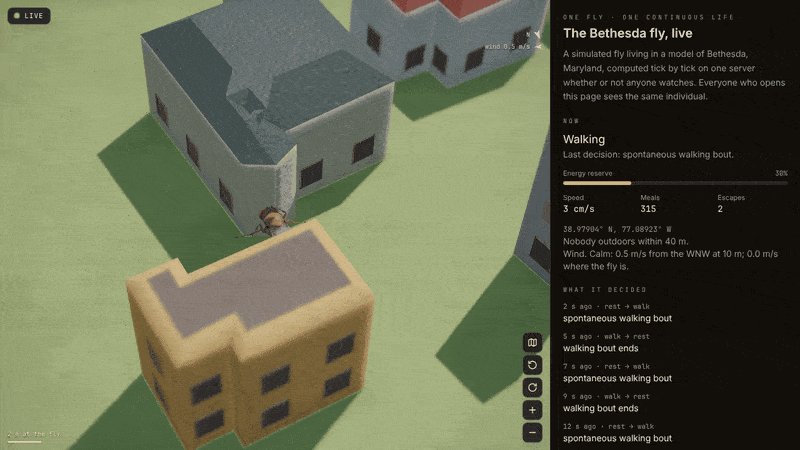](https://lop-nur-twin.vercel.app/live)

<sub>ECHO on <a href="https://lop-nur-twin.vercel.app/live"><code>/live</code></a>, recorded on 28 October 2026 (UTC), at twice real speed. Every change of behavior arrives with the reason its controller logged.</sub>

**[Watch ECHO](https://lop-nur-twin.vercel.app/live)** ·
**[Visit Eva's garden](https://150-136-49-49.sslip.io/)** ·
**[Explore the twin](https://lop-nur-twin.vercel.app/)** ·
**[Read the evidence](docs/RESEARCH_CLAIMS.md)** ·
**[Run it locally](#reproduce-it-or-build-on-it)**

</div>

## In one minute

**What is R.A.I.N. Lab?** An open-source laboratory for simulated organisms and
the simulated worlds they live in, built so that every result can be traced to
the code, data and records that produced it. It began as an evidence-linked
reconstruction of a desert airfield at Lop Nur, which is why the repository
keeps that name. Its ambition is a small, open digital Bell Labs: build worlds in
which questions can be tested, keep the attempts that fail, and leave the
reasoning and results for someone else to examine.

**What makes it unusual?** One of its simulated flies, **ECHO**, has lived as the
same individual since 26 October 2026: a three-millimeter fruit fly in a
simulated Bethesda, with FlyBody-derived anatomy, a reduced-order behavioral
controller, a computational model of its own sensorimotor abilities and a
mushroom-body rate model that learns from its meals. Its whole state is sealed
into a checkpoint every five simulated minutes, anchored to a public ledger, and
recomputed independently on other machines. A change to the engines it runs on
reaches it only by a recorded continuation that keeps its earlier state byte for
byte. A second fly, **Eva**, lives in a separate garden service.

**What can you explore?** ECHO live; Eva's garden as a clay stop-motion exhibit;
a 3D reconstruction in which every building carries its evidence; a hidden
simulated Bethesda with a research laboratory inside it; rule-based
civilizations; and a first-person simulation. All in the browser, with no
account.

**What has been shown?** That ECHO's history since 4 November recomputes seal
for seal (361 of 361 checkpoints); that the ECHO self-model compensates for an
impairment it is never told about, in registered tests on research flies; and
that memory gives identically built flies distinct, persistent preferences. Just as plainly: memory
did not help where food keeps moving, three self-model tests are inconclusive,
and connectome-level odor learning failed its test.
[Every claim, with its evidence class](docs/RESEARCH_CLAIMS.md).

**How can you check it or build on it?** Generated archives name the commit they
ran from and the command that wrote them, and most have a `--check` that
reproduces them byte for byte on the platform they were recorded on.
[Reproduce it](#reproduce-it-or-build-on-it), or start from
[CONTRIBUTING.md](CONTRIBUTING.md).

## 7 November 2026: both flies learn from their own bodies, in shadow mode

ECHO and Eva each have a new learning addition that continues the same individual
instead of replacing it. ECHO's learns how reliably its own steps carry it, and
may slow a failing walk. Eva's learns how far flying and walking each carry her,
and may swap them. Both run on the live flies in **shadow mode** since the evening
of 7 November: they learn and report, and change nothing they do. ECHO continues
as the same individual from checkpoint 3554, at the tick its old brain stopped,
after a pause of 13 min 45 s. Eva's service restarted in two seconds with her
database untouched. Every step was owner-approved
([activation record](docs/EVA_ECHO_ACTIVATION.md#record)).

On held-out research individuals, never the originals: shadow mode was identical
to the original fly in every run (ECHO 144 of 144, Eva 72 of 72), and restarts kept
what was learned. Active mode showed **no benefit**. ECHO's acted only when its
legs were weak, and changed meals by +0.17 (95% CI −1.00 to 1.33). Eva's never
acted, because her own learning already chose well
([what was built and found](docs/EVA_ECHO_BRAIN_PLASTICITY.md)).

## 4 November 2026: the collision repair reached the original ECHO

The deployed ECHO spent nearly three days inside the walls of a building it could
not leave. The defect was in the simulator, not the fly, and the repair reached the
original individual without replacing it.

| When (UTC)         | What the records show                                                                                                                                                                                                                                              |
| ------------------ | ------------------------------------------------------------------------------------------------------------------------------------------------------------------------------------------------------------------------------------------------------------------ |
| 1 Nov, 17:12–17:13 | ECHO passes into the walls of building 1011267786, the only time in its life it has been inside a solid. It does not eat again while inside.                                                                                                                       |
| 1–3 Nov            | The cause is found: on a wall's line a point counted as outside while a ray from it missed the wall, and motion trusted the ray. 2,774 of 17,999 test rays missed prism walls across the map. From inside, every wall held.                                        |
| 3 Nov              | `digital-fly/9` fixes how any moving body meets any surface: a surface stops a body going in, never one coming out. On the same new seeds, 9 of 12 research flies were trapped on the old physics and none on the new; mean meals in 96 h rose from 83.5 to 120.0. |
| 4 Nov, 10:54–11:02 | With the owner's approval: a last checkpoint on the old physics (#2,554), then a recorded continuation (#2,555) at the same tick, keeping every byte of its history but one label. The 7 min 46 s pause is recorded as a gap.                                      |
| 4 Nov, about 11:38 | ECHO crosses out of the solid, 36 simulated minutes after the repair (tick 7,664,060).                                                                                                                                                                             |
| 4 Nov, about 19:27 | Its first meal since 1 November.                                                                                                                                                                                                                                   |
| 4–5 Nov            | Four independent replays reproduce every seal from #2,566 to #2,927: 1,083,003 ticks, 361 of 361.                                                                                                                                                                  |

[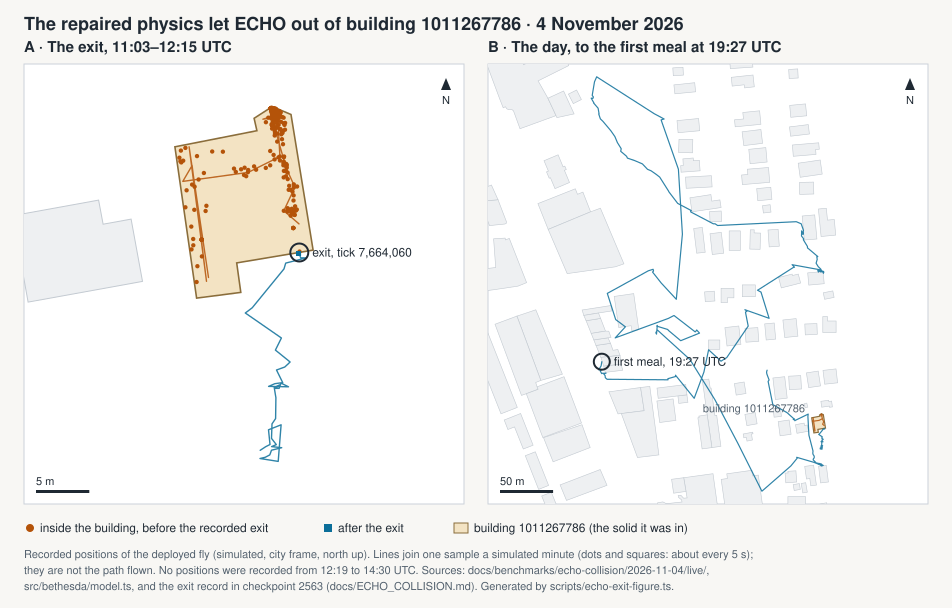](docs/ECHO_COLLISION.md#how-it-got-out)

<sub>Drawn by <code>scripts/echo-exit-figure.ts</code> from ECHO's recorded journal and witness, the building rings its world collides with, and the exit record in checkpoint 2563.</sub>

**The simulator became more correct; the fly did not become more intelligent.**
No controller, learning rule or goal changed. ECHO did not learn or navigate its
way out: it was in the air, refused a landing inside again and again, drifted
along a wall and crossed it. Programmed maintenance, an artificial energy
supply, carried it to its first meal, and it remembered no food places then, so
that meal was not memory-guided either.

**A merged feature is not a migrated life.** The repair was merged on GitHub
first; it reached ECHO only through the recorded continuation, rehearsed on
copies, with the owner's approval for each step on its machine.

[The full record](docs/ECHO_COLLISION.md) ·
[every command as it ran](docs/research/echo-collision/cutover.txt) ·
[replay verdicts](https://github.com/topherchris420/lop-nur-twin/blob/live-fly-ledger/replays.jsonl) ·
[how ECHO is kept](docs/ECHO_STEWARDSHIP.md)

## Explore

The public pages need **no account or model API key**. The 3D scenes need WebGL;
`/analysis` and `/compare` work without it.

<table>
  <tr>
    <td width="33%" valign="top">
      <a href="https://lop-nur-twin.vercel.app/live">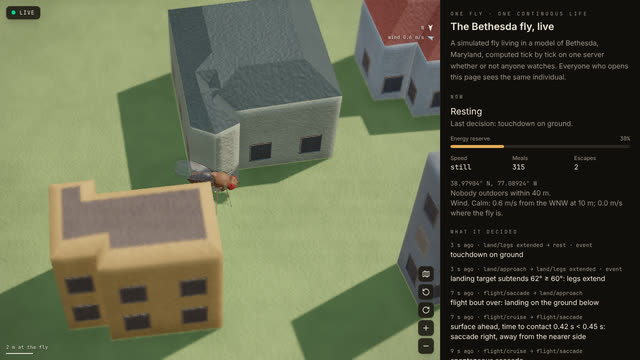</a>
      <br><b><a href="https://lop-nur-twin.vercel.app/live">ECHO in Bethesda</a></b>
      <br><sub>The one shared, persistent individual, as its read-only witness reports it, with its recent decisions and the public record.</sub>
    </td>
    <td width="33%" valign="top">
      <a href="https://150-136-49-49.sslip.io/">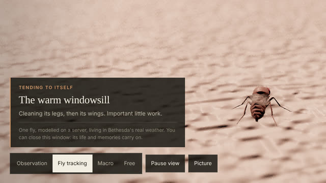</a>
      <br><b><a href="https://150-136-49-49.sslip.io/">Eva's clay garden</a></b>
      <br><sub>A different fly in a separate service, watched through a stop-motion clay exhibit. <a href="docs/LIVE_GARDEN.md">About the garden</a>.</sub>
    </td>
    <td width="33%" valign="top">
      <a href="https://lop-nur-twin.vercel.app/">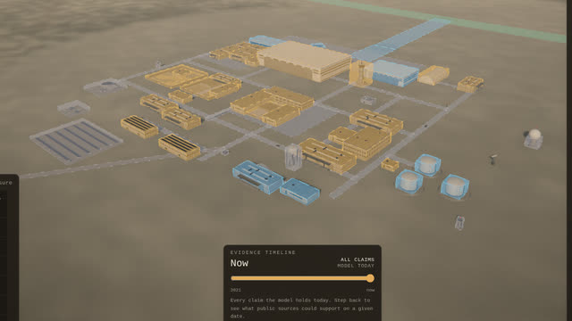</a>
      <br><b><a href="https://lop-nur-twin.vercel.app/">Lop Nur twin</a></b>
      <br><sub>Every building is observed, reported, interpreted or illustrative. Open its dossier, paint the scene by evidence (<code>L</code>), and move through what was knowable when.</sub>
    </td>
  </tr>
  <tr>
    <td width="33%" valign="top">
      <a href="docs/BETHESDA_ANOMALY.md">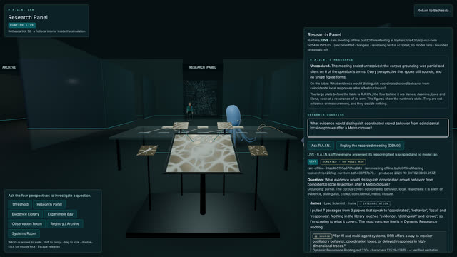</a>
      <br><b><a href="docs/BETHESDA_ANOMALY.md">Bethesda and the R.A.I.N. Lab</a></b>
      <br><sub>A hidden city on mapped geography, and the laboratory behind a door in it.</sub>
    </td>
    <td width="33%" valign="top">
      <a href="https://lop-nur-twin.vercel.app/noeterra">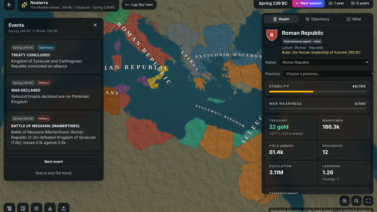</a>
      <br><b><a href="https://lop-nur-twin.vercel.app/noeterra">Noeterra</a></b>
      <br><sub>Rule-based civilizations in the Mediterranean (264 BC) or the Tarim Basin (77 BC).</sub>
    </td>
    <td width="33%" valign="top">
      <a href="https://lop-nur-twin.vercel.app/play">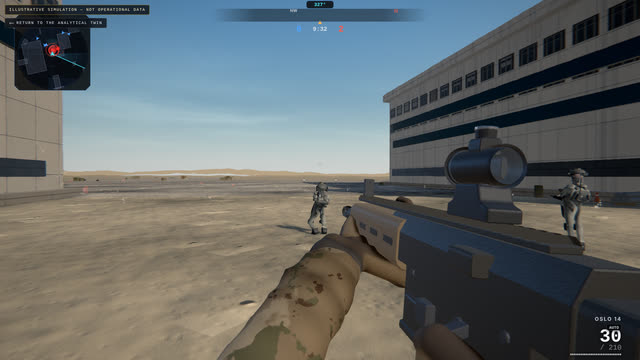</a>
      <br><b><a href="https://lop-nur-twin.vercel.app/play">Blacksite</a></b>
      <br><sub>An illustrative first-person simulation with human, scripted or model-controlled seats.</sub>
    </td>
  </tr>
</table>

**In your first five minutes:** open the twin and select a structure; press `L`
and move the timeline back (an outline marks absence of evidence, never evidence
of absence); follow a claim to its sources in the
[evidence inspector](https://lop-nur-twin.vercel.app/analysis); then
[watch ECHO](https://lop-nur-twin.vercel.app/live) and open "Check it yourself".
Press `H` for help. [Full controls](docs/CONTROLS.md).

<details>
<summary>Find Bethesda and the hidden laboratory (spoiler)</summary>

In the twin, press **backtick** (usually below Escape) and submit
`38.9847,-77.0947` or `resolve bethesda`, or press `I` and search the Site Index
for those coordinates. Bethesda loads on demand; the laboratory is inside a
building, behind a door.

[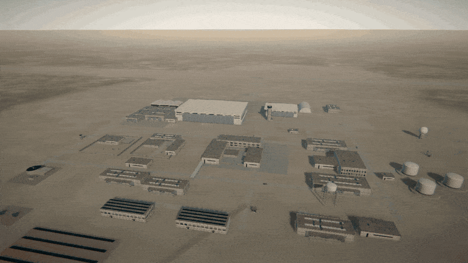](docs/BETHESDA_ANOMALY.md)

[City guide](docs/BETHESDA_ANOMALY.md) · [Lab guide](docs/RAIN_LAB_BETHESDA.md)

</details>

**A Life Three Millimeters Long** is a 58-second illustrated film about the
project ([watch](https://lop-nur-twin.vercel.app/film/),
[credits](docs/media/fly-film/README.md)): an interpretation, not a recording of
the simulator.

## How the pieces fit

Separate boxes are separate systems. An arrow is a connection the code makes;
no arrow means no channel.

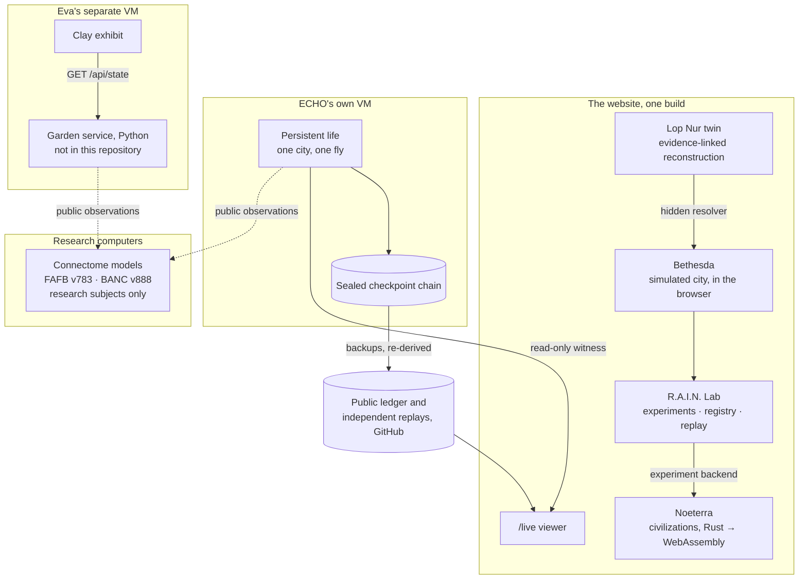

The Bethesda you open in the browser runs the same city simulator as ECHO's, with
a fly of its own: it never reads or writes ECHO. Eva's simulation shares nothing with
ECHO's. The connectome models run on research subjects; the dotted lines are a
read-only probe fed with the originals' public observations, whose output is a
counterfactual model response, not either fly's neural activity.
[System architecture](docs/SYSTEM_ARCHITECTURE.md#12-the-persistent-individuals-and-the-research-backends).

## What has been shown, and how strongly

A result belongs to one simulator, one design and one producing commit. None is
a claim about a living organism, a real society or awareness. The
[claims register](docs/RESEARCH_CLAIMS.md) gives each one's hypothesis, baseline,
protocol, uncertainty and limits.

| Result                                                               | Evidence                               | Outcome                                               |
| -------------------------------------------------------------------- | -------------------------------------- | ----------------------------------------------------- |
| ECHO's history since #2,566 recomputes on other machines             | Observation of the original            | **361 of 361** seals reproduced                       |
| Four engine changes reached ECHO with its state kept byte for byte   | Observation of the original            | **4** recorded continuations                          |
| The old physics trapped flies in buildings; `digital-fly/9` fixes it | Seeded comparison, 12 new seeds        | **9 of 12 → 0 of 12** trapped                         |
| A self-model compensates for a hidden impairment (ECHO-01)           | Registered, held-out conditions        | **Supported**: path error 0.073 vs 0.370              |
| It attributes hidden changes better than simpler rules (ECHO-02)     | Registered, held-out conditions        | **Supported**: 0.919 vs 0.537; overconfident held out |
| Memory, workspace and a second look help it (ECHO-03–05)             | Registered                             | **Inconclusive**                                      |
| Flies of one genesis acquire distinct, persistent place preferences  | Seeded study                           | **Supported**: 0.28 vs −0.01 with memory erased       |
| Memory helps where food keeps moving                                 | Seeded study; held-out benchmark       | **Negative**: 1.2 fewer meals per life                |
| A learned search preference transfers and pays                       | Held-out (sealed)                      | **Transfers**, +0.42; benefit **not shown**           |
| The fly agrees with published recordings of real flies               | Held-out observations from nine papers | **Narrow pass**: one paper, one mechanism             |
| Published connectome predictions reproduce on FlyWire v783           | Registered, dev and held-out seeds     | **10 of 12** criteria                                 |
| Connectome odor learning and threat discrimination                   | Registered                             | **Negative**                                          |
| Flies in separate worlds recognize one another                       | Frozen protocol, held-out seeds        | **Negative**                                          |

**Research boundary.** Simulated behavior, continuity and self-modeling do not
establish consciousness, subjective experience, biological equivalence or
open-ended learning. ECHO's maintenance supply is an artificial model choice, not
biology. The connectome research is separate from both original flies.

## How an experiment runs

James, Jasmine, Luca and Elena are R.A.I.N.'s four computational research
perspectives. Their proposals pass through the laboratory's validation,
authorization, execution and replay before anything counts as evidence.

> **Models propose. Host code validates. People authorize. Simulations run.
> Results remain open to inspection.**

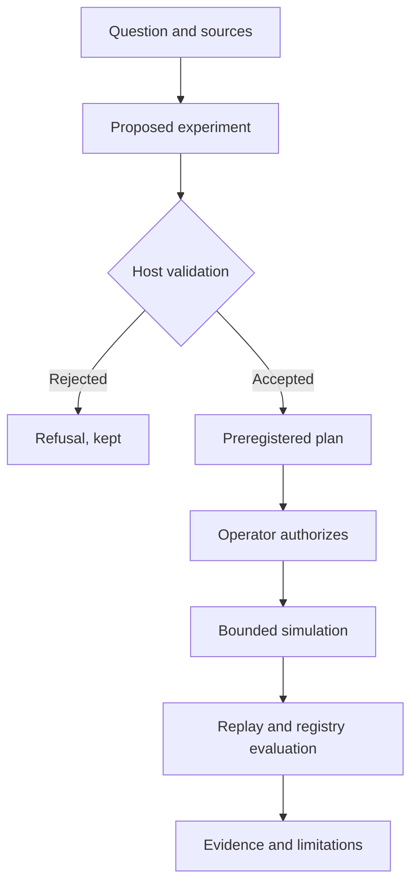

Models cannot authorize themselves or change criteria after seeing outcomes, and
an inconclusive result stays inconclusive. The backends are the Bethesda city,
numerical physics, Noeterra and the digital fly.
[Lab guide](docs/RAIN_LAB_BETHESDA.md) ·
[scientific workflow](docs/RAIN_SCIENTIFIC_INTELLIGENCE.md) ·
[evaluation philosophy](docs/EVALUATION_PHILOSOPHY.md)

## Reproduce it, or build on it

Use **Node.js 22.18+** and **Bun 1.3+**:

```sh
git clone https://github.com/topherchris420/lop-nur-twin.git
cd lop-nur-twin
bun install --frozen-lockfile
bun run dev        # http://localhost:5173
```

Running it locally starts local instances only; it never touches ECHO or Eva.

| Command                                                             | What it re-derives                                                                                                 |
| ------------------------------------------------------------------- | ------------------------------------------------------------------------------------------------------------------ |
| `bun run check`                                                     | Formatting, lint, unit tests, the evidence rules' own tests and the build                                          |
| `node scripts/run-ts.mjs scripts/individuality-evaluate.ts --check` | Studies A and B, byte for byte (about 8 minutes)                                                                   |
| `node scripts/run-ts.mjs scripts/echo-exit-figure.ts --check`       | The figure above, from its records                                                                                 |
| `bun run rain:fly:verify`                                           | Every archived fly record this engine can re-simulate; exit 3 means the rest were recorded on another Node version |

ECHO's backups are private, but the replays of them are public: read
`replays.jsonl` on the
[`live-fly-ledger`](https://github.com/topherchris420/lop-nur-twin/tree/live-fly-ledger)
branch and the GitHub runs each line links to.
[Getting started](docs/GETTING_STARTED.md) covers npm, Noeterra and local models;
[VALIDATION.md](docs/VALIDATION.md) covers every suite.

**To contribute,** bring a sourced correction, a reproducible experiment, a
clearer way to inspect evidence, an accessibility fix or a documented failure.
Start with [CONTRIBUTING.md](CONTRIBUTING.md) and [AGENTS.md](AGENTS.md), or
[open an issue](https://github.com/topherchris420/lop-nur-twin/issues).
Contributions keep four promises:

- **Trace claims to sources**, keeping observed, reported, interpreted and illustrative apart.
- **Keep authorship visible**: label scripted and model-generated work.
- **Preserve the record**: keep unsuccessful results; never hand-edit a generated archive.
- **Never touch the originals**: research runs on research subjects, and ECHO changes only by an approved, recorded continuation.

Never invent a source, date, measurement or confidence value. Report
vulnerabilities through [SECURITY.md](SECURITY.md).

## Documentation

Everything else, arranged by purpose, is in the
[documentation and research archive](docs/README.md). The most used:

| I want to…                  | Start here                                                                                                           |
| --------------------------- | -------------------------------------------------------------------------------------------------------------------- |
| Weigh the evidence          | [Claims register](docs/RESEARCH_CLAIMS.md), [evaluation philosophy](docs/EVALUATION_PHILOSOPHY.md)                   |
| Understand ECHO             | [Digital fly](docs/DIGITAL_FLY.md), [Project ECHO](docs/PROJECT_ECHO.md), [collision repair](docs/ECHO_COLLISION.md) |
| Look after ECHO             | [Keeping ECHO](docs/ECHO_STEWARDSHIP.md), [continuous life](docs/BETHESDA_CONTINUOUS_LIFE.md)                        |
| Assess the reconstruction   | [Site model](docs/SITE_MODEL.md), [provenance](docs/DATA_PROVENANCE.md), [uncertainty](docs/UNCERTAINTY_MODEL.md)    |
| Study the connectome models | [Connectome backend](docs/ECHO_CONNECTOME.md), [adaptive intelligence](docs/ECHO_ADAPTIVE_INTELLIGENCE.md)           |
| Change the code             | [Architecture](docs/SYSTEM_ARCHITECTURE.md), [validation](docs/VALIDATION.md), [threat model](docs/THREAT_MODEL.md)  |

The browser uses React 19, TypeScript, Three.js / React Three Fiber and TanStack
Router, built with Vite; the research runtime and decision endpoints run
server-side; Noeterra's core is Rust; ECHO's life runs headlessly under Node;
Eva's garden is a separate Python service.

## License and attribution

Source code and documentation: **[Apache 2.0](LICENSE)**. See [NOTICE](NOTICE)
for sources and attribution. Bundled Bethesda geography has
[additional data terms](src/bethesda/data/LICENSE.md). Noeterra uses
[Natural Earth](https://www.naturalearthdata.com) coastlines, recorded in
[`geography.source.json`](noeterra/data/geography.source.json). FlyBody-derived
anatomy and Virtual Fly Brain reference material retain the licenses and limits
in the [digital-fly source register](docs/DIGITAL_FLY.md#sources-and-licences).
Connectome datasets retain their own terms and are not committed here. FAFB
v783-derived results carry [FlyWire's terms](docs/benchmarks/fly-neural/LICENSE.md).
BANC v888-derived results are kept separately under
[CC BY 4.0](docs/benchmarks/fly-neural/banc/LICENSE.md), with the source citation
and reviewed data pin recorded by the backend.
