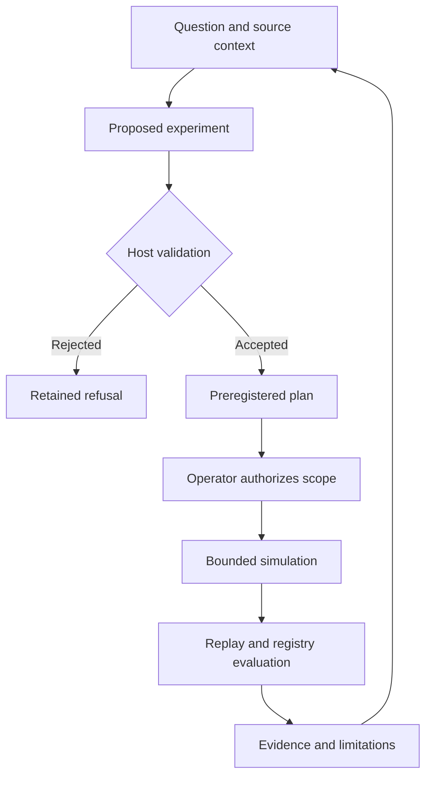

<div align="center">

# R.A.I.N. Lab

### A world to observe. A question to test. A record to inspect.

**An open-source laboratory for persistent simulated life and reproducible research.**

Created by **Christopher Woodyard** at **[Vers3Dynamics](https://vers3dynamics.com)**.

[](https://github.com/topherchris420/lop-nur-twin/actions/workflows/ci.yml)
[](LICENSE)
[](https://150-136-49-49.sslip.io/)

**[Watch the Bethesda fly](https://lop-nur-twin.vercel.app/live)** ·
**[Explore the twin](https://lop-nur-twin.vercel.app/)** ·
**[Inspect the evidence](https://lop-nur-twin.vercel.app/analysis)** ·
**[Watch the film](https://lop-nur-twin.vercel.app/film/)**

</div>

A three-millimeter digital fly moves through a simulated Bethesda. A headless
service can keep its world advancing when nobody is watching, preserve its state,
and resume its history after a restart. Alongside it, controlled experiments ask
what a simulated organism can learn about its body, its surroundings, and the
places it has been.

R.A.I.N. Lab connects that work to a wider research environment: a source-linked
reconstruction of **Lop Nur**, a walkable **Bethesda** with an AI research team,
**numerical physics experiments**, and **Noeterra**, a civilization simulator.
The repository keeps the name of the airfield reconstruction where it began.

The ambition is a small, open digital Bell Labs: build worlds in which questions
can be tested, keep the attempts that fail, and make the reasoning and results
available for someone else to examine.

> **Models propose. Host code validates. People authorize. Simulations run.
> Results remain open to inspection.**

[](https://lop-nur-twin.vercel.app/)

[Start exploring](#start-exploring) · [The digital fly](#the-digital-fly) ·
[Research method](#how-the-research-loop-works) · [Results](#recorded-results) ·
[Run locally](#run-locally) · [Documentation](#documentation)

## Start exploring

The public reconstruction and scripted experiences need **no account or model API
key**. The 3D scenes require WebGL; `/analysis` and `/compare` work without it.

| Experience                                                         | What you can do                                                                                                       |
| ------------------------------------------------------------------ | --------------------------------------------------------------------------------------------------------------------- |
| **[Live Bethesda fly](https://lop-nur-twin.vercel.app/live)**      | Observe the shared server-side individual, its activity, recent decision reasons, and nearby city activity.           |
| **[Eva's clay garden](https://150-136-49-49.sslip.io/)**           | Watch a separate server-side fly through a stop-motion clay exhibit. [About this garden](docs/LIVE_GARDEN.md).        |
| **[Lop Nur twin](https://lop-nur-twin.vercel.app/)**               | Explore the airfield, open structure dossiers, measure modeled distances, and move through the evidence timeline.     |
| **[Evidence inspector](https://lop-nur-twin.vercel.app/analysis)** | Trace claims to sources, classifications, dates, and stated uncertainty.                                              |
| **[Revision comparison](https://lop-nur-twin.vercel.app/compare)** | Inspect changes in geometry, sourcing, and uncertainty between recorded model releases.                               |
| **[Bethesda and R.A.I.N. Lab](docs/BETHESDA_ANOMALY.md)**          | Discover the hidden city and enter its research laboratory.                                                           |
| **[Noeterra](https://lop-nur-twin.vercel.app/noeterra)**           | Explore rule-based civilizations in the Mediterranean (264 BC) or Tarim Basin (77 BC).                                |
| **[Blacksite](https://lop-nur-twin.vercel.app/play)**              | Enter the illustrative first-person simulation with human, scripted, or optionally configured model-controlled seats. |
| **[Evaluation](https://lop-nur-twin.vercel.app/evaluation)**       | Inspect recorded decisions, experiment outcomes, and comparisons.                                                     |

**Your first five minutes:** open the twin, select a structure, and read its
dossier. Press `L` for the evidence lens, then open the inspector to follow a
claim to its sources. Press `H` for help or `1` / `2` / `3` to change camera mode.
[Full controls](docs/CONTROLS.md).

<details>
<summary>Find Bethesda and the hidden laboratory — spoiler</summary>

In the twin, press **backtick** (usually below Escape) and submit
`38.9847,-77.0947` or `resolve bethesda`. You can also press `I` to open the
Site Index and search for those coordinates. Bethesda loads on demand; the
laboratory is inside a building, behind a door.

[City guide](docs/BETHESDA_ANOMALY.md) · [Lab guide](docs/RAIN_LAB_BETHESDA.md)

</details>

## The digital fly

### A history that survives the window closing

The headless Bethesda service advances one city and one fly at **ten city ticks
per second** while it is running. Visitors to `/live` read that shared state;
opening or closing a viewer does not create, reset, or end the individual.
The [deployment record](docs/BETHESDA_CONTINUOUS_LIFE.md) documents its operation
on a single VM beginning October 26, 2026.

Continuity includes the body, controller, memories, city state, and random-stream
positions. Checkpoints are sealed, verified on restore, and committed by a single
writer every **five simulated minutes**. A restart resumes the last committed
state and records the outage as a pause. Uncommitted ticks can be lost after a
crash; incompatible simulator versions are refused. Long-term continuity depends
on maintaining the service, compatible software, and recoverable backups.

**The roughly 41-hour figure is a recording limit, not a lifespan.** In the
measured run, the city's decision log reached its 60,000-entry cap at about that
age and the checkpoint leveled off near 84 MB. The city and fly continue to
advance; reaching the cap does not reset or stop them.

There are three distinct ways to encounter a fly here:

| Experience                           | Where its state lives                            | What continuity means                                                                                                  |
| ------------------------------------ | ------------------------------------------------ | ---------------------------------------------------------------------------------------------------------------------- |
| **Shared Bethesda fly · `/live`**    | A headless city service with a durable store.    | Everyone observes the same individual; compatible restarts restore verified checkpoints.                               |
| **Eva · clay garden**                | A separate Python garden service on its own VM.  | The exhibit reads `GET /api/state`; its cameras and clay rendering change only the presentation.                       |
| **Local Bethesda and research runs** | Your browser session or a controlled experiment. | These are separate instances. Switching to ECHO or restoring only its self-model does not preserve a whole individual. |

The garden is public over [trusted HTTPS](https://150-136-49-49.sslip.io/), with
automatic certificate renewal and no visitor account. Its fly and runtime are
separate from the shared Bethesda service. [HTTPS operation and verification](docs/LIVE_GARDEN.md#public-https).

[Continuity and recovery](docs/BETHESDA_CONTINUOUS_LIFE.md) ·
[Identity and history studies](docs/INDIVIDUAL_CONTINUITY.md) ·
[Clay garden implementation](docs/LIVE_GARDEN.md)

### What the fly can learn

The Bethesda fly uses **FlyBody-derived anatomy** and a reduced-order behavioral
controller: it senses, walks, flies, feeds, grooms, avoids threats, and remembers
feeding places. The controller and body models can be examined and compared under
controlled perturbations.

**Project ECHO** adds an optional functional self-model. Every 50 ms in its research
protocol, it compares expected movement with sensed movement, evaluates whether a
mismatch comes from its body, surroundings, or sensing, and updates its estimates.
It can move more cautiously under uncertainty and retain bounded memories of
previous changes. The self-model receives sensory inputs, not the experimenter's
hidden perturbation labels or the body's true position and heading.

An optional **mushroom-body learning model**, used in the yard studies, replaces
a fixed rule for abandoning an empty feeding site with learned reward predictions.
It implements 2,000 Kenyon-cell rate units, two output units, two dopaminergic
units, and plastic synapses, following Bennett, Philippides & Nowotny (2021).
This is one modeled learning circuit. Virtual Fly Brain supplies anatomical
reference material; it does not supply an integrated nervous system.

**Research boundary:** these are simulated behaviors and functional models.
The default and circuit-informed controllers simulate no neurons or synapses;
the mushroom-body variant uses rate units, not spiking neurons or a connectome.
Neither continuity nor self-modeling establishes consciousness, subjective
experience, biological equivalence, or open-ended learning.

[Digital fly and sources](docs/DIGITAL_FLY.md) ·
[ECHO design](docs/PROJECT_ECHO.md) ·
[Next milestones and acceptance criteria](docs/FLY_PRIORITIES.md)

### A Life Three Millimeters Long

[](https://lop-nur-twin.vercel.app/film/)

**[Watch with sound](https://lop-nur-twin.vercel.app/film/)** ·
[Download the MP4](https://raw.githubusercontent.com/topherchris420/lop-nur-twin/main/docs/media/fly-film/a-life-three-millimeters-long.mp4) ·
[Vertical edition](https://raw.githubusercontent.com/topherchris420/lop-nur-twin/main/docs/media/fly-film/a-life-three-millimeters-long-vertical.mp4)

An illustrated interpretation of the project. The garden inset uses a recorded
observation; the film is not a continuous recording of the Bethesda simulator.
[Credits and production notes](docs/media/fly-film/README.md).

## How the research loop works

James, Jasmine, Luca, and Elena are four computational research perspectives.
They work with a shared paper corpus, mathematical context, protocol definitions,
and retained results. Their proposals pass through the laboratory's validation,
authorization, execution, and replay machinery.



The host binds execution to a reviewed plan or bounded charter. Models cannot
authorize themselves or rewrite the evaluation criteria after seeing outcomes.
Source material, model suggestions, and simulation measurements keep separate
labels. Replay checks reproducibility; the registry evaluates the declared
criteria. An inconclusive result remains an inconclusive result.

| Experiment backend    | Questions it supports                                                                    |
| --------------------- | ---------------------------------------------------------------------------------------- |
| **Bethesda**          | How do specified interventions affect programmed city behavior?                          |
| **Numerical physics** | Does a driven, damped oscillator match its analytic reference?                           |
| **Noeterra**          | How do memory, diplomacy, and rule changes affect simulated civilizations?               |
| **Digital fly**       | How do sensing, adaptation, and self-model variants respond to controlled perturbations? |

The learning engine evaluates proposed procedural guidance on frozen held-out
tasks; activation still requires operator approval. Project Inception adds
experimental researcher profiles and reviewed follow-up investigations. These
are tools for studying research workflows; broad autonomous discovery and
recursive scientific improvement remain unestablished.

[Scientific workflow](docs/RAIN_SCIENTIFIC_INTELLIGENCE.md) ·
[Research learning](docs/RAIN_RESEARCH_LEARNING.md) ·
[Project Inception](docs/RAIN_INCEPTION.md) ·
[Meet R.A.I.N.](https://rainlabteam.vercel.app/)

<details>
<summary>Watch the 15-second R.A.I.N. Lab introduction</summary>


[Watch with sound (MP4)](https://raw.githubusercontent.com/topherchris420/lop-nur-twin/main/docs/media/rain-lab-ad.mp4).
Music: “Supernova” by Scott Buckley,
[CC BY 4.0](https://creativecommons.org/licenses/by/4.0/),
[scottbuckley.com.au](https://www.scottbuckley.com.au).

</details>

## Recorded results

Every result below belongs to a specified simulator, design, and producing
revision. The linked records retain the methods, authorship, comparisons, and
limitations. **Registered demonstrations and exploratory seeded studies are
identified separately.**

| Study                                                                                                                                             | Recorded finding                                                                                                                                                                                                               | Interpretation                                                                                                                                                                  |
| ------------------------------------------------------------------------------------------------------------------------------------------------- | ------------------------------------------------------------------------------------------------------------------------------------------------------------------------------------------------------------------------------ | ------------------------------------------------------------------------------------------------------------------------------------------------------------------------------- |
| **[ECHO-01](docs/PROJECT_ECHO.md#results-in-brief)** · registered demonstration                                                                   | Path error after a hidden impairment was **0.073 with the self-model vs. 0.370 without**, over nine paired seeds.                                                                                                              | Supported under its frozen criteria; compensation within the reduced-order simulator.                                                                                           |
| **[ECHO-02 to ECHO-05](docs/PROJECT_ECHO.md#results-in-brief)** · registered demonstrations                                                       | Attribution accuracy was **0.919 vs. 0.537** for a simpler rule. A reset memory slowed re-identification by **1.6 seconds**; a second look lowered the Brier score from 0.132 to 0.099; removing the workspace changed little. | ECHO-02 **supported**. ECHO-03 to ECHO-05 **inconclusive**: under-powered by their pilots, effects below their prespecified thresholds. Held-out calibration remains imperfect. |
| **[Individual history](docs/benchmarks/fly-individuality/README.md)** · seeded study                                                              | Different feeding histories produced a remembered-site preference. Restored and replayed controller states matched the originals byte for byte in **24/24** individuals.                                                       | A fresh copy does not carry a history; a copy given the same recorded events can reproduce it.                                                                                  |
| **[Changing food locations](docs/INDIVIDUAL_CONTINUITY.md#study-b-open-ended-adaptation)** · seeded study                                         | Memory-bearing flies ate **1.2 fewer meals per life** than matched memory-lesioned runs.                                                                                                                                       | Memory can hinder adaptation. Accumulating improvement was not demonstrated.                                                                                                    |
| **[Mushroom-body learning](docs/benchmarks/fly-mushroom-body/README.md)** · seeded study designed after a pilot                                   | Return flights to an emptied site depended on prior feeding. In the moving-food condition, the learning circuit changed nothing.                                                                                               | Learned reward expectations affected behavior only where the fly encountered the omitted reward.                                                                                |
| **[Live Gemma experiment](docs/rea-research/evaluations/gemma-live/README.md)** · operator-approved run                                           | A two-arm oscillator experiment replayed and entered the registry with an **inconclusive** verdict.                                                                                                                            | A completed model-assisted workflow that preserved a failure to meet analytic accuracy guards.                                                                                  |
| **[Noeterra memory experiment](docs/benchmarks/noeterra-civilization/CV-11b7adb76f31fa3d4307bd0b/report.md)** · scripted design and authorization | Withholding memory of past treatment reduced mean wars declared from **6.50 to 2.83** over 40 seasons and six matched seeds.                                                                                                   | Behavior of rule-based simulator agents; no inference about historical societies.                                                                                               |

More records: [scripted compiler comparison and research attempts](docs/rea-research/evaluations/README.md),
[Bethesda discovery](docs/benchmarks/rain-discovery-validation/README.md),
[fly experiment archive](docs/benchmarks/fly-behavior/README.md), and
[24-seed ECHO characterization](docs/benchmarks/fly-echo/README.md).

The reconstruction distinguishes **observed, reported, interpreted, and
illustrative** claims. Simulation outcomes describe their models, not the real
airfield, Bethesda residents, historical societies, or living flies. The lab
operates simulated experiment backends, not physical laboratory equipment.

## Run locally

Use **Node.js 22.18+** and **Bun 1.3+**. CI installs from `bun.lock`.

```sh
git clone https://github.com/topherchris420/lop-nur-twin.git
cd lop-nur-twin
bun install --frozen-lockfile
bun run dev
```

Open **http://localhost:5173**. No environment file or model server is needed
for the base app. Running the app starts a local experience; it does not start
or replace either hosted fly service.

<details>
<summary>Use npm instead</summary>

After cloning and entering the repository:

```sh
npm ci
npm run dev
```

Individual scripts, including `npm run build`, work with Node. The aggregate
`check` script invokes Bun internally, so it still requires Bun.

</details>

<details>
<summary>Build Noeterra's optional civilization engine</summary>

Install [Rust stable](https://rustup.rs), then build the engine **before starting
or restarting the dev server**:

```sh
rustup target add wasm32-unknown-unknown
bun run noeterra:wasm
bun run dev
```

Open **http://localhost:5173/noeterra**. Without the build, the rest of the
site works and Noeterra reports its engine as unavailable. Its browser core
runs in Rust/WebAssembly; public seats use human, rule-based, or random control.

The separate local workbench supports optional model rulers:
`bun run noeterra:serve`, then **http://127.0.0.1:7878**.
[Noeterra guide](docs/NOETERRA.md).

</details>

<details>
<summary>Connect LM Studio for model-assisted research</summary>

Start LM Studio's server at `http://127.0.0.1:1234` and load a model. Replace
`your-loaded-model-id` with its exact identifier from `/v1/models`. Stop the
existing dev server before restarting it with these settings.

**macOS / Linux**

```sh
export RAIN_AUTONOMY_ENABLED=true
export RAIN_MODEL_PROVIDER=lmstudio
export RAIN_MODEL=your-loaded-model-id
npm run dev
```

**Windows PowerShell**

```powershell
$env:RAIN_AUTONOMY_ENABLED = "true"
$env:RAIN_MODEL_PROVIDER = "lmstudio"
$env:RAIN_MODEL = "your-loaded-model-id"
npm run dev
```

Enter Bethesda and open the discovery workbench. Enabling the service does not
authorize an experiment: review its plan or bounded charter before execution.
The hosted site's server-side runtime cannot reach a model on your computer.

[Model-generated meetings](docs/RAIN_LAB_BETHESDA.md#model-meetings-qwen-or-another-local-model)
have separate settings. The [autonomous research CLI](docs/RAIN_LAB_BETHESDA.md#autonomous-research)
also supports Ollama. Failed calls remain in the journal; there is no silent
switch to a remote model.

</details>

**Try the pipeline without a model:**

```sh
npm run rain:scientific:demo -- --dir .rain-research/readme-demo
```

This uses a **scripted designer and scripted operator**, executes a numerical
simulation, and retains artifacts in that directory. Its fixture authorization
applies only to the demonstration. Use a fresh directory for a new run.

Optional settings live in [`.env.example`](.env.example). For local development,
copy it to the git-ignored `.env.local` and set only what you need. Provider keys
stay server-side; never prefix them with `VITE_`. Optional
`/play?brain=jev|glide|llm` seats require their own provider configuration and
show `UNAVAILABLE` when it is missing.

To host a persistent Bethesda individual, follow the separate
[service, backup, and recovery guide](docs/BETHESDA_CONTINUOUS_LIFE.md).

## Validation

`bun run build` is the integration gate: it validates data and Bethesda/lab
artifacts, generates and checks the release manifest, bundles the app, runs
strict TypeScript checks, and scans `dist/` for credentials.

```sh
bun run check  # formatting, lint, unit tests, evidence tests, and build
```

| Command                                               | Purpose                                                                        |
| ----------------------------------------------------- | ------------------------------------------------------------------------------ |
| `bun run rain:conformance`                            | Exercise lab drafts and submissions through the research registry.             |
| `bun run rain:scientific:verify`                      | Recheck archived journals, numerical replay, graphs, and learning evaluations. |
| `bun run rain:fly:verify`                             | Check archived fly records and replay compatible runs.                         |
| `bun run bethesda:life:smoke`                         | Exercise a short headless city-and-fly run.                                    |
| `bun run rain:civilization:verify`                    | Recheck the civilization archive; build Noeterra first.                        |
| `bun run noeterra:test`                               | Run the Rust engine's tests.                                                   |
| `bun run a11y` / `bun run routes`                     | Check accessibility, security headers, deep links, and URL handling.           |
| `bun run verify:bethesda` / `bun run verify:rain-lab` | Exercise the hidden city and lab end to end.                                   |

Browser checks have server prerequisites; see [CONTRIBUTING.md](CONTRIBUTING.md).
Noeterra backend tests skip when its engine is absent. Fly archive verification
reports older-engine records separately and exits with code `3` if incompatible
records remain unchecked. [Validation guide](docs/VALIDATION.md) ·
[Evaluation philosophy](docs/EVALUATION_PHILOSOPHY.md).

## Documentation

| I want to…                           | Start here                                                                                                                                                                                                     |
| ------------------------------------ | -------------------------------------------------------------------------------------------------------------------------------------------------------------------------------------------------------------- |
| Understand the fly                   | [Digital fly](docs/DIGITAL_FLY.md), [ECHO](docs/PROJECT_ECHO.md), [individual continuity](docs/INDIVIDUAL_CONTINUITY.md), [development priorities](docs/FLY_PRIORITIES.md)                                     |
| Operate or observe a persistent life | [Continuous Bethesda](docs/BETHESDA_CONTINUOUS_LIFE.md), [clay garden](docs/LIVE_GARDEN.md)                                                                                                                    |
| Assess the reconstruction            | [Site model](docs/SITE_MODEL.md), [provenance](docs/DATA_PROVENANCE.md), [uncertainty](docs/UNCERTAINTY_MODEL.md), [white paper](docs/WHITE_PAPER.md)                                                          |
| Inspect time, space, or revisions    | [Temporal model](docs/TEMPORAL_MODEL.md), [spatial analysis](docs/SPATIAL_ANALYSIS.md), [model comparison](docs/MODEL_COMPARISON.md)                                                                           |
| Navigate the worlds                  | [Controls](docs/CONTROLS.md), [accessibility](docs/ACCESSIBILITY.md), [Bethesda](docs/BETHESDA_ANOMALY.md), [Blacksite](docs/BLACKSITE.md), [model seats](docs/JEV_BLACKSITE.md), [Noeterra](docs/NOETERRA.md) |
| Run research                         | [Lab guide](docs/RAIN_LAB_BETHESDA.md), [scientific workflow](docs/RAIN_SCIENTIFIC_INTELLIGENCE.md), [authorization and recovery](docs/RAIN_EXPERIMENTAL_DISCOVERY.md)                                         |
| Study research across runs           | [Learning](docs/RAIN_RESEARCH_LEARNING.md), [programs](docs/RAIN_RESEARCH_PROGRAM.md), [lineage](docs/RAIN_RESEARCH_LINEAGE.md), [Inception](docs/RAIN_INCEPTION.md)                                           |
| Evaluate a deployment                | [Architecture](docs/SYSTEM_ARCHITECTURE.md), [deployment](docs/DEPLOYMENT.md), [validation](docs/VALIDATION.md), [threat model](docs/THREAT_MODEL.md), [government evaluation](docs/GOVERNMENT_EVALUATION.md)  |

<details>
<summary>Repository map</summary>

| Path                             | Responsibility                                                              |
| -------------------------------- | --------------------------------------------------------------------------- |
| `src/lib/`                       | Site layout, sources, evidence, uncertainty, and temporal/spatial rules.    |
| `src/components/`, `src/routes/` | 3D presentation, controls, and application routes.                          |
| `src/bethesda/`                  | City, fly controllers, durable life, live observer view, and lab interface. |
| `src/garden/`                    | The separate live garden's read-only clay exhibit.                          |
| `src/rain/`                      | Research corpus, meetings, autonomy, experiment backends, and registry.     |
| `src/game/`                      | Blacksite, player controls, model seats, and evaluation.                    |
| `src/noeterra/`, `noeterra/`     | Civilization interface, Rust engine, scenarios, and workbench.              |
| `fly-physics/`                   | Separate MuJoCo locomotion evaluation; does not drive the browser fly.      |
| `server/`, `api/`                | Server-side research and decision endpoints.                                |
| `scripts/`, `tools/`             | Importers, validators, research commands, and browser checks.               |
| `model-history/`, `docs/`        | Release records, guides, source investigations, and experiments.            |
| `deploy/`, `Dockerfile`          | Self-hosting, persistent-life service, and garden deployment tools.         |

</details>

<details>
<summary>Implementation lineage and reference investigations</summary>

The research runtime was consolidated from `james_library`:
[migration record](docs/RAIN_MIGRATION.md). Public-product investigations are
recorded in the [capability matrix](docs/rea-research/capability-matrix.md),
[Mirrors](docs/rea-research/mirrors/observations.md),
[Poth Labs](docs/rea-research/poth-labs/observations.md), and
[Infera](docs/rea-research/infera/observations.md).

Noeterra's design also draws on studies of
[Open Historia](docs/research/OPEN_HISTORIA_ANALYSIS.md) and
[Pax Historia](docs/research/PAX_HISTORIA_ANALYSIS.md). These reports distinguish
observation, documented behavior, inference, and unknowns. No proprietary
implementation was copied, and no code from either Historia project is used.

</details>

## Contribute

Bring a sourced correction, a reproducible experiment, a clearer way to inspect
evidence, an accessibility improvement, or a documented failure case. Start with
[CONTRIBUTING.md](CONTRIBUTING.md) and [AGENTS.md](AGENTS.md), or
[open an issue](https://github.com/topherchris420/lop-nur-twin/issues).

Preserve unsuccessful results. Distinguish scripted work from model-generated
work. Never invent a source, date, measurement, or confidence value. Report
vulnerabilities through [SECURITY.md](SECURITY.md).

## License and attribution

Source code and documentation: **[Apache 2.0](LICENSE)**. See [NOTICE](NOTICE)
for sources and attribution. Bundled Bethesda geography has
[additional data terms](src/bethesda/data/LICENSE.md). Noeterra uses
[Natural Earth](https://www.naturalearthdata.com) coastlines, recorded in
[`geography.source.json`](noeterra/data/geography.source.json). FlyBody-derived
anatomy and Virtual Fly Brain reference material retain the licenses and limits
in the [digital-fly source register](docs/DIGITAL_FLY.md#sources-and-licences).
