<div align="center">

# R.A.I.N. Lab

**A world to observe. A question to test. A record to inspect.**

An open-source laboratory for **persistent simulated life**, **source-linked worlds**,
and **reproducible research**.

Created by **Christopher Woodyard** at **[Vers3Dynamics](https://vers3dynamics.com)**.

[](https://github.com/topherchris420/lop-nur-twin/actions/workflows/ci.yml)
[](LICENSE)
[](package.json)

[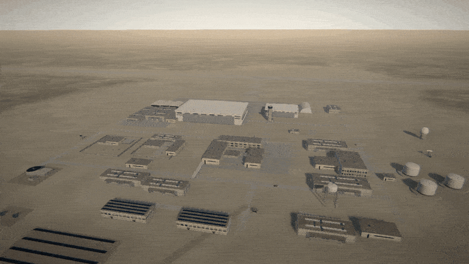](https://lop-nur-twin.vercel.app/)

<sub>The Lop Nur twin: one orbit of the reconstructed compound while night falls and lifts (press <code>N</code> in the twin).</sub>

**[Watch the Bethesda fly](https://lop-nur-twin.vercel.app/live)** ·
**[Explore the twin](https://lop-nur-twin.vercel.app/)** ·
**[Inspect the evidence](https://lop-nur-twin.vercel.app/analysis)** ·
**[Run locally](#run-locally)**

</div>

A three-millimeter digital fly moves through a simulated Bethesda. Its world
can keep advancing when nobody is watching, and its verified history can survive
a restart. Researchers can ask what its controller learns, perturb its senses,
and compare what happens against a declared baseline.

**R.A.I.N. Lab brings the world, the experiment, and the evidence into one open
research environment.** It connects the Lop Nur airfield reconstruction, a
walkable Bethesda and its research laboratory, numerical physics experiments,
and Noeterra's simulated civilizations. `lop-nur-twin` keeps the name of the
reconstruction where the project began.

The ambition is a small, open digital Bell Labs: build worlds in which questions
can be tested, preserve the attempts that fail, and make the reasoning and results
available for someone else to examine.

> **Models propose. Host code validates. People authorize. Simulations run.
> Results remain open to inspection.**

[Quick start](#run-locally) · [Explore](#start-exploring) ·
[Evidence](#every-claim-carries-its-evidence) · [Digital life](#the-digital-fly) ·
[Research method](#how-the-research-loop-works) · [Results](#recorded-results) ·
[Optional capabilities](#optional-capabilities) · [Validation](#validation) ·
[Documentation](#documentation)

## Run locally

Use **Node.js 22.18+** and **Bun 1.3+**. CI installs from `bun.lock`.

```sh
git clone https://github.com/topherchris420/lop-nur-twin.git
cd lop-nur-twin
bun install --frozen-lockfile
bun run dev
```

Open **[localhost:5173](http://localhost:5173)**. No environment file or model server is needed
for the base app. Running the app starts a local experience; it does not start
or replace either hosted fly service.

<details>
<summary>Use npm instead</summary>

After cloning and entering the repository:

```sh
npm ci
npm run dev
```

Individual scripts, including `npm run build`, work with Node. The aggregate
`check` script invokes Bun internally, so it still requires Bun.

</details>

**Run your first recorded experiment — no model required:**

```sh
npm run rain:scientific:demo -- --dir .rain-research/readme-demo
```

This fixture uses a **scripted designer and scripted operator**, runs a numerical
simulation, and retains its artifacts in `.rain-research/readme-demo`. Use a fresh
directory for each run. Fixture authorization covers this demonstration only.

For a production build and local preview:

```sh
bun run build
bun run preview
```

Open **[localhost:4173](http://localhost:4173)**. Add
[Noeterra, local models, or a persistent service](#optional-capabilities) when
needed; the base app needs none of them.

## Start exploring

The public reconstruction and scripted experiences need **no account or model API
key**. The 3D scenes require WebGL; `/analysis` and `/compare` work without it.

<table>
  <tr>
    <td width="33%" valign="top">
      <a href="https://lop-nur-twin.vercel.app/">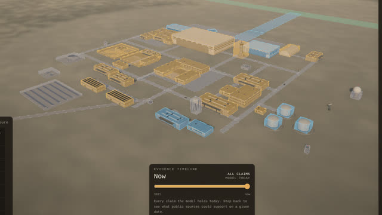</a>
      <br><b><a href="https://lop-nur-twin.vercel.app/">Lop Nur twin</a></b>
      <br><sub>Explore the airfield, open structure dossiers, measure modeled distances, and move through the evidence timeline.</sub>
    </td>
    <td width="33%" valign="top">
      <a href="https://lop-nur-twin.vercel.app/live">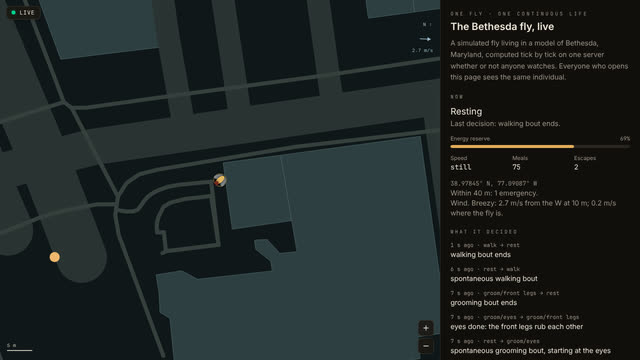</a>
      <br><b><a href="https://lop-nur-twin.vercel.app/live">Live Bethesda fly</a></b>
      <br><sub>Observe the shared server-side individual, its activity, recent decision reasons, and nearby city activity.</sub>
    </td>
    <td width="33%" valign="top">
      <a href="https://150-136-49-49.sslip.io/">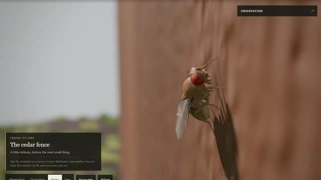</a>
      <br><b><a href="https://150-136-49-49.sslip.io/">Eva's clay garden</a></b>
      <br><sub>Watch a separate server-side fly through a stop-motion clay exhibit. <a href="docs/LIVE_GARDEN.md">About this garden</a>.</sub>
    </td>
  </tr>
  <tr>
    <td width="33%" valign="top">
      <a href="docs/BETHESDA_ANOMALY.md">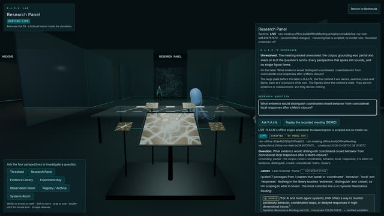</a>
      <br><b><a href="docs/BETHESDA_ANOMALY.md">Bethesda and R.A.I.N. Lab</a></b>
      <br><sub>Discover the hidden city and enter its research laboratory.</sub>
    </td>
    <td width="33%" valign="top">
      <a href="https://lop-nur-twin.vercel.app/noeterra">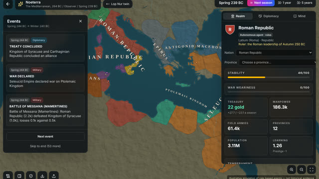</a>
      <br><b><a href="https://lop-nur-twin.vercel.app/noeterra">Noeterra</a></b>
      <br><sub>Explore rule-based civilizations in the Mediterranean (264 BC) or Tarim Basin (77 BC).</sub>
    </td>
    <td width="33%" valign="top">
      <a href="https://lop-nur-twin.vercel.app/play">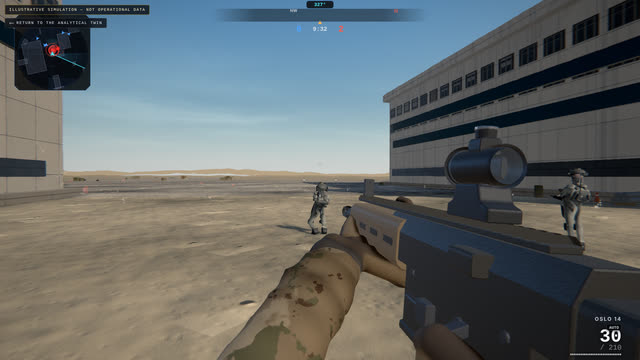</a>
      <br><b><a href="https://lop-nur-twin.vercel.app/play">Blacksite</a></b>
      <br><sub>Enter the illustrative first-person simulation with human, scripted, or optionally configured model-controlled seats.</sub>
    </td>
  </tr>
</table>

| Analytical page                                                    | What you can do                                                                         |
| ------------------------------------------------------------------ | --------------------------------------------------------------------------------------- |
| **[Evidence inspector](https://lop-nur-twin.vercel.app/analysis)** | Trace claims to sources, classifications, dates, and stated uncertainty.                |
| **[Revision comparison](https://lop-nur-twin.vercel.app/compare)** | Inspect changes in geometry, sourcing, and uncertainty between recorded model releases. |
| **[Evaluation](https://lop-nur-twin.vercel.app/evaluation)**       | Inspect recorded decisions, experiment outcomes, and comparisons.                       |

**Your first five minutes:**

1. Open the twin and select a structure to read its dossier.
2. Press `L` for the evidence lens; move the timeline to see what was knowable then.
3. Open the [evidence inspector](https://lop-nur-twin.vercel.app/analysis) and follow a claim to its sources.
4. Visit the [shared fly](https://lop-nur-twin.vercel.app/live) and inspect its recorded decisions.

Press `H` for help or `1` / `2` / `3` to change camera mode.
[Full controls](docs/CONTROLS.md).

<details>
<summary>Find Bethesda and the hidden laboratory — spoiler</summary>

In the twin, press **backtick** (usually below Escape) and submit
`38.9847,-77.0947` or `resolve bethesda`. You can also press `I` to open the
Site Index and search for those coordinates. Bethesda loads on demand; the
laboratory is inside a building, behind a door.

[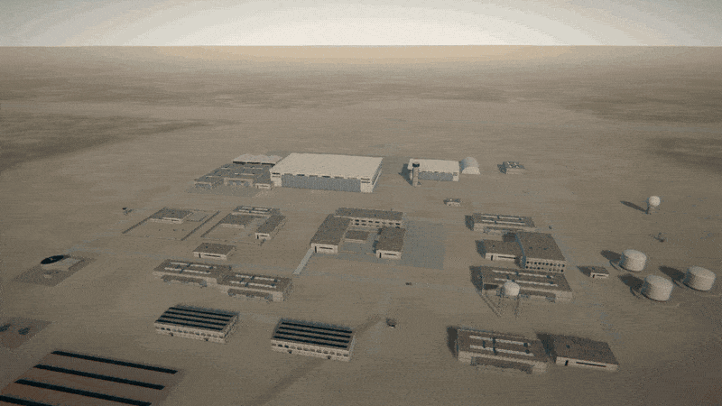](docs/BETHESDA_ANOMALY.md)

[City guide](docs/BETHESDA_ANOMALY.md) · [Lab guide](docs/RAIN_LAB_BETHESDA.md)

</details>

## Every claim carries its evidence

The Lop Nur twin is a public-source analytical reconstruction. Every building
and pavement carries a classification that tells you what supports it:

| Classification   | What it means                                      |
| ---------------- | -------------------------------------------------- |
| **Observed**     | The feature is visible in cited imagery.           |
| **Reported**     | A cited publication reports the feature.           |
| **Interpreted**  | The model assigns an identity or explanation.      |
| **Illustrative** | The feature supplies context or simulation detail. |

Press `L` to color the scene by evidence status. Move the timeline back and the
twin draws solid only what public sources had established by that date; the rest
becomes an outline. **An outline marks absence of evidence, never evidence of
absence.**

[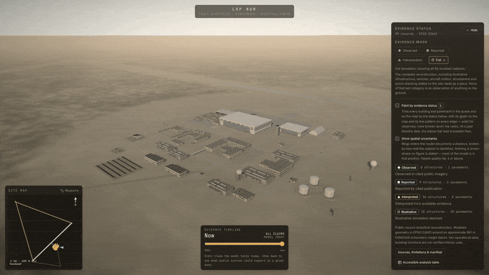](https://lop-nur-twin.vercel.app/?lens=1)

Select any structure for its dossier: what the evidence establishes, what the
model infers, what remains unknown, and three separate dates for when it existed
at the site, when the evidence became public, and when it entered this model.
The [evidence inspector](https://lop-nur-twin.vercel.app/analysis) presents the
same records without WebGL, and the
[revision comparison](https://lop-nur-twin.vercel.app/compare) shows how geometry,
sourcing, and uncertainty changed between recorded model releases.

[Site model](docs/SITE_MODEL.md) · [Provenance](docs/DATA_PROVENANCE.md) ·
[Temporal model](docs/TEMPORAL_MODEL.md) · [Uncertainty](docs/UNCERTAINTY_MODEL.md)

## The digital fly

[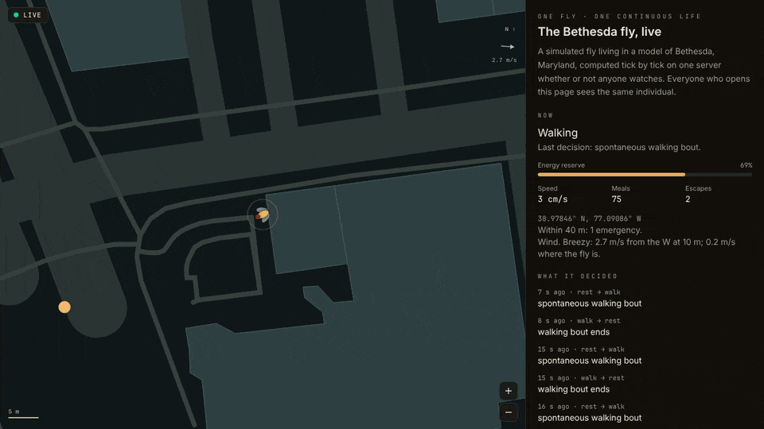](https://lop-nur-twin.vercel.app/live)

<sub>The shared fly on <a href="https://lop-nur-twin.vercel.app/live"><code>/live</code></a>, recorded on 28 October 2026 (UTC) and shown at twice real speed. Every change of behavior arrives with the reason its controller logged.</sub>

### A history that survives the window closing

The headless Bethesda service advances one city and one fly at **ten city ticks
per second** while it is running. Visitors to `/live` observe that shared state;
opening or closing a viewer does not create, reset, or end the individual.
The [operation record](docs/BETHESDA_CONTINUOUS_LIFE.md) documents the service on
one VM beginning October 26, 2026.

Three experiences have deliberately separate histories:

| Experience                                                                | Where its state lives                         | What you are observing                                       |
| ------------------------------------------------------------------------- | --------------------------------------------- | ------------------------------------------------------------ |
| **[Shared Bethesda fly · `/live`](https://lop-nur-twin.vercel.app/live)** | Headless city service with a durable store.   | One shared individual, resumed from verified checkpoints.    |
| **[Eva · clay garden](https://150-136-49-49.sslip.io/)**                  | Separate Python garden service on its own VM. | A different fly, presented through a read-only clay exhibit. |
| **Local Bethesda and research runs**                                      | Browser session or controlled experiment.     | Separate instances for exploration and comparison.           |

### What the fly can learn

The fly uses **FlyBody-derived anatomy** and a reduced-order behavioral
controller: it senses, walks, flies, feeds, grooms, avoids threats, and remembers
feeding places. **Project ECHO** adds a functional self-model that compares
expected movement with sensed movement, estimates whether a mismatch comes from
its body, surroundings, or sensing, and adjusts its behavior. It receives sensory
inputs, never the experimenter's hidden perturbation labels or true body state.

**Recorded milestone — October 28, 2026:** the shared Bethesda individual was
[continued as the ECHO organism](docs/ECHO_ORGANISM_CONTINUATION.md), preserving
its birth, checkpoint lineage, body, controller, memories, and ECHO v3 self-model.
The continuation added:

| Component                  | What it contributes                                                                                             |
| -------------------------- | --------------------------------------------------------------------------------------------------------------- |
| **Associative learning**   | A mushroom-body rate model learns from meals and fruitless returns to remembered places.                        |
| **Odor-guided walking**    | Sensory-history filters adjust upwind movement and local search while walking.                                  |
| **Recoverable physiology** | Energy, hydration, fatigue, sleep, and stress proxies, with a separately metered artificial maintenance supply. |
| **An archive**             | Records recovery, learning updates, and episodes released from bounded ECHO memory.                             |

The mushroom-body model implements 2,000 Kenyon-cell rate units, two output
units, two dopaminergic units, and plastic synapses. It models one learning
circuit, not a complete nervous system. The default and circuit-informed
controllers simulate no neurons or synapses; Virtual Fly Brain provides
anatomical reference material, not an integrated neural controller.

**Research boundary:** simulated behavior, continuity, and self-modeling do not
establish consciousness, subjective experience, biological equivalence, or
open-ended learning. The maintenance supply is an explicit artificial model
choice, not a biological claim or a guarantee of indefinite operation.

[Digital fly and sources](docs/DIGITAL_FLY.md) · [ECHO design](docs/PROJECT_ECHO.md) ·
[Continuation evidence](docs/ECHO_ORGANISM_CONTINUATION.md) ·
[Next milestones](docs/FLY_PRIORITIES.md)

<details>
<summary>Continuity, checkpoints, and operating limits</summary>

Continuity includes the body, controller, memories, city, and random-stream
positions. A single writer commits sealed checkpoints every **five simulated
minutes**, with restore verification. A restart resumes the last committed state
and records the outage as a pause; a crash can lose uncommitted ticks.
Incompatible simulator versions are refused. Explicit engine continuations need
their own verified migration and retained source releases.

**The roughly 41-hour figure is a recording limit, not a lifespan.** In the
measured run, the city's decision log reached its 60,000-entry cap at about that
age. The continued organism has a separate archive: if it fills, the runner
stops rather than dropping records. Sustained continuity depends on the service,
compatible software, storage, and recoverable backups.

The garden's viewer reads only `GET /api/state`; cameras and clay rendering change
presentation alone. Switching controllers in local Bethesda, or restoring only
an ECHO self-model, does not continue the shared individual.

The garden viewer source also offers **Save observation**: a portable JSON record
of the displayed state, identity, reported weather and timestamps. The **This moment**
panel makes the delayed or paused view explicit, while connection status remains
visible. This is an observation, not a life backup. See the
[viewer release notes](docs/LIVE_GARDEN.md#keeping-an-observation); the garden VM
is deployed separately from this repository.

[Service, backup, and recovery](docs/BETHESDA_CONTINUOUS_LIFE.md) ·
[Identity and history studies](docs/INDIVIDUAL_CONTINUITY.md) ·
[Clay garden and HTTPS operation](docs/LIVE_GARDEN.md)

</details>

### Computational Neural Research: the connectome backend

[`fly-neural/`](fly-neural/README.md) is a separate research backend, not
part of the deployed fly. It runs Shiu et al. 2024's leaky
integrate-and-fire model of the whole adult central brain on FlyWire's
public connectome, release v783. It never reads, writes or controls the
shared individual, and nothing in `src/` or `deploy/` uses it.

| Done and measured                                                                                                                                                                                    | Not done                                                                                                                                                                                   |
| ---------------------------------------------------------------------------------------------------------------------------------------------------------------------------------------------------- | ------------------------------------------------------------------------------------------------------------------------------------------------------------------------------------------ |
| Import and checks of all of v783: **139,255 neurons, 15,091,983 pairs, 54,492,922 synapses**, downloaded only on acceptance of FlyWire's terms, never committed                                      | No neural controller for the shared fly, and none is planned without separate authorization                                                                                                |
| The whole brain simulated, matching Brian 2 running the authors' own code (spike for spike on test networks; MN9 62.1 vs 62.5 Hz, per-neuron r = 0.9998 on the full brain)                           | No neuromodulation, gap junctions, morphology or ventral nerve cord: a two-sign spiking model, not the fly's nervous system                                                                |
| Shiu et al. 2024 reproduced on v783 with pre-registered criteria: **10 of 12 pass on dev and held-out seeds**; water input (S6) and our sign-shuffle control (C3) fail on both, reported as failures | No GPU or cloud compute: one CPU thread                                                                                                                                                    |
| ECHO Neural Shadow replays of three research flies (never the shared one) through the full brain: wind null, food partial (28%), looms negative (194 false escapes)                                  | No working learning on the connectome: a dopamine-gated rule depresses synapses for both odours alike (negative result); `neural-experimental` mode is tested only with a stand-in readout |

[Methods, results and limits](docs/ECHO_CONNECTOME.md) ·
[Generated results](docs/benchmarks/fly-neural/README.md)

### A Life Three Millimeters Long

<details>
<summary>Watch the 58-second illustrated film</summary>

[](https://lop-nur-twin.vercel.app/film/)

**[Watch with sound](https://lop-nur-twin.vercel.app/film/)** ·
[Download the MP4](https://raw.githubusercontent.com/topherchris420/lop-nur-twin/main/docs/media/fly-film/a-life-three-millimeters-long.mp4) ·
[Vertical edition](https://raw.githubusercontent.com/topherchris420/lop-nur-twin/main/docs/media/fly-film/a-life-three-millimeters-long-vertical.mp4)

An illustrated interpretation of the project. The garden inset uses a recorded
observation; the film is not a continuous recording of the Bethesda simulator.
[Credits and production notes](docs/media/fly-film/README.md).

</details>

## How the research loop works

<p align="center">
  <a href="https://rainlabteam.vercel.app/">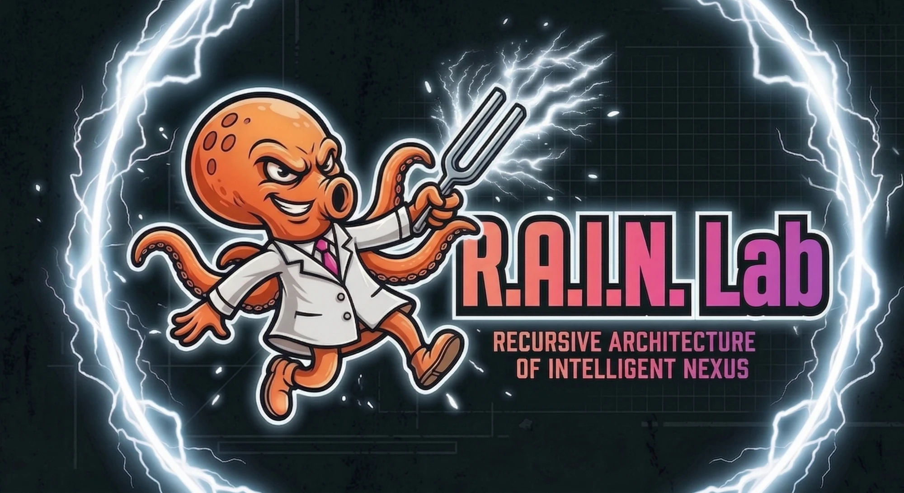</a>
</p>

James, Jasmine, Luca, and Elena are four computational research perspectives.
They work with a shared paper corpus, mathematical context, protocol definitions,
and retained results. Their proposals pass through the laboratory's validation,
authorization, execution, and replay machinery.

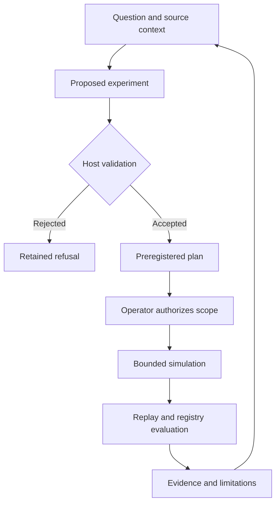

The host binds execution to a reviewed plan or bounded charter. Models cannot
authorize themselves or rewrite the evaluation criteria after seeing outcomes.
Source material, model suggestions, and simulation measurements keep separate
labels. Replay checks reproducibility; the registry evaluates the declared
criteria. An inconclusive result remains an inconclusive result.

| Experiment backend    | Questions it supports                                                                    |
| --------------------- | ---------------------------------------------------------------------------------------- |
| **Bethesda**          | How do specified interventions affect programmed city behavior?                          |
| **Numerical physics** | Does a driven, damped oscillator match its analytic reference?                           |
| **Noeterra**          | How do memory, diplomacy, and rule changes affect simulated civilizations?               |
| **Digital fly**       | How do sensing, adaptation, and self-model variants respond to controlled perturbations? |

<details>
<summary>Watch fifty simulated years in each Noeterra world</summary>

[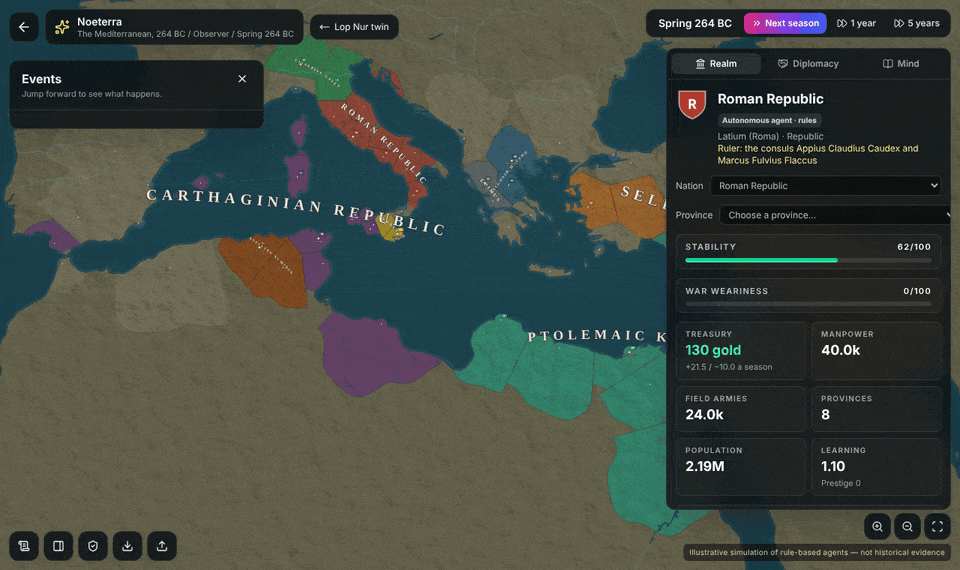](https://lop-nur-twin.vercel.app/noeterra?scenario=mediterranean-264bc&play=observe&seed=1)

<sub>Noeterra's Mediterranean scenario in observer mode (seed 1), one frame per five simulated years. Every power is a rule-based agent; the outcome is an illustrative simulation, not historical evidence.</sub>

[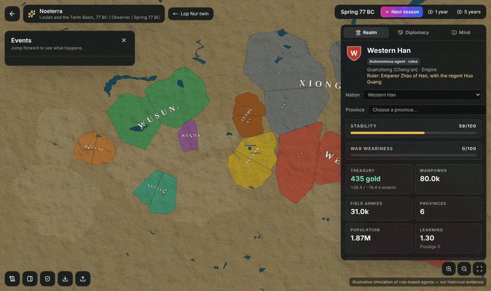](https://lop-nur-twin.vercel.app/noeterra?scenario=tarim-77bc&play=observe&seed=1)

<sub>Noeterra's Tarim Basin scenario, Loulan and its neighbors from Spring 77 BC, in observer mode (seed 1), one frame per five simulated years. The cyan ring beside Loulan's capital marks the twin's airfield today, about 60 km away. Every power is a rule-based agent; the outcome is an illustrative simulation, not historical evidence.</sub>

</details>

The learning engine evaluates proposed procedural guidance on frozen held-out
tasks; activation still requires operator approval. Project Inception adds
experimental researcher profiles and reviewed follow-up investigations. These
are tools for studying research workflows; broad autonomous discovery and
recursive scientific improvement remain unestablished.

[Scientific workflow](docs/RAIN_SCIENTIFIC_INTELLIGENCE.md) ·
[Research learning](docs/RAIN_RESEARCH_LEARNING.md) ·
[Project Inception](docs/RAIN_INCEPTION.md) ·
[Meet R.A.I.N.](https://rainlabteam.vercel.app/)

<details>
<summary>Watch the 15-second R.A.I.N. Lab introduction</summary>


[Watch with sound (MP4)](https://raw.githubusercontent.com/topherchris420/lop-nur-twin/main/docs/media/rain-lab-ad.mp4).
Music: “Supernova” by Scott Buckley,
[CC BY 4.0](https://creativecommons.org/licenses/by/4.0/),
[scottbuckley.com.au](https://www.scottbuckley.com.au).

</details>

## Recorded results

A result belongs to a **specific simulator, design, and producing revision**.
The linked records retain methods, authorship, baselines, criteria, and limitations.
Registered demonstrations, exploratory seeded studies, and model-assisted runs
are distinguished below; none establishes a claim about a living organism or
historical society.

| Study and design                                                                                                                                      | Recorded finding                                                                                                                          | Interpretation                                                                                         |
| ----------------------------------------------------------------------------------------------------------------------------------------------------- | ----------------------------------------------------------------------------------------------------------------------------------------- | ------------------------------------------------------------------------------------------------------ |
| **[ECHO-01](docs/PROJECT_ECHO.md#results-in-brief)** · registered demonstration                                                                       | Path error after a hidden impairment: **0.073 with the self-model vs. 0.370 without**, across nine paired seeds.                          | **Supported** under frozen criteria; compensation within a reduced-order simulator.                    |
| **[ECHO-02](docs/PROJECT_ECHO.md#results-in-brief)** · registered demonstration                                                                       | Hidden-change attribution accuracy: **0.919 vs. 0.537** for a simpler rule.                                                               | **Supported**; held-out calibration remains imperfect.                                                 |
| **[ECHO-03–05](docs/PROJECT_ECHO.md#results-in-brief)** · registered demonstrations                                                                   | Memory, workspace, and second-look effects did not clear their prespecified thresholds.                                                   | **Inconclusive**; the archive preserves the under-powered designs and negative findings.               |
| **[Individual history](docs/benchmarks/fly-individuality/README.md)** · seeded study                                                                  | Restored and replayed controller states matched the originals byte for byte in **24/24** individuals.                                     | Recorded events reproduced learned place preferences in this simulator.                                |
| **[Changing food locations](docs/INDIVIDUAL_CONTINUITY.md#study-b-open-ended-adaptation)** · seeded study                                             | Memory-bearing flies ate **1.2 fewer meals per life** than matched memory-lesioned runs.                                                  | Memory hindered adaptation here; accumulating improvement was not demonstrated.                        |
| **[Mushroom-body learning](docs/benchmarks/fly-mushroom-body/README.md)** · study designed after a pilot                                              | Prior feeding changed return flights to an emptied site; the moving-food condition showed no change.                                      | The learning circuit affected behavior where the fly encountered the omitted reward.                   |
| **[Shiu et al. 2024 on FlyWire v783](docs/ECHO_CONNECTOME.md#reproducing-shiu-et-al-2024-on-v783)** · registered reproduction, dev and held-out seeds | **10 of 12** criteria pass on both seed sets; water drives MN9 to 30.3 Hz (the paper: 40), and permuting signs causes runaway excitation. | Most of the published predictions hold in this model of the connectome; the two failures are recorded. |
| **[Connectome plasticity](docs/ECHO_CONNECTOME.md#plasticity-a-dopamine-gated-rule-on-the-connectome-against-controls)** · registered comparison      | A dopamine-gated rule depresses KC-to-MBON synapses for the paired and unpaired odour alike; learning index near 0.                       | **Negative**: no odour-specific learning under this rule and model.                                    |
| **[Live Gemma experiment](docs/rea-research/evaluations/gemma-live/README.md)** · operator-approved model-assisted run                                | A two-arm oscillator experiment replayed and entered the registry as **inconclusive**.                                                    | Reproducibility did not overcome failed analytic accuracy guards.                                      |
| **[Noeterra memory](docs/benchmarks/noeterra-civilization/CV-11b7adb76f31fa3d4307bd0b/report.md)** · scripted design and authorization                | Withholding memory of past treatment reduced mean wars declared from **6.50 to 2.83**, over 40 seasons and six matched seeds.             | A result about rule-based simulator agents, not historical societies.                                  |

Start with a report, inspect its producing revision and comparison, then use the
[verification commands](#validation) appropriate to that archive. Replay checks
reproducibility under compatible engines and runtimes; it does not turn a
simulator outcome into a real-world measurement.

More records: [compiler comparison and research attempts](docs/rea-research/evaluations/README.md) ·
[Bethesda discovery](docs/benchmarks/rain-discovery-validation/README.md) ·
[Fly experiment archive](docs/benchmarks/fly-behavior/README.md) ·
[24-seed ECHO characterization](docs/benchmarks/fly-echo/README.md).

## Optional capabilities

| Capability                       | Additional requirement                                                 |
| -------------------------------- | ---------------------------------------------------------------------- |
| Noeterra in the browser          | Rust stable and a local WebAssembly build.                             |
| Model-assisted research          | A configured local model server and reviewed experiment authorization. |
| Model-controlled Blacksite seats | The selected provider's server-side configuration.                     |
| A persistent Bethesda individual | A separately operated headless service, durable storage, and backups.  |

Optional settings live in [`.env.example`](.env.example). For local development,
copy it to the git-ignored `.env.local` and set only what you need. Provider keys
stay server-side; never prefix them with `VITE_`. Optional
`/play?brain=jev|glide|llm` seats require their own provider configuration and
show `UNAVAILABLE` when it is missing.

To host a persistent Bethesda individual, follow the separate
[service, backup, and recovery guide](docs/BETHESDA_CONTINUOUS_LIFE.md).

<details>
<summary>Build Noeterra's optional civilization engine</summary>

Install [Rust stable](https://rustup.rs), then build the engine **before starting
or restarting the dev server**:

```sh
rustup target add wasm32-unknown-unknown
bun run noeterra:wasm
bun run dev
```

Open **[localhost:5173/noeterra](http://localhost:5173/noeterra)**. Without the build, the rest of the
site works and Noeterra reports its engine as unavailable. Its browser core
runs in Rust/WebAssembly; public seats use human, rule-based, or random control.

The separate local workbench supports optional model rulers:
`bun run noeterra:serve`, then **[127.0.0.1:7878](http://127.0.0.1:7878)**.
[Noeterra guide](docs/NOETERRA.md).

</details>

<details>
<summary>Connect LM Studio for model-assisted research</summary>

Start LM Studio's server at `http://127.0.0.1:1234` and load a model. Replace
`your-loaded-model-id` with its exact identifier from `/v1/models`. Stop the
existing dev server before restarting it with these settings.

**macOS / Linux**

```sh
export RAIN_AUTONOMY_ENABLED=true
export RAIN_MODEL_PROVIDER=lmstudio
export RAIN_MODEL=your-loaded-model-id
npm run dev
```

**Windows PowerShell**

```powershell
$env:RAIN_AUTONOMY_ENABLED = "true"
$env:RAIN_MODEL_PROVIDER = "lmstudio"
$env:RAIN_MODEL = "your-loaded-model-id"
npm run dev
```

Enter Bethesda and open the discovery workbench. Enabling the service does not
authorize an experiment: review its plan or bounded charter before execution.
The hosted site's server-side runtime cannot reach a model on your computer.

[Model-generated meetings](docs/RAIN_LAB_BETHESDA.md#model-meetings-qwen-or-another-local-model)
have separate settings. The [autonomous research CLI](docs/RAIN_LAB_BETHESDA.md#autonomous-research)
also supports Ollama. Failed calls remain in the journal; there is no silent
switch to a remote model.

</details>

## Validation

For this repository, verification is part of the research method: source claims,
experiment records, and presentation are checked at different boundaries.

`bun run build` is the integration gate: it validates data and Bethesda/lab
artifacts, generates and checks the release manifest, bundles the app, runs
strict TypeScript checks, and scans `dist/` for credentials.

```sh
bun run check  # formatting, lint, unit tests, evidence tests, and build
```

| Command                                               | Purpose                                                                        |
| ----------------------------------------------------- | ------------------------------------------------------------------------------ |
| `bun run rain:conformance`                            | Exercise lab drafts and submissions through the research registry.             |
| `bun run rain:scientific:verify`                      | Recheck archived journals, numerical replay, graphs, and learning evaluations. |
| `bun run rain:fly:verify`                             | Check archived fly records and replay compatible runs.                         |
| `bun run bethesda:life:smoke`                         | Exercise a short headless city-and-fly run.                                    |
| `bun run rain:civilization:verify`                    | Recheck the civilization archive; build Noeterra first.                        |
| `bun run noeterra:test`                               | Run the Rust engine's tests.                                                   |
| `bun run a11y` / `bun run routes`                     | Check accessibility, security headers, deep links, and URL handling.           |
| `bun run verify:bethesda` / `bun run verify:rain-lab` | Exercise the hidden city and lab end to end.                                   |

Browser checks have server prerequisites; see [CONTRIBUTING.md](CONTRIBUTING.md).
Noeterra backend tests skip when its engine is absent. Fly archive verification
reports older-engine records separately and exits with code `3` if incompatible
records remain unchecked. [Validation guide](docs/VALIDATION.md) ·
[Evaluation philosophy](docs/EVALUATION_PHILOSOPHY.md).

## Documentation

The browser uses **React 19, TypeScript, Three.js / React Three Fiber, and
TanStack Router**, built with **Vite**. The research runtime and decision
endpoints run server-side. Noeterra's core is **Rust / WebAssembly**; persistent
Bethesda life runs headlessly, while Eva's garden uses its separate Python
service. [System architecture](docs/SYSTEM_ARCHITECTURE.md).

| I want to…                           | Start here                                                                                                                                                                                                                     |
| ------------------------------------ | ------------------------------------------------------------------------------------------------------------------------------------------------------------------------------------------------------------------------------ |
| Understand the fly                   | [Digital fly](docs/DIGITAL_FLY.md), [ECHO](docs/PROJECT_ECHO.md), [organism continuation](docs/ECHO_ORGANISM_CONTINUATION.md), [development priorities](docs/FLY_PRIORITIES.md), [connectome backend](docs/ECHO_CONNECTOME.md) |
| Operate or observe a persistent life | [Continuous Bethesda](docs/BETHESDA_CONTINUOUS_LIFE.md), [clay garden](docs/LIVE_GARDEN.md)                                                                                                                                    |
| Assess the reconstruction            | [Site model](docs/SITE_MODEL.md), [provenance](docs/DATA_PROVENANCE.md), [uncertainty](docs/UNCERTAINTY_MODEL.md), [white paper](docs/WHITE_PAPER.md)                                                                          |
| Inspect time, space, or revisions    | [Temporal model](docs/TEMPORAL_MODEL.md), [spatial analysis](docs/SPATIAL_ANALYSIS.md), [model comparison](docs/MODEL_COMPARISON.md)                                                                                           |
| Navigate the worlds                  | [Controls](docs/CONTROLS.md), [accessibility](docs/ACCESSIBILITY.md), [Bethesda](docs/BETHESDA_ANOMALY.md), [Blacksite](docs/BLACKSITE.md), [model seats](docs/JEV_BLACKSITE.md), [Noeterra](docs/NOETERRA.md)                 |
| Run research                         | [Lab guide](docs/RAIN_LAB_BETHESDA.md), [scientific workflow](docs/RAIN_SCIENTIFIC_INTELLIGENCE.md), [authorization and recovery](docs/RAIN_EXPERIMENTAL_DISCOVERY.md)                                                         |
| Study research across runs           | [Learning](docs/RAIN_RESEARCH_LEARNING.md), [programs](docs/RAIN_RESEARCH_PROGRAM.md), [lineage](docs/RAIN_RESEARCH_LINEAGE.md), [Inception](docs/RAIN_INCEPTION.md)                                                           |
| Evaluate a deployment                | [Architecture](docs/SYSTEM_ARCHITECTURE.md), [deployment](docs/DEPLOYMENT.md), [validation](docs/VALIDATION.md), [threat model](docs/THREAT_MODEL.md), [government evaluation](docs/GOVERNMENT_EVALUATION.md)                  |

<details>
<summary>Repository map</summary>

| Path                             | Responsibility                                                              |
| -------------------------------- | --------------------------------------------------------------------------- |
| `src/lib/`                       | Site layout, sources, evidence, uncertainty, and temporal/spatial rules.    |
| `src/components/`, `src/routes/` | 3D presentation, controls, and application routes.                          |
| `src/bethesda/`                  | City, fly controllers, durable life, live observer view, and lab interface. |
| `src/garden/`                    | The separate live garden's read-only clay exhibit.                          |
| `src/rain/`                      | Research corpus, meetings, autonomy, experiment backends, and registry.     |
| `src/game/`                      | Blacksite, player controls, model seats, and evaluation.                    |
| `src/noeterra/`, `noeterra/`     | Civilization interface, Rust engine, scenarios, and workbench.              |
| `fly-physics/`                   | Separate MuJoCo locomotion evaluation; does not drive the browser fly.      |
| `fly-neural/`                    | Separate FlyWire connectome research backend; drives no fly.                |
| `server/`, `api/`                | Server-side research and decision endpoints.                                |
| `scripts/`, `tools/`             | Importers, validators, research commands, and browser checks.               |
| `model-history/`, `docs/`        | Release records, guides, source investigations, and experiments.            |
| `deploy/`, `Dockerfile`          | Self-hosting, persistent-life service, and garden deployment tools.         |

</details>

<details>
<summary>Implementation lineage and reference investigations</summary>

The research runtime was consolidated from `james_library`:
[migration record](docs/RAIN_MIGRATION.md). Public-product investigations are
recorded in the [capability matrix](docs/rea-research/capability-matrix.md),
[Mirrors](docs/rea-research/mirrors/observations.md),
[Poth Labs](docs/rea-research/poth-labs/observations.md), and
[Infera](docs/rea-research/infera/observations.md).

Noeterra's design also draws on studies of
[Open Historia](docs/research/OPEN_HISTORIA_ANALYSIS.md) and
[Pax Historia](docs/research/PAX_HISTORIA_ANALYSIS.md). These reports distinguish
observation, documented behavior, inference, and unknowns. No proprietary
implementation was copied, and no code from either Historia project is used.

</details>

## Contribute

Bring a sourced correction, a reproducible experiment, a clearer way to inspect
evidence, an accessibility improvement, or a documented failure case. Start with
[CONTRIBUTING.md](CONTRIBUTING.md) and [AGENTS.md](AGENTS.md), or
[open an issue](https://github.com/topherchris420/lop-nur-twin/issues).

Contributions should keep four promises:

- **Trace claims to sources.** Preserve the observed, reported, interpreted, and illustrative distinctions.
- **Keep authorship visible.** Label scripted work and model-generated work accurately.
- **Preserve the record.** Retain unsuccessful results; never hand-edit generated evidence archives.
- **Make the change verifiable.** Run the build and the checks that cover the affected behavior.

Never invent a source, date, measurement, or confidence value. Report
vulnerabilities through [SECURITY.md](SECURITY.md).

## License and attribution

Source code and documentation: **[Apache 2.0](LICENSE)**. See [NOTICE](NOTICE)
for sources and attribution. Bundled Bethesda geography has
[additional data terms](src/bethesda/data/LICENSE.md). Noeterra uses
[Natural Earth](https://www.naturalearthdata.com) coastlines, recorded in
[`geography.source.json`](noeterra/data/geography.source.json). FlyBody-derived
anatomy and Virtual Fly Brain reference material retain the licenses and limits
in the [digital-fly source register](docs/DIGITAL_FLY.md#sources-and-licences).
FlyWire connectome data used by `fly-neural/` is downloaded on acceptance of
its terms and never committed; the results derived from it carry FlyWire's
terms ([details](docs/benchmarks/fly-neural/LICENSE.md)).
