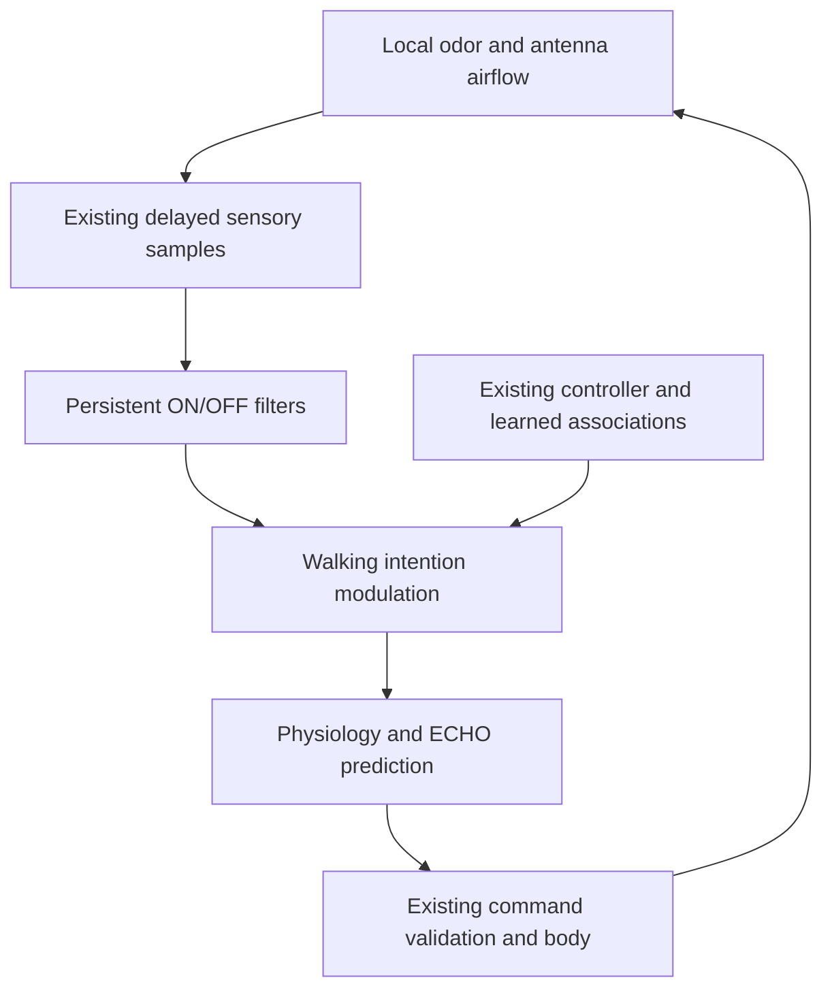

# ECHO: odor history changes walking

This opt-in research extension adds a measurable sensory–motor mechanism: odor arriving, persisting, and disappearing produces different walking commands. A hungry walking fly turns toward airflow while odor is present; odor loss increases local turning and slows walking. Recent sensory history changes the response to an otherwise identical sample. This is transient sensory adaptation, not a newly learned association.

The original individual, its checkpoint store, the garden renderer, and the production runner are unchanged. This code is a candidate for later reviewed integration, not an update already running in the live fly. The existing migration dry run adds maintenance only; it does not migrate this controller.

## Scientific basis and classification

Álvarez-Salvado et al., [eLife 7:e37815 (2018)](https://doi.org/10.7554/eLife.37815), equations 8–13 and Table 1 ACF rows, describe adaptive odor compression followed by ON and OFF filtering. ON is a low-pass response; OFF is the positive difference between slow and fast responses. Their walking experiments found odor-dependent upwind orientation and local search after odor loss.

We independently implement those filter equations. ON uses adaptation and filtering time constants of 9.8 and 0.72 seconds; OFF uses 10.08, 0.62 and 4.84 seconds. Table 1 is authoritative for the OFF adaptation value; nearby prose gives a different value. These are published behavioral model parameters, not neuronal membrane constants.

ECHO odor units differ from the paper's vinegar concentration. Half-saturation, motor gains, hunger gating, search-turn timing, assay geometry and stimuli are labeled **model** choices in `OLFACTION_PARAMS` and the study plan. The new filters are behavioral transfer functions, not reconstructed receptor neurons, antennal-lobe circuitry, a connectome, or spiking neurons. No authors' source code or dataset is imported.

## Integration



`olfactoryView` admits only scalar odor, relative airflow bearing, reserve fraction, motor mode, edge/contact observations and the walking schema. It cannot read source location, world coordinates, true heading, food identifiers, landmarks, experiment labels, or stimulus schedules. The wider pre-existing controller retains its existing inputs; this extension does not claim to repair every privileged field in that older controller.

The extension changes only an ongoing walking intention. It cannot initiate feeding, flight, landing, escape, or a walking bout. Edge/near-contact avoidance is left intact. Food reward and learned landmark values still come from the existing mushroom-body implementation. Protective physiology has priority. Fatigue and olfactory modulation precede ECHO's `act`/`expect`, so its forward prediction refers to the actual validated command, including any ECHO compensation.

The ON signal adds a bounded upwind yaw term using the antenna's relative bearing. The OFF signal raises the probability of brief turns using a separate seeded, checkpointed random stream. Speed increases with ON and decreases with OFF, within existing limits. No wind bearing means no new directional wind term; loss-triggered search can still occur. Satiated flies receive no new motor modulation. No stage teleports the body or supplies a hidden goal vector.

These are integration choices, not an exact replication of the paper's whole navigation model. The existing controller still contributes turns, phototaxis and navigation; flight retains its previous policy. Bethesda still uses its existing scalar odor field, not a turbulent plume simulation.

## Configuration and continuity

```ts
const genesis = {
  ...foragingGenesis(1201),
  olfactoryNavigation: true,
  flags: {
    immortality: true,
    associativeLearning: true,
    predictiveSelfModel: true,
  },
};
const research = FORAGING_RESEARCH_LIFE.build(genesis);
```

The flag defaults to `false`. Use `FORAGING_RESEARCH_LIFE` with the existing birth/checkpoint/LifeStore machinery for persistent research operation. A bare `build` call is not durable storage. The kind is `echo-olfactory-research`; its version includes `echo-olfactory-navigation/v1`. It cannot restore an original `bethesda` life or silently reinterpret an older research checkpoint as this controller. No automatic migration is provided.

The v1 immortal composition gains three reusable seams: an intention hook, a constructor-only adapter factory, and a generic wrapper for the existing archive transaction. Default graph structure, controller behavior, source-fly version and ECHO version remain unchanged. A regression fixture compares state and graph digests against the previously published implementation, and the disabled extension is compared against that composition during operation.

Filter history, RNG position, existing learning weights, physiological state and ECHO state are part of the full graph checkpoint. `inspect()` returns copies of the filter outputs labeled as inferred model states. Observation does not advance a simulation. Working filter storage is constant-size; existing event archival limits and backpressure remain in force. None of this guarantees infinite hardware uptime or unlimited archival disk space.

## Verification and interpretation

Run:

```sh
npm run echo:foraging:test
npm run echo:foraging:evaluate
npm run echo:foraging:evaluate -- --check
```

The evaluation requires a clean implementation commit and accepts no production store path. It records its source commit/fingerprint. An independent 1 ms RK4 transcription checks the production integrator; this verifies equations, not biology. The production integrator uses midpoint compression and exponential low-pass steps no larger than 10 ms.

Two paired 60-second assays use eight evaluation seeds separate from three development seeds: a spatially uniform odor pulse in wind, and a synthetic stationary downwind Gaussian odor footprint. They use the actual reduced-order body and normal delayed, noisy sensory path. Flight, spontaneous stops, grooming and phototaxis are disabled by assay configuration to isolate walking. The Gaussian is a test field, not a validated plume solver. Source proximity is scored by the experimenter; there is no food reward in these two assays.

Criteria are fixed in `FORAGING_STUDY` before evaluation: at least 0.2 mean improvement in upwind alignment and six of eight positive pairs; at least 20% improvement in mean closest-source distance and six of eight improved pairs. Negative and inconclusive outcomes remain in the report. This is a repository engineering study, not a registered R.A.I.N. experiment or independent validation.

A separate persistent research individual retains ordinary spontaneous behaviors and actual food-driven learning. It runs for one simulated hour, archives experiences through the existing store and compares future state after restores at 60, 600 and 3,600 seconds. All time is computed; outages are not filled with fabricated experience.

Results: [generated summary](research/echo-foraging/results.md) and [complete report](research/echo-foraging/report.json). The previous immortal-study report is retained in [archive-v1](research/echo-immortal/archive-v1/report.json); the current report is regenerated for the source-only refactor and compared for identical behavioral outcomes.

Still unimplemented or unproven: multi-odor identity, calibrated receptor dynamics, realistic plumes, validated MuJoCo locomotion, sleep-linked consolidation, independently demonstrated learning gains from this extension, and safe migration of the original individual to a new controller. No claim of consciousness or general “aliveness” follows from these tests.
