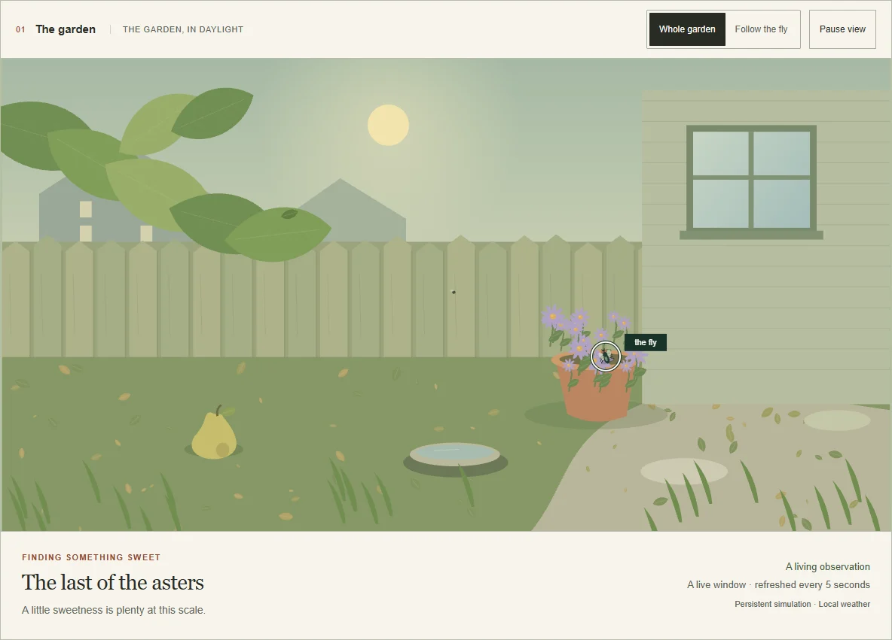
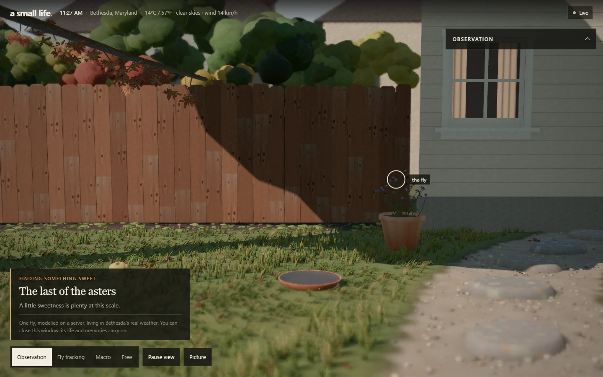
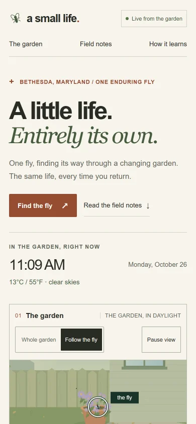
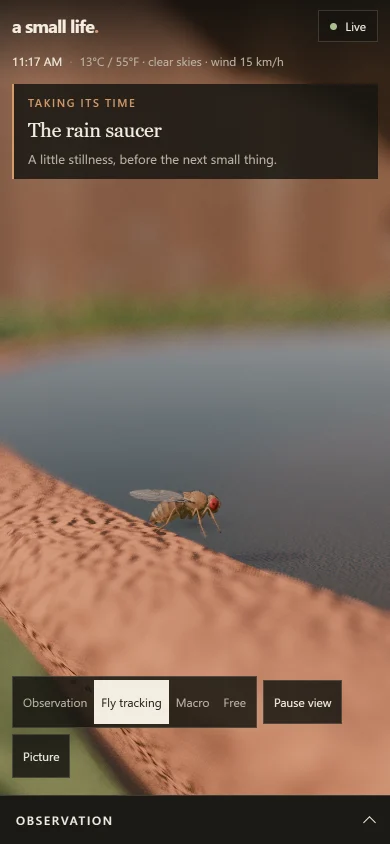
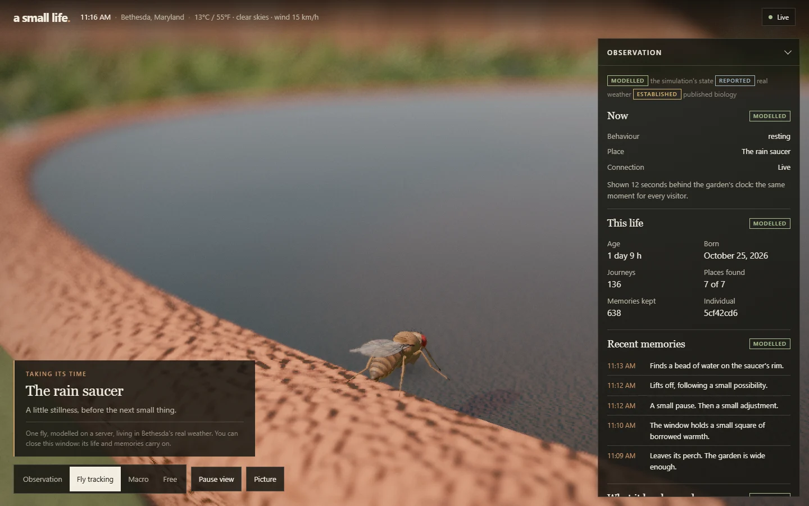
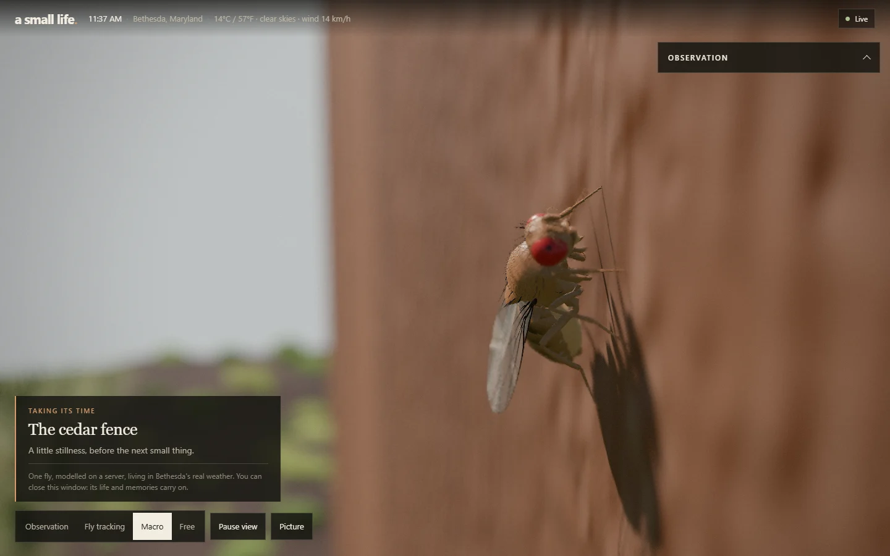
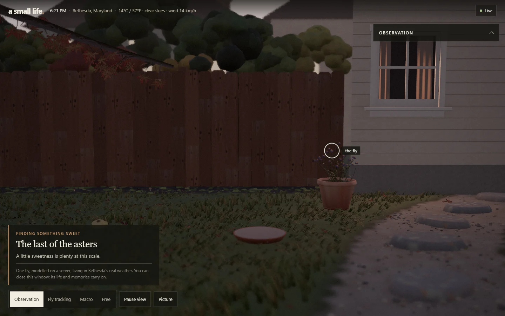
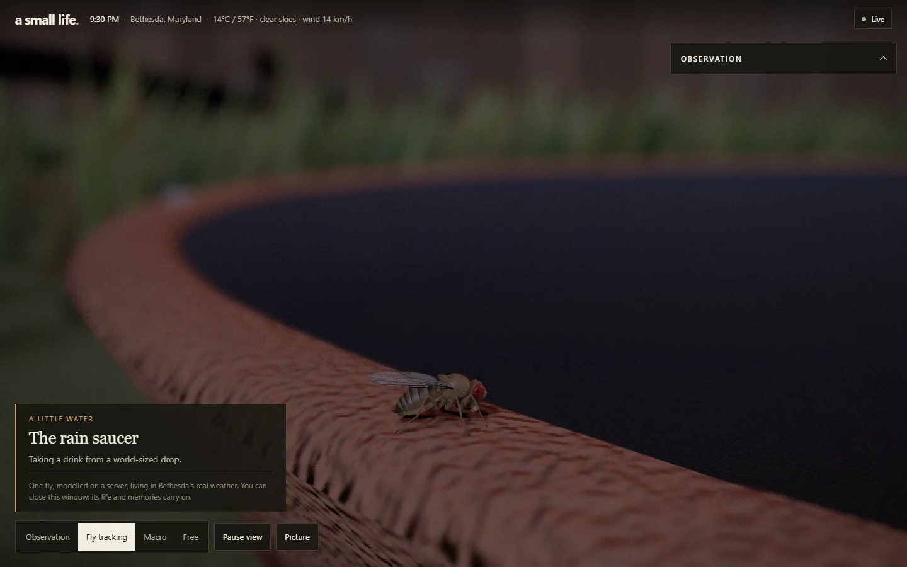
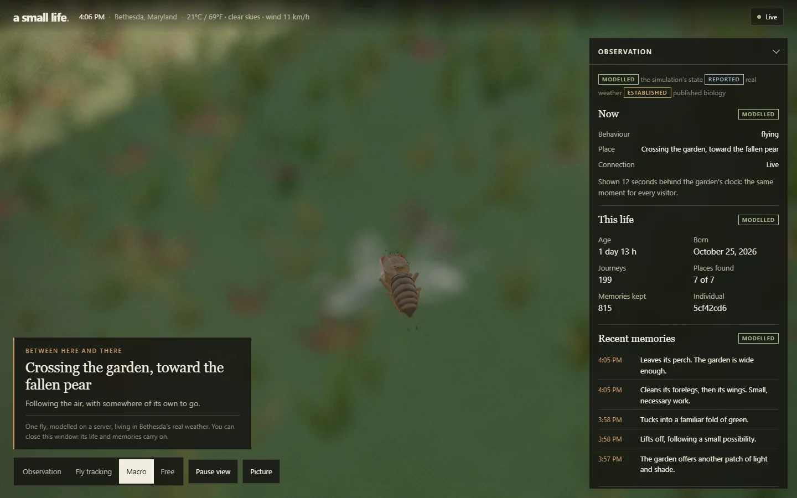

# The live fly garden, in clay

`src/garden/` is a new exhibit page for the live fly garden at
<http://150.136.49.49/>. It shows the same fly, drawn as a stop-motion clay film
in a 3D Bethesda back garden instead of the flat 2D painting. The page is a
viewer. The garden's Python service remains the only thing that decides what
the fly does; this page reads its state and draws it.

**Status: live since 2026-10-26.** At 20:27 UTC (4:27 PM in Bethesda) the live
garden began serving this page as release `garden-20261026-65635e04cc63`,
built from commit `5957f4d`, in place of its 2D page
(`ui-20261025-9abcdf40d541`). The fly was not restarted, reset or replaced.
The [deployment record](#deployment-record-2026-10-26) lists what was checked
before and after.

| The live page before (11:09 AM, 2026-10-26)                         | The clay garden, on a recorded live state from 11:27 AM the same day |
| ------------------------------------------------------------------- | -------------------------------------------------------------------- |
|     |                 |
|  |     |

| Fly tracking                                                            | Macro                                                     |
| ----------------------------------------------------------------------- | --------------------------------------------------------- |
|  |  |
| **Evening**                                                             | **Night**                                                 |
|                       |   |



The clay pictures above the last are local renders of this release, replaying
live states recorded read-only on 2026-10-26; the dusk and night pictures move
the clock to 6:21 PM and 9:30 PM to show the light. The last is the live site
itself a minute after the deploy, at 4:28 PM, photographed through a local
proxy because Chrome refuses the bare address: the fly feeding on the asters,
205 journeys and 832 memories into its life.

## What the page may and may not do

The code and its tests hold to these rules:

- **The server is authoritative.** The fly's place, activity, journeys,
  memories, learning and weather come from the garden's service (`server.py`
  and `learning.py` on the garden's VM). The page decides only how they look.
- **It only reads.** The page's one request to the garden is `GET /api/state`
  (`cache: no-store`, same origin, an 8 s timeout). It sends nothing else: no
  POST, no WebSocket, no beacon, no analytics. `src/garden/ui/page.test.ts`
  scans the sources for any other request, and `tools/garden.mjs check`
  records every request the running page makes.
- **It never creates a fly.** Opening, refreshing or closing the page starts,
  resets or ends nothing. No simulation runs in the browser that could stand
  in for the server's. When the garden cannot be reached, the page says so and
  holds the last state it received.
- **One moment for everyone.** Every visitor sees the garden 12 s behind the
  server's clock, interpolated between two states the server published. All
  visitors therefore see the same moment of the same life.
- **Presentation never feeds back.** Cameras, presets, stop motion, pause and
  reduced motion change only the picture. Nothing computed in the browser is
  sent anywhere.
- **Unknown stays unknown.** A field the server omits is shown as "—" or "not
  reported", never estimated. A state that fails validation is refused, not
  drawn.
- **Modelled, reported and established stay apart.** See
  [The observation panel](#the-observation-panel).

## How it works

```
server.py, every 5 s ──▶ nginx: GET /api/state ──▶ core/poll.ts: about one request per step
                                                        │
core/observation.ts   parse and validate; refuse what cannot be drawn honestly
core/timeline.ts      keep recent states; present the server's clock − 12 s
core/stopMotion.ts    the 12–15 fps frame that contains that instant
core/performance.ts   the fly's pose, from the two published states around the frame
core/stage.ts         where the 2D garden's places and routes land in 3D
core/sky.ts           the sun, moon and light at that instant, with the reported weather
                                                        │
scene/                clay, fly, garden, lights, camera, post-processing ──▶ canvas
ui/words.ts           the label and the observation panel                ──▶ page
```

Everything flows one way. Observations are frozen as they arrive. The scene
reads them through a function and keeps nothing that could feed back.

| Folder             | What it holds                                                                                                                                                                                                            |
| ------------------ | ------------------------------------------------------------------------------------------------------------------------------------------------------------------------------------------------------------------------ |
| `src/garden/core`  | Pure, tested logic with no DOM or WebGL: the observation contract, timeline, polling, staging, the director (`performance.ts`), sky, stop motion, quality presets, the light meter's arithmetic and the garden's layout. |
| `src/garden/scene` | Three.js, loaded on demand: the clay material, procedural textures, props, ground, maple, backdrop, the fly, the midge, rain, lights, cameras and post-processing.                                                       |
| `src/garden/ui`    | The page: `index.html`, `garden.css`, `main.ts` (polling, clocks, controls), `words.ts` (all its text) and `fallback2d.ts` (the previous 2D painting).                                                                   |

### Time

- The server steps its simulation every five seconds. It publishes each step
  when its clock loop wakes, a few seconds later. The page estimates the
  server's clock from `server_time` and each request's round trip, then shows
  the garden `BROADCAST_DELAY_S` (12 s) behind it, between the two published
  states that bracket that instant.
- The page never extrapolates. If the next state is late, the fly holds the
  last published one and the status reads "Waiting for the garden".
- `poll.ts` learns when steps are published and asks just after. That is
  about one request per five-second step, the previous page's rate, with a
  slightly early probe every eighth request. Failures back off from 2 s to
  30 s. A hidden tab asks every 30 s.
- A state with a new `life_id` or `born_at` is never blended with the old one.
  The timeline starts again from it, and the panel says the server now reports
  a different individual.

### Stop motion

- Only the picture is stepped. The fly's pose and flight path, the wind, the
  water and the rain are sampled at the start of the current frame of a
  12–15 fps clock (12 by default; Picture → Stop motion).
- The clock runs on presented time, so frame boundaries fall at the same
  instants for every visitor.
- Each frame gets a small seeded "boil": the clay marks shift, and the head,
  antennae and abdomen wobble like a puppet re-posed by hand. The grain
  changes with each frame.
- Polling, the presented clock and the simulation are untouched. Turning stop
  motion off shows the same performance continuously.
- The tracking and macro cameras move on frames, like a motion-control rig.
  The free camera follows the hand at the display's rate. When the camera is
  still, the renderer draws only when the frame changes, which saves power on
  phones.

### Staging

The simulation's world is an abstract 2D plane: seven places, and positions in
fractions of the garden. It knows nothing of heights or surfaces. `stage.ts`
and `performance.ts` are the renderer's explicit interpretation of it:

- **At a place**, the fly stands on that place's sculpted surface: a fence
  board, the windowsill, the shelter leaf's underside, an aster's disc, the
  pear, the saucer's rim or a stepping stone. Its offset from the place's 2D
  anchor is scaled onto that surface.
- **Travelling**, its progress along the server's 2D route sets how far along
  a flight path between perches it is drawn. The path's curve is seeded by the
  life and the journey number, so every visitor sees the same flight.
- **Each step's action** follows `learning.last.action` from the server: the
  fly is drawn flying, walking, resting or grooming accordingly.
- **The midge and the swaying leaf** follow the positions the server reports
  for `drifting_midge` and `swaying_leaf` in `learning.nearby`.
- **An unknown place** is drawn at the nearest known place to its 2D position
  and labelled with the server's own `place_name`.

### The fly

- **Shape and proportions** are FlyBody's: its meshes, decimated by the
  repository's importer to 39 965 and 5 161 triangles (from 272 550), on its
  skeleton. They are posed by the same leg and wing solver
  (`src/bethesda/fly/pose.ts`) as the repository's other fly. Nothing is
  restyled.
- **The surface** is the clay. The cuticle has thumbprints and tool marks at
  the fly's scale, with darker bands on the abdominal tergites.
- **The compound eyes** are fields of tiny domes with a deep pseudopupil.
  There are no pupils, eyelids or face.
- **The wings** are translucent and veined. A beating wing is drawn as the
  translucent sweep a camera records.

### Light, sky and lens

- **Sun and moon** are placed for Bethesda (38.9847° N, 77.0947° W, the point
  the server asks Open-Meteo about):
  - the sun by NOAA's formulation, to about 0.01°;
  - the moon from the main terms of its orbit, to a few tenths of a degree,
    with its phase.
- **Day, evening, night and moonlight** follow the server's clock. Reported
  cloud, rain and fog change the light; reported rain and snow are drawn as
  streaks.
- **Lights:**
  - a warm key light in two shadow cascades: the whole garden, and a tight one
    round the fly for contact shadows;
  - sky light as image-based lighting, whose lower half is the lawn's bounce
    (the global-illumination approximation);
  - a warm lamp in the house window from dusk;
  - haze.
- **The lens:** ambient occlusion and thin-lens depth of field. Exposure is
  set from the light (and metered in the close-up lenses). Then come a grade
  (cooler by night), AgX tone mapping, a light vignette and grain. There is
  no bloom.

### Cameras

| Camera       | What it does                                                                                                                                        |
| ------------ | --------------------------------------------------------------------------------------------------------------------------------------------------- |
| Observation  | A locked-off wide shot with every place in frame. The fly is smaller than a pixel here, so a ring marks it; clicking the ring switches to tracking. |
| Fly tracking | A three-quarter view from a few centimetres, on the viewer's side of whatever the fly stands on, trailing it in flight.                             |
| Macro        | A close-up lens a couple of centimetres away, with a paper-thin depth of field, drifting slowly round the fly.                                      |
| Free         | Orbit, pan and zoom by hand, kept out of the soil and the walls.                                                                                    |

Every camera reads the presented pose and writes nothing back.

### Presets, resolution, reduced motion and fallbacks

| Preset      | Resolution (DPR range) | Shadow map | Ambient occlusion | Depth of field | Grass blades | MSAA | Fly mesh    | Textures | Frame budget |
| ----------- | ---------------------- | ---------- | ----------------- | -------------- | ------------ | ---- | ----------- | -------- | ------------ |
| High        | 1–2                    | 2048       | on                | always         | 64 000       | 4×   | 39 965 tris | 1024 px  | 17 ms        |
| Balanced    | 0.85–1.5               | 1536       | on                | always         | 36 000       | 4×   | 39 965 tris | 1024 px  | 22 ms        |
| Performance | 0.7–1.25               | 1024       | off               | macro only     | 15 000       | 2×   | 5 161 tris  | 512 px   | 30 ms        |

- **The starting preset** depends on the device:
  - Performance when the browser asks to save data;
  - on phones, Balanced with at least 6 GB and 8 cores, otherwise
    Performance;
  - on computers, Balanced with 4 cores or 4 GB or fewer, otherwise High.
- **The visitor's choices** (preset, camera, stop motion and its rate, motion
  blur, panel) are kept in `localStorage` under `garden-view`.
- **Adaptive resolution** moves within the preset's DPR range. It steps down
  quickly when typical frames run 15 % over budget, and up slowly when they
  run under 60 % of it.
- **Grass, scattered leaves and pebbles, and the backdrop** are instanced
  meshes. The clay's hand marks fade out where they would be smaller than a
  pixel.
- **With `prefers-reduced-motion`**, there is no boil, grain flicker or
  motion blur. Camera moves and exposure changes happen at once instead of
  easing, and the page has no CSS transitions.
- **The 2D fallback.** Without WebGL 2, or if the 3D picture fails to start,
  the previous 2D painting (`fallback2d.ts`) takes over and reads the same
  state. It also takes over if the GPU context is lost and does not come back
  within 5 s. Without JavaScript, a note says the life continues on the
  server.
- **No downloaded images or fonts.** Every texture is drawn on a canvas at
  load, and the type is the system's.

## The observation panel

Every section carries one of three labels:

| Label           | What it covers                                                                                                                                                                                                                                                                                                                                                                                                                                                                                                                                                 |
| --------------- | -------------------------------------------------------------------------------------------------------------------------------------------------------------------------------------------------------------------------------------------------------------------------------------------------------------------------------------------------------------------------------------------------------------------------------------------------------------------------------------------------------------------------------------------------------------- |
| **Modelled**    | The simulation's state:<br>• behaviour, place and connection<br>• age, birth, journeys, places found, memories kept, and the individual (the first characters of `life_id`)<br>• the five newest memories, in the server's words<br>• what it has learned: attempts and success at flying and walking in the current conditions, comparisons saved, prediction error, larger surprises, the last trial, wing and leg integrity, wetness, and which nearby things it has found move on their own<br>These are a model's numbers, not measurements of an insect. |
| **Reported**    | Bethesda's weather, as the server fetched it from Open-Meteo. When the server falls back to its seasonal estimate, the page labels it "(seasonal estimate)".                                                                                                                                                                                                                                                                                                                                                                                                   |
| **Established** | Published measurements of real flies, each with its source, shown as context and never as this fly's data:<br>• always, the body's provenance (FlyBody; Vaxenburg et al. 2025, [doi:10.1038/s41586-025-09029-4](https://doi.org/10.1038/s41586-025-09029-4))<br>• while it grooms, how real dust-covered flies divide their grooming time (Zhang, Guo & Simpson 2020, [doi:10.1016/j.cub.2020.01.045](https://doi.org/10.1016/j.cub.2020.01.045))                                                                                                              |

The state's distance flown and `needs` (energy, fullness, water) are read but
not shown.

The fly's name, Eva, carries none of the three labels:

- **Who gave it.** The garden's keeper named this individual on 2026-10-26.
  The simulation has no names, and no sex.
- **Why Eva.** It fits the body the fly is drawn with: FlyBody's model was
  built from microscope images of one adult female (Vaxenburg et al. 2025).
  The panel's body note says so.
- **Where it lives.** The page holds the name, not the server: `NAMES` in
  `src/garden/ui/words.ts` gives it to life
  `5cf42cd6-fd0a-474d-882c-4cb70e0357e8` alone.
- **Where it shows.** The panel shows it above the individual's id, with the
  note "Named by the garden's keeper. The simulation itself has no names." The
  locator and the canvas's text alternative use it too.
- **Another life.** If the server ever reported another individual, the page
  would show that one by its id until it is named there.

## API compatibility

The page needs no change to the server, to nginx or to the site's Content
Security Policy:

- It loads scripts and styles from its own origin only; there are no inline
  scripts, styles or handlers (`page.test.ts` checks this).
- It connects only to its own origin. It loads no fonts, and no images except
  its favicon.
- It is a static directory beside the earlier releases. Only `index.html`
  changes to point at it.

It reads these fields of `GET /api/state` and checks each one
(`src/garden/core/observation.ts`):

| Field                                                                                                         | Use                                                             | If absent or malformed                                                                   |
| ------------------------------------------------------------------------------------------------------------- | --------------------------------------------------------------- | ---------------------------------------------------------------------------------------- |
| `life_id`, `born_at`                                                                                          | identity, and the name given to it; age                         | state refused                                                                            |
| `server_time`, `updated_at`, `ticks`                                                                          | the clocks and ordering                                         | state refused (`updated_at` must not precede `born_at`)                                  |
| `place`, `place_name`, `position`                                                                             | where the fly is drawn; the label                               | state refused; an unknown `place` is staged as described above                           |
| `activity`                                                                                                    | the pose; the label                                             | state refused; an unknown activity is drawn as a rest, its text shown as sent            |
| `travel` (`from`, `to`, `destination`, `started_at`)                                                          | the journey                                                     | state refused if present but malformed                                                   |
| `travel.ends_at`, `travel.paused_until`                                                                       | arrival estimate; a pause to recover                            | treated as absent                                                                        |
| `journeys`, `places_visited`                                                                                  | the panel                                                       | state refused                                                                            |
| `moments_count`                                                                                               | the panel                                                       | shown as "—"                                                                             |
| `moments[]` (`id`, `at`, `text`; the first 40)                                                                | recent memories                                                 | state refused; a moment whose id is not a number is skipped                              |
| `weather.temperature`, `.description`, `.is_day`                                                              | the masthead; the light                                         | state refused                                                                            |
| `weather.code`, `.wind`, `.rain`, `.source`                                                                   | cloud, wind, rain; the label                                    | treated as absent                                                                        |
| `learning` (`trials`, `capabilities`, `prediction_error`, `surprises`, `last`, `body`, `condition`, `nearby`) | the panel; which action each step shows; the midge and the leaf | the panel says the server did not report learning; steps are drawn from `activity` alone |
| `distance`, `needs`, `weather.sun`                                                                            | read, not shown (the sky computes the sun itself)               | ignored                                                                                  |

A newer server may add fields; the page ignores what it does not know.

## Continuity: what the page guarantees, and what it cannot

These properties hold by construction, and are checked by tests and by
`tools/garden.mjs check` (results below):

| Property                                            | How it is held                                                                                                                         |
| --------------------------------------------------- | -------------------------------------------------------------------------------------------------------------------------------------- |
| No visitor creates a fly                            | The page has no code that creates, resets or simulates a fly; its only request is a read.                                              |
| The same fly for everyone                           | Every visitor draws the state the server publishes, at the same presented instant.                                                     |
| Refreshing changes nothing                          | A reload shows the same individual at the shared moment.                                                                               |
| A lost connection is said, not hidden               | The status reads Reconnecting (Disconnected after two minutes) and the fly holds its last published state; polling resumes on its own. |
| A new individual is never passed off as the old one | A change of `life_id` or `born_at` is shown as a notice, with both identities. A name is shown only for the life it was given to.      |

What only the garden's server can guarantee, and its present limits:

- **The fly's continuity is the server's.** `server.py` loads its saved world
  when it starts, and creates a new life only when its database holds none.
  The repository's README calls the garden's availability and restart
  recovery **not guaranteed**. If the database were lost, the server would
  start a new individual, and this page would show it as a different one.
- **Backups are daily.** `bethesda-fly-backup.timer` keeps one snapshot per
  weekday (`/var/lib/bethesda-fly/backups/day-0` … `day-6`). A disk failure
  could lose up to a day.
- **Plain HTTP.** The garden has no TLS, and some browsers and networks refuse
  the bare address.
- **The page itself may be cached.** nginx sends `index.html` without
  `Cache-Control`, so after a publish a browser may keep the previous page for
  a while. The hashed assets never change under their names.

## Performance

Measured by `tools/garden.mjs check` on release `garden-20261026-65635e04cc63`
in headless Chrome 151, on this repository's development laptop (Snapdragon X,
Adreno X1-45 GPU via ANGLE/Direct3D 11). It ran three times: before the deploy
on recorded states (replay) and on the live garden's state (live), and after
it on the live site through a proxy (live site):

| Measure                                                   | Replay                                                 | Live                     | Live site                |
| --------------------------------------------------------- | ------------------------------------------------------ | ------------------------ | ------------------------ |
| Frame interval, 1440×900, DPR 1, fly tracking, High       | median 16.7 ms, 90th percentile 16.8 ms                | the same                 | the same                 |
| Two observers' presented instants                         | 0.006 s apart, same pose                               | 0.002 s apart, same pose | 0.007 s apart, same pose |
| The same individual for both observers and after a reload | yes                                                    | yes (`5cf42cd6`)         | yes (`5cf42cd6`)         |
| JS heap after cycling every camera and two presets        | +0.45 MB; geometries and textures did not grow         | +0.78 MB; the same       | +0.77 MB; the same       |
| Requests                                                  | 69, all same-origin GETs; the API only at `/api/state` | the same                 | 65; the same             |
| Console                                                   | no errors, warnings or CSP violations                  | the same                 | the same                 |

The frame interval is the display's 60 Hz: the page kept pace with it. GPU
time per frame was not measured separately. A first visit downloads 1.41 MB
(0.95 MB on Performance, which loads the smaller fly). If nginx served the
shipped `.gz` twins, that would be 0.44 MB (0.28 MB).

Not measured: real phones (the check's phone is a 390×844 emulation on the
laptop's GPU), Safari, Firefox, and low-end GPUs.

## Verifying

```sh
bunx vitest run src/garden                              # the garden's unit tests
python -m unittest deploy/garden/test_publish.py        # the server-side publisher, on a fake garden
bun run garden:build                                    # → dist-garden/<release>/
bun run garden:check                                    # serve the newest release locally and check it
node tools/garden.mjs check --source live               # the same, reading the live /api/state
node tools/garden.mjs serve --port 4173                 # look at it: http://127.0.0.1:4173/
```

`tools/garden.mjs` serves a release under the live server's own CSP. Its
`/api/state` is answered in one of three ways:

- `--source replay` (the default) replays real recorded states on a virtual
  clock, and nothing leaves the machine;
- `--source live` makes a read-only GET to the live garden, at most once a
  second, shared by every local observer;
- `--source proxy --origin <url>` passes the whole site through unchanged,
  headers included, so the check runs on what the server actually serves.

In every mode, the garden's outage is simulated locally; the server is only
read. `check` photographs every camera at desktop and phone sizes. It then
checks the console and CSP, requests, two observers, a reload, an outage and
recovery, memory across camera and preset changes, and the 2D fallback. It
writes `report.json` and the photographs to `garden-check/` (ignored by git).
`record` saves live states, read-only, for replay.

## Deploying

Each step needs the owner's go-ahead. The first deploy followed these steps on
2026-10-26 ([record](#deployment-record-2026-10-26)). The tooling reads the
server and its credentials from the environment, never from the repository:

```sh
export GARDEN_SSH=ubuntu@150.136.49.49
export GARDEN_SSH_KEY=/path/to/the/key
export GARDEN_KNOWN_HOSTS=/path/to/a/known_hosts/pinning/the/server
export GARDEN_BACKUP_DIR=/path/outside/the/repository
```

1. **Inspect, read only:** `node deploy/garden/deploy.mjs inspect`. It
   prints:
   - the live `index.html`'s SHA-256, the release it uses, and the release
     directories;
   - the service's state, PID and restart count;
   - the backup unit's last result and its snapshots;
   - the life's `life_id`, `born_at`, ticks and memories.
2. **Back up the life:** `node deploy/garden/deploy.mjs backup`.
   1. It copies every existing snapshot to `$GARDEN_BACKUP_DIR` and checks
      their hashes.
   2. It runs the garden's own `bethesda-fly-backup.service`: SQLite's backup
      API, then an integrity check. That writes today's weekday slot.
   3. It copies the new snapshot too, then opens a copy of it and checks its
      integrity, its `life_id`, `born_at` and memories against the live state.
3. **Build from the commit being deployed,** in a clean checkout:
   `bun install --frozen-lockfile && bun run garden:build`. Then
   `bun run garden:check` and `node tools/garden.mjs check --source live` on
   that release.
4. **Publish**, giving the index SHA-256 from step 1:

   ```sh
   node deploy/garden/deploy.mjs publish dist-garden/<release> --expect-index <sha256>
   ```

   On the server, `publish.py`:
   1. refuses unless the garden's backup unit succeeded and its newest
      snapshot is under 30 minutes old;
   2. checks every file against the release's manifest;
   3. refuses unless the live index is still the one inspected;
   4. saves that index under `/var/backups/bethesda-fly-ui/<release>/`;
   5. installs the release beside the earlier ones and swaps `index.html`
      last.

   It then checks that nginx serves the release's exact bytes, and that the
   same life, by `life_id` and `born_at`, runs in the same process with no
   fewer memories. If any check fails, it puts the previous index back.

   It restarts no service and never opens the life's database. It writes its
   result to `dist-garden/<release>.deployment.json`.

5. **Verify from outside:** `node deploy/garden/deploy.mjs verify dist-garden/<release>`.
   This compares the public bytes of `/` and every file in the manifest with
   the release, reads the CSP, and reads `/api/state` twice, 6 s apart.
6. **Check what the server actually serves:**
   `node tools/garden.mjs check --source proxy --origin http://150.136.49.49`.
   Then look at its photographs: they are the live page as a browser draws it.
7. **Roll back, if needed:** `node deploy/garden/deploy.mjs rollback <release>`
   puts back the page that `<release>` replaced, with the same checks.

Two optional server changes would help. Neither is made by these scripts, and
each needs the owner's approval:

- `Cache-Control: no-cache` on `/index.html`, so returning visitors get a new
  release at once. In nginx, an `add_header` inside a `location` drops the
  server-level ones, so that location must repeat the CSP and the other
  security headers.
- `gzip_static on` for the release directories, to serve the `.gz` twins
  (0.44 MB instead of 1.41 MB on a first visit).

### Deployment record: 2026-10-26

| Step        | Result                                                                                                                                                                                                                            |
| ----------- | --------------------------------------------------------------------------------------------------------------------------------------------------------------------------------------------------------------------------------- |
| Inspect     | Live index `0a65c8f6…` (`ui-20261025-9abcdf40d541`). Service active, PID 8320, no restarts. Life `5cf42cd6`, 830 memories.                                                                                                        |
| Backup      | Sunday's `day-6.sqlite3` copied off the server first. Then `bethesda-fly-backup.service` succeeded: `day-0.sqlite3` (69 632 bytes, SHA-256 `7f2d0c04…`) passed the integrity check and holds the same life with all 830 memories. |
| Build       | From `5957f4d`: `garden-20261026-65635e04cc63`, byte for byte the release the replay and live checks ran on.                                                                                                                      |
| Publish     | Index `0a65c8f6…` → `9615246d…`, the old one saved in `/var/backups/bethesda-fly-ui/garden-20261026-65635e04cc63/`. The same life in the same process (PID 8320, not restarted), 831 memories before and after.                   |
| Verify      | 9 of 9 files served byte for byte; the CSP unchanged; the life the same, and advancing.                                                                                                                                           |
| Proxy check | Passed (the "Live site" column under [Performance](#performance)).                                                                                                                                                                |

To undo it: `node deploy/garden/deploy.mjs rollback garden-20261026-65635e04cc63`.

## Asset provenance

| Asset                                       | Source                                                                                                                                                                                                                                                                                                                                                              | Licence                                                                 |
| ------------------------------------------- | ------------------------------------------------------------------------------------------------------------------------------------------------------------------------------------------------------------------------------------------------------------------------------------------------------------------------------------------------------------------- | ----------------------------------------------------------------------- |
| The fly's meshes and skeleton               | [FlyBody](https://github.com/TuragaLab/flybody) at commit `d015e9bf`, imported by the repository (`src/bethesda/fly/data/flybody.source.json` records every modification). Cite Vaxenburg et al., Nature 643, 1312–1320 (2025), [doi:10.1038/s41586-025-09029-4](https://doi.org/10.1038/s41586-025-09029-4). FlyBody's GPL-3.0 figshare datasets are not imported. | Apache-2.0; the licence ships with the release as `flybody-LICENSE.txt` |
| Grooming shares in the panel                | Zhang, Guo & Simpson 2020, summary statistics only (`src/bethesda/fly/data/grooming-reference.json`)                                                                                                                                                                                                                                                                | CC BY 4.0                                                               |
| The garden, its props, textures, sky, midge | Procedural code in `src/garden/scene/`, seeded so the garden is the same on every visit. No image, model, font or sound files.                                                                                                                                                                                                                                      | this repository's                                                       |
| The 2D fallback                             | The live garden's previous page (`app.js`), carried over with types                                                                                                                                                                                                                                                                                                 | this repository's                                                       |
| Weather                                     | Open-Meteo, fetched by the garden's server; the page shows what the server reports                                                                                                                                                                                                                                                                                  | Open-Meteo's terms                                                      |
| Test fixtures                               | Live `/api/state` responses recorded read-only on 2026-10-26 (`src/garden/core/fixtures/README.md`)                                                                                                                                                                                                                                                                 | —                                                                       |

## Files outside `src/garden`

- `scripts/garden-build.ts` (`bun run garden:build`): builds a release into
  `dist-garden/` (ignored by git), with a manifest of SHA-256 hashes and the
  `.gz` twins.
- `tools/garden.mjs` (`bun run garden:check`): the local server and browser
  check.
- `deploy/garden/`: `deploy.mjs` (`bun run garden:deploy`), the server-side
  `publish.py`, and its tests.
- `docs/media/live-garden/`: the images on this page.
