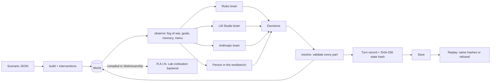

# Noeterra — autonomous civilizations for the R.A.I.N. Lab

Noeterra is a deterministic, replayable simulation of rival civilizations in which
every civilization is ruled by an autonomous agent with its own memory. It has
two front doors:

- **The workbench** (`npm run noeterra:serve`, <http://127.0.0.1:7878>): a map,
  the powers, their diplomacy, a chronicle, each agent's goals, beliefs and
  memories, a seat a person can play, and paired experiments.
- **The R.A.I.N. Lab civilization backend**: the same engine, compiled to an
  import-free WebAssembly module, runs pre-registered, operator-authorized
  experiments that the lab replays independently and admits to its registry
  (`npm run rain:civilization`).

The rule it keeps is the lab's: **agents propose; the resolver decides.** A
brain — rule-based, a local model in LM Studio, or Claude through the Anthropic
API — sees only what its civilization could know and chooses from a menu of
legal actions. Deterministic Rust code re-validates every choice, applies what
is legal, records what is not, and resolves the consequences. Every turn ends in
a SHA-256 state hash that a replay must reproduce.

**Every number Noeterra produces is a simulated observation of an illustrative
model.** Its economy, warfare and diplomacy are invented rules; the built-in
scenario's populations, armies and treasuries are game values. Nothing here is
evidence about the historical Mediterranean or any real society, and the lab
records it as `evidence_class: "simulated"`.

## Where it lives in lop-nur-twin

Noeterra is a page of the site, **`/noeterra`**, and it is reached from the
places it belongs to:

| From             | How                                                                                                                                                                                                     |
| :--------------- | :------------------------------------------------------------------------------------------------------------------------------------------------------------------------------------------------------ |
| The twin (`/`)   | The Research panel's **Deep Time** section: "Rule Loulan, 77 BC" or "All worlds". Typing _loulan_, _kroraina_, _shanshan_ or _noeterra_ in the **Site Index** offers the ancient kingdom of this place. |
| The R.A.I.N. Lab | The lab's Research Panel has a **Civilizations** section with "Open Noeterra": the third experimental substrate beside the city and the oscillator.                                                     |
| Any page         | The not-found page lists it with the site's other views; deep links such as `/noeterra?scenario=tarim-77bc&play=loulan&seed=3` open a game directly.                                                    |
| Inside the game  | "← Lop Nur twin" leads back, and on the Tarim map the twin's own airfield is marked as a modern point about 60 km from Loulan; selecting it returns to the reconstruction.                              |

The page runs the engine **in the visitor's browser**: the same Rust crate,
compiled to an import-free WebAssembly module and served from the site. No
server is involved and nothing leaves the page. Visitors pick a world, pick a
nation (or observe), issue orders, answer proposals, write letters and jump
forward a season, a year or five years; every other nation is ruled by a
rule-based agent with memory. The fog of war limits what the agents know,
not what the visitor's map draws: the map shows every army and the Relations
list every pending proposal, as a game's map does. The Advisor tab shows what
the visitor's own court sees; a labelled research view also reads other
nations' minds, and says that it breaks the fog of war. Histories save to a file, load back only through
replay verification, and "Verify replay" re-simulates the whole history in
the browser.

Model rulers (Claude, LM Studio) run in the local workbench and the CLI only:
the public site never calls a model or spends credit on a visitor's behalf.

### Worlds

- **The Mediterranean, 264 BC** — nine powers on the eve of the First Punic War.
- **Loulan and the Tarim Basin, 77 BC** — the oasis kingdom of Lop Nur between
  the Western Han and the Xiongnu, with the Wusun, Kucha, Yutian, Dayuan and
  Jushi, in the year a Han envoy is sent to Loulan. Loulan's ruins lie roughly
  60 km east-southeast of the twin's runway; the distance is computed from the
  twin's `SITE_PROFILE` coordinate and the commonly cited position of the ruins.

Both follow the standard record for their polities and rulers where it is
secure and give titles only where it is not; every number is a game value.

### Look

The page follows the two games it studied without taking anything from them.
The lobby borrows Pax Historia's starfield, rounded display type, large world
cards and gradient-ringed controls; the world on each card is a dot matrix of
its provinces in their nations' colours. The game borrows Open Historia's
map-first screen: a dark sea, terrain relief generated in SVG (lighting over
procedural noise) showing through translucent nation colours, nation names
lettered in spaced serif capitals along each realm's principal axis, hatching
for occupation, a session chip, a date control with "Jump forward", an event
feed that replays each jump card by card ("Next event", "Skip to end"), and a
nation panel of stat bars and tiles. No images, fonts or third-party code are
loaded; coastlines, lakes and rivers come from Natural Earth (public domain),
imported by `noeterra/scripts/import-geography.mjs`, which records each source
file's retrieval time and SHA-256 in `noeterra/data/geography.source.json`.
Provinces are each seat's cell, given an organic outer edge and clipped to the
land at draw time. Geography is display data only and never enters the
simulation or its hashes.

### Deployment

`npm run noeterra:wasm` builds the module; `scripts/copy-noeterra-wasm.mjs`
(run by `npm run dev` and `npm run build`) copies it to
`public/noeterra/noeterra.wasm`, which is ignored by git. Vercel's build
command, `scripts/vercel-build.sh`, installs a minimal Rust toolchain when the
build image has none, builds the module and then runs the normal build; a
failed engine build fails the deploy. The deploy workflow and the CI browser
jobs build it the same way. Without the module a local build
still succeeds and `/noeterra` says the engine is not part of this build; the
loader checks the module's magic bytes, because a host that rewrites unknown
paths answers a missing file with HTML. The site's Content-Security-Policy
adds `'wasm-unsafe-eval'` to `script-src` (in `vercel.json`, `vite.config.ts`
and `deploy/security-headers.conf`, which a test keeps identical): it permits
compiling WebAssembly and nothing else; JavaScript `eval` stays forbidden.

## Where the ideas came from

Noeterra was designed after studying two existing AI grand-strategy games. The
studies are in [`docs/research/`](research/): one reads
[Open Historia's source](research/OPEN_HISTORIA_ANALYSIS.md); the other examines
[Pax Historia's public surface](research/PAX_HISTORIA_ANALYSIS.md) only (its
website, wiki, press and the JavaScript it ships to anonymous visitors — no
login, no private API). Each claim there is marked verified or inferred.

Open Historia is **AGPL-3.0** (not MIT, as one directory lists it) and Pax
Historia is proprietary. **No code from either is used here.** Noeterra is an
independent implementation in Rust and plain JavaScript under this repository's
Apache-2.0 licence; it borrows ideas, not text.

| Concern                 | Open Historia (verified in source)                            | Pax Historia (public surface)                              | Noeterra                                                                                    |
| :---------------------- | :------------------------------------------------------------ | :--------------------------------------------------------- | :------------------------------------------------------------------------------------------ |
| Who decides outcomes    | One large LLM call per time skip writes events and "impacts"  | An LLM "jump forward" writes the world's events (inferred) | Deterministic Rust resolver; models only choose actions                                     |
| Other nations           | No per-nation agents; one model "simulates the rest of world" | Model-generated responses per nation (inferred)            | One autonomous agent per civilization, each with memory, beliefs and goals                  |
| What a mutation can be  | Closed vocabulary of typed impacts, checked after the fact    | Map changes from model output; rules written as prose      | Closed action menu offered _before_ the choice, re-validated at resolution                  |
| Economy, war, logistics | Mostly narrative; ledgers check legality                      | Narrative                                                  | Modelled: income, upkeep, manpower, battles, sieges, attrition, unrest, revolt              |
| Memory                  | ~1,500-word rolling summary plus recent turns                 | Summaries (wiki)                                           | Per-agent episodic memory with salience and decay, beliefs (trust, grievances), notes       |
| Knowledge limits        | Audience-scoped reports and chats                             | Not determined                                             | Fog of war: own and neighbouring land exact, foreign armies as noisy estimates              |
| Reproducibility         | `Math.random()` in places; no seeded replay                   | None observed                                              | Seeded streams, per-turn state hashes, replay from a save, native = WebAssembly bit for bit |
| Models                  | Many providers incl. LM Studio; ordered fallback list         | OpenRouter, a model per task (12 task slots, verified)     | Per-seat providers (LM Studio, Anthropic); rules fallback that says why                     |
| Science                 | —                                                             | —                                                          | Pre-registered paired experiments admitted by the R.A.I.N. Lab registry                     |

Ideas taken and reworked: Open Historia's typed mutation vocabulary, ledgers that
gate narrative (no battle without a recorded war), separate ownership / control /
claim layers, audience-limited knowledge and treating model text as data; Pax
Historia's routing of each kind of model call to its own model and its
plain-language orders. Weaknesses fixed: the model no longer owns the world, every
nation is its own agent, rules are enforced in code instead of prose, and every
history is reproducible.

## Architecture



`noeterra/` is a self-contained Rust crate:

| File                                 | Holds                                                                                                                                         |
| :----------------------------------- | :-------------------------------------------------------------------------------------------------------------------------------------------- |
| `src/model.rs`                       | The world's typed state: provinces (owner, controller, claims), civilizations, armies, treaties, wars, proposals, letters, events             |
| `src/scenario.rs`                    | Scenario loading and validation, and a procedural continent generator for scale tests                                                         |
| `src/action.rs`                      | The closed action vocabulary, the bounded menu (`offered`) and the legality check (`validate`)                                                |
| `src/observe.rs`                     | What a civilization can know: fog of war, intelligence estimates, host-derived goals                                                          |
| `src/resolve.rs`                     | The only code that changes the world: proposals, letters, actions in rotating rounds, battles, sieges, economy, unrest, events, opinion drift |
| `src/memory.rs`                      | Per-agent episodic memory, beliefs and consolidation                                                                                          |
| `src/brain/`                         | Brains: `utility.rs` (rules), `llm.rs` (model seat), `provider.rs` (LM Studio, Anthropic, test double)                                        |
| `src/sim.rs`                         | Seats, decision records, saves and replay                                                                                                     |
| `src/experiment.rs`                  | Paired, seeded experiments and their metrics                                                                                                  |
| `src/api.rs`, `src/wasm.rs`          | The JSON request surface and the three-export WebAssembly boundary                                                                            |
| `src/server.rs`, `ui/`               | The loopback-only workbench and its interface                                                                                                 |
| `src/design.rs`                      | A model proposes a lab experiment design, with a receipt                                                                                      |
| `scenarios/mediterranean-264bc.json` | The built-in scenario: nine powers, 63 provinces, on the eve of the First Punic War                                                           |

### The world

Each province has three territorial layers: **owner** (legal title, changed
only by peace terms, conquest of unclaimed land or revolt), **controller** (who
holds it on the ground; differs under occupation) and **claims** (who believes
it ought to be theirs — a ceded province leaves a claim behind). Provinces have
terrain, population, development, fortification, culture and unrest.
Civilizations have a treasury, manpower, stability, learning, war weariness,
prestige and a temperament (aggression, expansion, caution, honour, interest in
trade, diplomacy). The seed varies the opening slightly, so two seeds are two
histories.

Each season the resolver:

1. applies answers to last season's proposals (alliances, pacts, trade, peace
   terms, tribute demands and calls to arms — an ally that refuses a call to
   arms breaks the alliance and is remembered for it);
2. delivers letters, and stores each agent's note to itself;
3. applies actions one per civilization per round, rotating who goes first, and
   re-validates each one against the world as it stands by then;
4. fights battles (strength × morale × learning, terrain and fortification for
   the holder, seeded variation; the beaten retreat or scatter), runs sieges and
   occupations, applies attrition, then economy, population, unrest and revolt,
   random events (harvests, plague, successions, windfalls, generals,
   scandals), stability and opinion drift;
5. rounds the state, records statistics and hashes the world.

Declaring war in breach of a non-aggression pact is a betrayal: the victim's
trust collapses and every power in contact remembers it. Wars without a claim
or remembered grievance cost stability. Peace returns occupations, transfers
ceded provinces and imposes a truce.

### Agents and memory

A brain receives an `Observation` — never the world. It holds the realm's own
figures, its armies, the provinces it can see, each known power's estimated
strength (exact only for allies), opinions, treaties, wars, proposals awaiting
an answer, letters received, recent events, host-derived goals (defend the
capital, retake lost land, pursue claims, contain a threatening rival, avenge
grievances, prosper) and the numbered menu of legal actions.

Memory is written by the host from what the realm witnessed: each entry has a
kind, the powers it concerns, a salience and a feeling. Beliefs follow from it —
trust falls with betrayal and broken promises and rises with kept ones;
grievances and favours accumulate. Memory is bounded (96 entries); the least
memorable entry (salience × recency) is folded into a counted archive ("battle
lost ×14 involving the Roman Republic, turns 3–40"). Recall ranks entries by
salience, recency and relevance to the powers at hand. A model may write a
one-sentence note to its future self; it is stored as model-written and never
treated as fact.

| Seat        | Brain                                                                                                                        | Label in records     |
| :---------- | :--------------------------------------------------------------------------------------------------------------------------- | :------------------- |
| `rules`     | Scores every offered action from temperament, goals, intelligence and memory; picks within budget. Deterministic for a seed. | `RULES`              |
| `amnesic`   | The same policy with memory withheld — the control arm for memory experiments.                                               | `RULES · NO MEMORY`  |
| `random`    | Uniformly random legal choices — a baseline, not a player.                                                                   | `RANDOM`             |
| `lmstudio`  | A local model through LM Studio's OpenAI-compatible server (loopback or private network only).                               | `LIVE` or `FALLBACK` |
| `anthropic` | Claude through the Messages API (default `claude-opus-5-5`, low effort, structured output, cached system prompt).            | `LIVE` or `FALLBACK` |
| `human`     | A person in the workbench.                                                                                                   | `HUMAN`              |

A model seat is asked the host's question — a fog-of-war situation report and
the numbered menu — and answers with JSON: action numbers, answers to
proposals, letters and a note. Every part is checked against the menu: unknown
numbers, a second move for one army, actions beyond the treasury, answers to
proposals that do not exist and letters to unknown powers are discarded and
listed in the record. If the call fails, times out, is refused or is unusable,
the rules decide instead and the record says `FALLBACK` and why. Letters from
other rulers are given to models as their words, not facts or instructions. Model
calls to one LM Studio server are queued so each call's timeout measures
generation, not waiting.

The workbench also routes two further tasks to models, following Pax Historia's
per-task routing: interpreting a person's plain-language orders into menu
numbers (shown for confirmation, never applied on the model's say-so) and
replying in character to a person's letter (words only; a reply changes no
state).

### Reproducibility

- All randomness comes from `xoshiro256**` streams keyed by `(seed, turn,
purpose, …)`, implemented in the crate so a dependency upgrade cannot change
  a history. Streams are independent of the order brains run in.
- Every turn record carries the state hash; a save holds the scenario, seed,
  interventions, seats and every submitted decision. `noeterra replay save.json`
  (and the workbench's **Verify replay**) re-simulates the save without any
  brain — so a history played by models replays without the models — and
  refuses at the first diverging hash. Loading a save into the workbench
  requires a successful replay.
- The engine uses only IEEE-exact arithmetic in simulation, and the native
  x86-64 build and the WebAssembly build were checked to produce identical state
  hashes and metrics for the same plans.

## Running it

```sh
npm run noeterra:test        # Rust unit and integration tests (no model, no network)
npm run noeterra:serve       # the workbench on http://127.0.0.1:7878
npm run noeterra:wasm        # the WebAssembly engine the R.A.I.N. Lab loads
```

The crate needs a Rust toolchain. It deliberately depends only on pure-Rust
crates, so it builds with the GNU toolchain on Windows without a C compiler.

```sh
cd noeterra
cargo run --release -- run --seed 264 --turns 40                    # a rule-based history
cargo run --release -- run --seat rome=anthropic --seat carthage=lmstudio --live --out save.json
cargo run --release -- replay save.json                             # re-simulate, compare hashes
cargo run --release -- prompt --civ carthage                        # the exact question a model seat gets
cargo run --release -- experiment plan.json                         # a noeterra-experiment/v1 plan
```

| Variable                   | Meaning                                                                                      |
| :------------------------- | :------------------------------------------------------------------------------------------- |
| `NOETERRA_LMSTUDIO_URL`    | default `http://127.0.0.1:1234/v1`; only loopback or private-network `http://` is accepted   |
| `NOETERRA_LMSTUDIO_MODEL`  | else `RAIN_MODEL`, else the first chat model the server lists                                |
| `ANTHROPIC_API_KEY`        | read by `curl` at call time through `--variable`; never in a command line, record or browser |
| `NOETERRA_ANTHROPIC_MODEL` | default `claude-opus-5-5`                                                                    |
| `NOETERRA_MODEL_TIMEOUT`   | seconds per model call (default 240)                                                         |

Anthropic calls go through the system `curl` because the crate keeps a pure-Rust
dependency tree and TLS would need a C toolchain on this platform. Model seats
in `noeterra run` and `noeterra design` refuse to start without `--live`, because
they call a model server and Anthropic calls spend credit. Tests never reach a
model: they use a scripted provider and local stand-in servers.

The workbench binds `127.0.0.1` only, answers only requests whose `Host` and
`Origin` are its own (so no other web page can drive it or spend API credit),
serves its page under a strict Content-Security-Policy, and places every string
from the simulation or a model with `textContent`.

## The R.A.I.N. Lab civilization backend

The lab's scientific layer (`src/rain/scientific/`) gains a third backend beside
Bethesda and the numerical oscillator, and follows the same contract:

| Step          | Code                                                     | What happens                                                                                                                                                                                                                                                                                     |
| :------------ | :------------------------------------------------------- | :----------------------------------------------------------------------------------------------------------------------------------------------------------------------------------------------------------------------------------------------------------------------------------------------- |
| Design        | `rain-civilization-design/v1` in `scientificProtocol.ts` | A closed design: scenario, 3–32 seeds, 8–200 seasons, one treatment (a temperament trait, withheld memory, a treaty added or removed, armies or treasury scaled), a primary metric, a direction, a minimum effect and how many seeds must agree                                                  |
| Compile       | `compileCivilizationExperiment`                          | The host checks the design, has the engine validate it (a treatment that leaves every starting world unchanged, such as removing a treaty nobody signed, is refused), writes the question and hypothesis itself, freezes the criteria and binds the engine version into the plan digest (`CV-…`) |
| Preregister   | `preregisterCivilization`                                | The registry stores the exact plan with every metric and unit                                                                                                                                                                                                                                    |
| Authorize     | `authorizeCivilization`                                  | An operator repeats the digest's first eight characters; valid one hour                                                                                                                                                                                                                          |
| Execute       | `executeCivilization`                                    | The engine runs every seed with and without the treatment, then re-simulates every run to confirm each state hash (guard G2)                                                                                                                                                                     |
| Verify, admit | `verifyCivilizationRecord`, `admitCivilizationRecord`    | Independent re-simulation must reproduce the record exactly; the registry evaluates the frozen `rain-criteria/v1` and must agree with the record                                                                                                                                                 |

Criteria: G1 every matched run completes; G2 the re-simulation reproduces every
state hash; S1 the mean paired difference reaches the preregistered effect; S2
enough seeds lie in the expected direction; F1 no difference or the opposite
direction. Admitted experiments use rule-based agents only, so every run
re-simulates exactly from its plan; model-driven histories replay from their
saves but are not admitted as experiments.

The engine module imports nothing — no file, socket, clock or process — and each
call gets a fresh instance. It is built, never committed; without it the
civilization tests skip and the backend reports itself unavailable. CI builds it
and checks it is present.

```sh
npm run rain:civilization:demo      # scripted designs: a pass, a non-pass and two refusals
npm run rain:civilization:verify    # re-simulate every archived record

# A model proposes; a person reviews; only then does anything run:
cd noeterra && cargo run --release -- design --provider anthropic --live \
  --question "Do remembered grievances make wars recur?" --out ../design.json --receipt ../receipt.json
cd .. && npm run rain:civilization -- --design design.json --receipt receipt.json
npm run rain:civilization -- --execute-reviewed <the full plan digest it printed>
```

A model's design names its receipt — the exact question and answer — by the
SHA-256 of the receipt's bytes, and must be exactly the design that answer
produces: the host refuses a receipt that does not match, and a design whose
seeds, horizon, treatment or threshold were edited after the model proposed
them. The model's own words stay in the design and receipt; the plan's question
and hypothesis are the host's.

Seeds that an equivalent protocol (same engine, scenario, horizon and arms) has
already run are spent. The host refuses a new metric, threshold or hypothesis on
them, because its outcome there is already known, and a model designing the next
experiment is shown the lab's prior results. Fresh seeds are a replication.

Every outcome is archived in
[`docs/benchmarks/noeterra-civilization/`](benchmarks/noeterra-civilization/):
passed, failed, inconclusive, refused and not admitted alike, with the design,
any receipt, the plan, the preregistration, the sealed record, the registry's
run and a report. A run is archived before the registry is asked to admit it,
so a run that does not reproduce is kept as evidence of that. `--verify`
re-simulates every record this engine can, checks each summary against its
record, and fails if no record re-simulates at all.

### First results (simulated)

On the built-in scenario, 40 seasons, six matched seeds, rule-based agents, on
the current engine (sim/2):

- **Withholding memory reduced wars declared** from a mean of 6.50 to 2.83 per
  history (paired difference −3.67; fewer wars in all six seeds). Remembered
  grievances and broken pacts feed cycles of retaliation in this model. The lab
  passed the preregistered hypothesis (`CV-e39cbe63…`). Battles fell too (mean
  paired change −7.50), but battles was a secondary observation, not a
  preregistered test.
- **Six fresh seeds against an implausible threshold** (a fall of 50 wars) were
  judged insufficient evidence, not a pass, and kept (`CV-42f24afb…`). The
  effect itself replicated: 7.00 to 3.00 wars, fewer in all six.
- **Lowering Rome's aggression to 0.1** appeared to reduce wars declared (by 2.17
  on average) in an exploratory run that was neither preregistered nor archived.
  It is a lead to test through the lab, not a result.

The first engine (sim/1) let an occupation outlive its war. Its two records stay
in the archive, which `--verify` reports as made by another engine: the same
memory result (`CV-11b7adb7…`, −3.67), and the same data against the implausible
threshold (`CV-bb09bfed…`), a re-test on spent seeds the host now refuses.

These describe the simulator's agents and rules, not ancient states.

## Tests

| Suite                                      | Covers                                                                                                                                                                                                                                                                                              |
| :----------------------------------------- | :-------------------------------------------------------------------------------------------------------------------------------------------------------------------------------------------------------------------------------------------------------------------------------------------------- |
| `noeterra/src/**` unit tests               | RNG streams and a pinned first value, memory bounds and recall, scenario validation, the local-address rule                                                                                                                                                                                         |
| `noeterra/tests/simulation.rs`             | 120-season invariants after every season, determinism, a bounded and always-legal menu, illegal choices refused and recorded, save → replay to identical hashes, forged decisions and a tampered scenario refused, memory changes behaviour, interventions, experiments, a 400-province world       |
| `noeterra/tests/models.rs`                 | A model seat over real HTTP to a stand-in server: valid answers kept to the menu, every malformed or unusable answer falling back with a reason, the fog of war in the prompt, a model seat replaying without the model, the Anthropic client's request shape and refusal handling, design receipts |
| `src/rain/scientific/civilization.test.ts` | The engine imports nothing and agrees with the host on metrics; compiler determinism and refusals; authorization; execution and independent re-simulation; resealed tampering refused; registry admission of passing and non-passing results; the typed backend seam                                |

## Limitations

- The rules are illustrative and coarse: one army type, no navies (sea lanes are
  links), no trade routes beyond treaties, no internal politics beyond
  stability, succession and revolt.
- The rule-based agents are hand-tuned scoring functions; their behaviour is a
  property of those functions.
- Local model seats are slow on small hardware. With three seats sharing one LM
  Studio server running `gemma-4-e4b-it`, every call exceeded the 240-second
  timeout and the seats fell back to the rules (recorded as `FALLBACK`). After
  calls were queued and reasoning effort lowered, a single Rome seat answered
  `LIVE` in 381 seconds (2,437 tokens in, 1,284 out), with nothing discarded.
  For many model seats, use the Anthropic provider or a faster local model.
- The workbench runs on a person's machine; the deployed site does not include
  it and cannot reach a local model server.
- The experiment protocol trusts its designer further than it should:
  - A design names its own seeds. The engine is public and deterministic, so a
    designer can run candidate seeds before preregistering and keep the
    favourable ones. The spent-seed rule refuses only seeds that an equivalent
    protocol already ran in this archive.
  - `--execute-reviewed` takes the digest on its command line, so any process
    that can read the printed digest can authorize a plan.
  - Admission checks that a record binds the preregistered plan, not that the
    preregistration came first.
  - S2 can be met by half the seeds, and no rule fixes the false-positive rate.
  - F1 counts no difference as a refutation, so a metric stuck at its floor or
    ceiling reads as "not supported" rather than as no information.

  All four archived records were authorized by `Scripted.DemoOperator`, under
  these rules.
