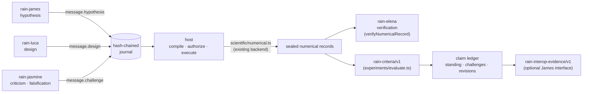

# R.A.I.N. collaboration

Bounded, auditable collaboration between research seats, built on the lab's
existing numerical backend and registry evaluator. Code:
`src/rain/collaboration/`. Results: `docs/benchmarks/rain-collaboration/`
(generated; never edit by hand). Design:
`docs/superpowers/specs/2026-11-16-multi-agent-ecosystem-design.md`.

The rule it exists to keep: **seats propose and challenge; the host runs the
experiments; `rain-criteria/v1` decides; the ledger records who said what and
what the evidence did to it.**



## What it is

| Part             | File                                             | Rule                                                                                                                                                                                                                                                                                                                                                                                                                                                                                                  |
| ---------------- | ------------------------------------------------ | ----------------------------------------------------------------------------------------------------------------------------------------------------------------------------------------------------------------------------------------------------------------------------------------------------------------------------------------------------------------------------------------------------------------------------------------------------------------------------------------------------- |
| Roster           | `roster.ts`                                      | Responsibilities are assigned to the existing perspectives by name (James → hypothesis, Luca → design, Jasmine → criticism and falsification, Elena → verification; replication and memory revision are host seats). The perspectives themselves (`meeting/perspectives.ts`, the SOUL files) are not edited. Agent ids carry `rain-` so the R.A.I.N. perspective James is never confused with the James desktop. The proposer may not criticise, falsify or verify its own claim (a test holds this). |
| Journal          | `ledger.ts`                                      | Every message is an `agent-event/v1` record (`docs/interop/agent-interop-v1/`), hash-chained by `prev`, in a closed vocabulary. `verify()` recomputes the chain.                                                                                                                                                                                                                                                                                                                                      |
| Claim ledger     | `ledger.ts`                                      | Standing comes from cited runs and open challenges, never from agreement. Any seat may challenge any claim at any time; only a run resolves a challenge; an open challenge leaves the claim `contested`. Revisions supersede with an explicit parent and delete nothing.                                                                                                                                                                                                                              |
| Experiments      | `experiment.ts`                                  | A design becomes a `NumericalDesign`; the existing compiler checks it, the existing digest ritual authorizes it as `Scripted.DemoOperator` (a scripted demonstration authorization, never a person's review), the existing executor runs it on a fresh simulator and `verifyNumericalRecord` re-checks the sealed record. Nothing here simulates.                                                                                                                                                     |
| Ground truth     | `physics.ts`                                     | The closed-form steady-state response, independent of the integrator, used only to score the evaluation.                                                                                                                                                                                                                                                                                                                                                                                              |
| Evaluation       | `evaluation.ts`, `protocols/collab-eval-v1.json` | The preregistered comparison of the fixed workflow, a single self-checking agent and the multi-seat protocol.                                                                                                                                                                                                                                                                                                                                                                                         |
| Demonstration B  | `episode.ts`, `protocols/assumption-v1.json`     | Hypothesis, discriminating design, challenge, correction and a preregistered held-out test.                                                                                                                                                                                                                                                                                                                                                                                                           |
| Interop evidence | `evidence.ts`                                    | An episode sealed as `rain-interop-evidence/v1`.                                                                                                                                                                                                                                                                                                                                                                                                                                                      |

Every seat in this release is a **rule-based policy** (`generation:
"scripted"`). No language model wrote a claim, a challenge or a verdict here.

## Isolation

The module imports nothing from the life, the fly, the garden, augmentation,
deployment or first-contact code except `firstContact/originals.ts`, whose
`refuseOriginal` every subject id passes; subject ids start with `research-`.
It reads no environment, starts no process, fetches nothing and writes no
file (`collaboration.test.ts` scans it). Eva's and ECHO's identities,
memories, controller states and histories are not read or written.

## The evaluation

`protocols/collab-eval-v1.json` was committed before any held-out case
existed: held-out seeds are derived from the protocol's own canonical digest.
Its `development_history` records the one change made during development (the
generator was narrowed to near-resonance pairs after a draft produced no
discordant cases) and why.

```sh
node scripts/run-ts.mjs scripts/rain-collaboration.ts --dev        # development only, prints
node scripts/run-ts.mjs scripts/rain-collaboration.ts --evaluate   # clean tree only; writes results
node scripts/run-ts.mjs scripts/rain-collaboration.ts --demo       # clean tree only; writes Demonstration B
node scripts/run-ts.mjs scripts/rain-collaboration.ts --check      # re-runs both and compares bytes
```

`--check` reproduces byte for byte on the platform recorded in the files;
floating-point `Math` differs elsewhere, as for the fly pilots. The results
and their limits are in `docs/benchmarks/rain-collaboration/README.md`.

## The optional James interface

`server/rain/interop.ts` serves `/api/rain/interop/v1/{status,evidence,proposals}`
on the local dev and preview servers only, off unless
`RAIN_INTEROP_READ_TOKEN` and/or `RAIN_INTEROP_PROPOSE_TOKEN` is set, to
loopback peers only. `read` serves sealed evidence files that pass the shared
schema and their own digest. `propose` writes one file per proposal digest
into `.rain-interop/proposals/` (gitignored) for the operator and answers with
`"authorizes_execution": false`. No interop route touches the registry, a
simulator, an organism, the autonomy controller or any agent's memory.

## Limits

- Rule-based seats written by the same team as the benchmark: the evaluation
  measures these protocols on this substrate, not language-model agents.
- Deterministic substrate: replication detects numerical sensitivity and
  record damage, not sampling noise.
- The Demonstration B correction is textbook physics; the episode shows the
  protocol catching and testing it, not a discovery.
- Not wired into the autonomy controller or the discovery scheduler; a
  language-model seat is future work and would need its own preregistration.
