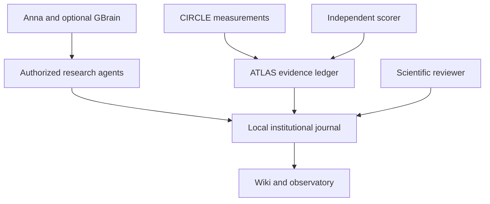

# R.A.I.N. institutional memory

The local institutional journal preserves typed research events, evidence identifiers,
assignee-specific handoffs, and permission-bound review decisions. The published
[observatory](../public/research-memory/index.html) follows one actual computational
correction and its independently scored evidence. This release runs in Lop Nur Twin's
offline cross-lab workspace. The production discovery scheduler does not consume the
journal yet.



## Reproduce the study

Check out CIRCLE at `0f231ec41f3a1bd0cf47d347dc2b6068dc5fb7da` and ATLAS at
`a876d458778b0917541a26153d2425b922762480`. Use clean checkouts, Python 3.12,
NumPy 2.3.5 and jsonschema 4.26.0.

```sh
study=experiments/crosslab/institution
output=$(mktemp -d)
python -m unittest discover -s "$study" -p 'test_*.py'
OPENBLAS_NUM_THREADS=1 python "$study/study.py" ../circle ../atlas-instrument "$output/correction"
python "$study/evaluation.py" > "$output/evaluation.json"
python "$study/verify_release.py" "$output/correction" "$output/evaluation.json" ../atlas-instrument
```

The archived assumption challenge's refuted forecast and failed revision are
verified and imported by the existing ATLAS exporter. The correction tests
the separately registered proposition that enough detected beat coverage
guarantees accuracy under delayed delivery. The paired intervention holds the
samples and acquisition schedule fixed and changes delivery timing.

Discovery and replication each used 16 seeds, three rate profiles and two
delivery arms. All 32 delayed ramp candidates in each phase exceeded 3 bpm
error while clearing the coverage floor. Delayed rising candidates underestimated
the reference and delayed falling candidates overestimated it. Every constant
candidate and every timely candidate was within the error bound. The freshness
gate withheld all 48 delayed candidates per phase. Their reported error rate is
undefined. The joint pattern held on 16 of 16 replication seeds (exact 95% interval
79.4% to 100%). This is a fresh, within-team computational replication with a
different waveform and the same CIRCLE detector. The correction remains a
proposal pending scientific review. The experiment design and competing
hypotheses were host-authored, and no language model ran.

The fixture evaluation yielded 24/24 recall and retrieval successes in both
memory modes. The institutional journal additionally retained source lineage,
contradiction status, handoff assignment and review state in all 24 cases
(each Wilson 95% interval 86.2% to 100%). The retrieval-only baseline matches text
from the same corpus and has no history validation or review projection.
A deliberately modified backup failed the journal's integrity check in all cases.
The no-memory baseline returned no records. Representative median query-path
costs were roughly 0.37 ms for the journal and 0.03 ms for retrieval only,
with an approximately 24 KiB SQLite file versus approximately 6 KiB of
serialized retrieval records per fixture. Machine load and SQLite page size affect
these costs. This measures structural behavior on synthetic fixtures with shared
grammar. It does not establish better model reasoning, more accurate source
entailment, or superiority to the full prior discovery architecture.

## Operate locally

Create a private directory owned by the service operator. Give agent
processes separate OS accounts, no filesystem access to the data directory,
and unique credentials generated with `secrets.token_hex(32)`. Put the
SHA-256 of each ASCII token and its role in an owner-only JSON policy file,
keyed by actor name. The service uses one shared reading scope per database.
Use separate journals and service ports for distinct data-sharing groups.

```json
{
  "jasmine": { "role": "researcher", "token_sha256": "<64 lowercase hex characters>" },
  "operator": { "role": "reviewer", "token_sha256": "<64 lowercase hex characters>" }
}
```

```sh
python "$study/service.py" /private/lab/journal.sqlite /private/lab/credentials.json
python "$study/mcp_bridge.py" --service http://127.0.0.1:8768
python "$study/maintenance.py" /private/lab/journal.sqlite --wiki /private/lab/wiki-new
python "$study/maintenance.py" /private/lab/journal.sqlite --backup /private/lab/backup.sqlite
python "$study/maintenance.py" /private/lab/backup.sqlite --checkpoint SAVED_HEAD
```

The service accepts bearer-authenticated JSON POSTs to `/recall`
(`{"query":"delivery"}`), `/trace` (`{"hash":"…"}`), `/resume` (`{}`), and
`/append` (the event envelope defined in `memory.py`). A researcher can submit
proposals and acknowledge their own assigned handoff. Only a separately
credentialed reviewer can approve, reject or revoke a correction or guidance
proposal. Reviews are retained and are never applied as executable instructions.
MCP exposes the three read operations through stdio. Provision the corresponding
credential with `RAIN_MEMORY_TOKEN` in the MCP client's process environment.

Observation and verdict writes occur in the operator-owned CIRCLE/ATLAS pipeline
after verification. Anna's native search, citation and record verification
contracts and GBrain's source-pinned MCP search are available through optional
host adapters. Results carry context standing. No core path requires either
service, and the two external contracts are covered by test doubles. The current
demo does not perform live Anna or GBrain retrieval.

SQLite v1 uses transaction-serialized, idempotent appends, append-only SQL triggers,
ordered references and SHA-256 chain validation. Unsupported versions fail closed.
Keep trusted head hashes and ATLAS backups separately from the journal. Verify
a recovered copy against its saved checkpoint before opening it for writing.
A local operator who controls the database can rewrite bytes and recompute an
unanchored chain. A chain hash does not authenticate a human reviewer. The
service has a single-host trust boundary and is not a network-facing deployment.
The observatory consumes an explicitly published synthetic snapshot. Keep private
journals and wiki exports outside the application's public directory.

The correction path reads pinned CIRCLE and ATLAS checkouts and the committed
assumption archive. It uses no Bethesda simulator, life store, controllers or
production credentials. TRIAD and Dynamic Resonance Rooting were inspected.
This experiment directly exercises CIRCLE's acquisition and estimator path.

## Memory system review

The references below identify the snapshots examined. All six repositories
contained MIT licenses. The LLM Wiki gist did not include a license. The
implementation adapts design ideas and does not incorporate upstream code.

| Project at inspected revision                                                                                                | Design and dependencies                                                                     | Trade-off for institutional memory                                                                                                                                                     |
| ---------------------------------------------------------------------------------------------------------------------------- | ------------------------------------------------------------------------------------------- | -------------------------------------------------------------------------------------------------------------------------------------------------------------------------------------- |
| [GBrain](https://github.com/garrytan/gbrain/tree/db2f4f0a091ae30588628adb5a7c30a0fa0b3768)                                   | Bun and TypeScript, PGlite or PostgreSQL, hybrid search and scoped MCP tool surfaces        | Source-pinned reads are useful. Its many writable surfaces and configured ingestion, embedding and expansion paths need operator governance. Scientific standing stays in the journal. |
| [LLM Wiki](https://gist.github.com/karpathy/442a6bf555914893e9891c11519de94f/ac46de1ad27f92b28ac95459c782c07f6b8c964a)       | Markdown schemas, source archive, iterative synthesis and linting, no software dependencies | Generate a browseable wiki. Model-edited pages alone cannot establish who verified a claim or which past version it superseded.                                                        |
| [ai-memory](https://github.com/akitaonrails/ai-memory/tree/73f6ccd036b8490b1072877f76740d96509c7d7a)                         | Rust workspace, SQLite, configurable local and remote embedding, hook-driven handoffs       | Use explicit handoff envelopes. Session hooks, relay, webhooks and optional credentials are separate data and permission surfaces.                                                     |
| [COG](https://github.com/huytieu/COG-second-brain/tree/144c7a3a959cc99538b7dfee9c22c4b065a0e156)                             | Markdown vault, agent skills and bounded verification steps                                 | Separate proposal and verification roles. Separate agent prompts sharing a model are insufficient independent evidence.                                                                |
| [Agent Second Brain](https://github.com/smixs/agent-second-brain/tree/7828ed62cf76aae87bee7f2660468ab88495cf3d)              | Python with aiogram, Deepgram, HTTPX and Pydantic, plus a Markdown vault                    | Use explicit ingress and resumable history. Telegram, speech transcription and bot credentials add unrelated data flows.                                                               |
| [Open Second Brain](https://github.com/itechmeat/open-second-brain/tree/0f5eb07d003fefcd70832d197fd53e748371b1be)            | Local vault, Bun and SQLite vector search, intent review and consolidation previews         | Keep proposals and reviewed dispositions separate. Repetition can prioritize review without raising scientific standing.                                                               |
| [Claude Second Brain](https://github.com/jessepinkman9900/claude-second-brain/tree/599f55ad50afceb9eae4f31746aa37274087d239) | Node scaffolding, Obsidian, qmd and optional GitHub sync                                    | Portable wiki views are valuable. Sync hooks and publication can disclose unpublished research, so serving the journal does not imply sync.                                            |
