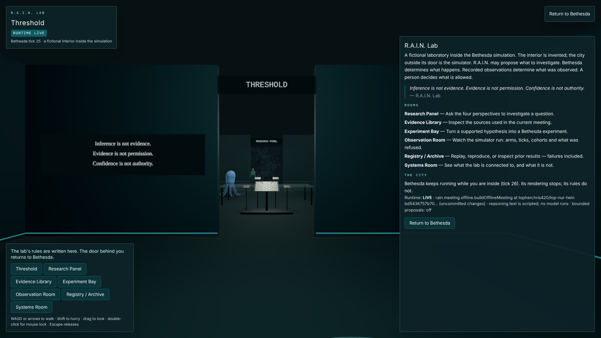
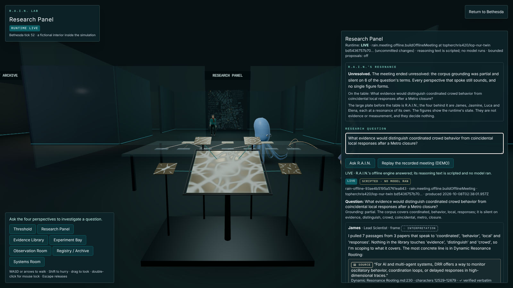
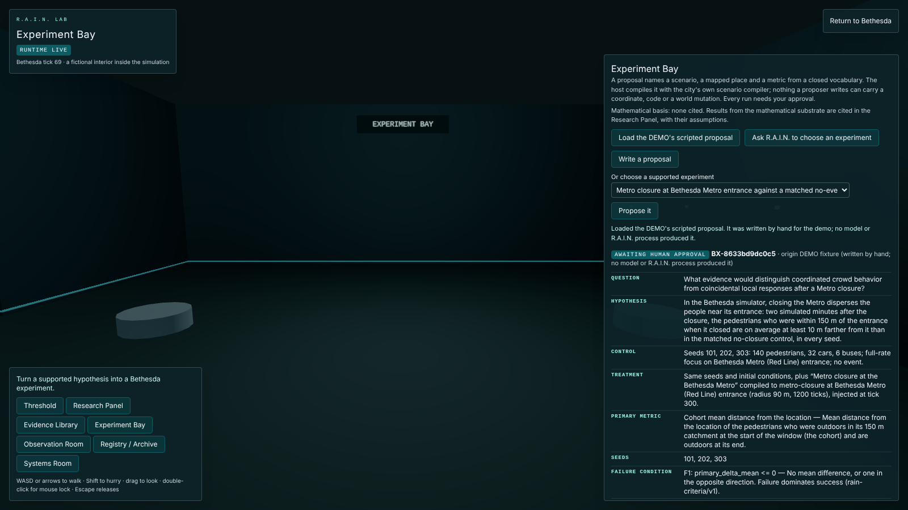

# The R.A.I.N. Lab in Bethesda

Behind an unmarked door in the Bethesda anomaly is a research lab where the four
perspectives of R.A.I.N. — James, Jasmine, Luca and Elena — investigate
questions about the city, and where their hypotheses become experiments that
the Bethesda simulator runs. The R.A.I.N. Lab is an integrated research
environment embedded inside the Bethesda city simulation. Its research runtime,
experiment registry, evidence layer and simulation interface live in this
repository; this is the lab's canonical home. It is a spatial interface to a
real workflow, not a chatbot and not a scripted scene:

```text
human question → R.A.I.N. meeting → evidence and constraints → mathematical framing
(optional) → experiment proposal → deterministic validation → human authorization
→ Bethesda simulator (matched runs)
→ recorded observations → deterministic evaluation → the registry's own record
→ provenance-preserving, replayable record
```

**Models propose; host code validates; the simulator determines world state;
recorded observations become evidence.** Every arrow in that line is code in
this repository, and each side keeps its own authority.

The runtime was ported from R.A.I.N.'s own code in
`topherchris420/james_library`; [the migration note](RAIN_MIGRATION.md) says
what was incorporated, what was left behind and against which commit.

## Read this first

- **The interior is fictional.** The lab, its rooms, its door and the figures
  in it are invented. Nothing about a real building at that location is
  claimed.
- **The visual world is not evidence.** What the lab and the city _draw_ —
  rooms, figures, avatars, the wall map, the city itself — is presentation.
  Evidence is what the simulator computes from its own state, recorded with the
  tick and state hash it came from.
- **Agents have no unrestricted city control.** R.A.I.N. can choose among
  options the host offers, and nothing else. The four perspectives can look at
  the city through seven read-only tools and on bounded walks, two at a time.
  Nothing in the lab can move, inject, close, dispatch, pause or step the live
  city.
- **Simulated results do not establish real Bethesda behaviour.** The
  simulator is rule-based. A result says what _these rules_ do on _these
  seeds_ — not what real people near the real Metro would do.
- **Experiments remain simulations.** Every run reported to the registry is
  labelled `evidence_class: "simulated"`, and the registry's run record says so
  in its words: "Simulated data: this characterizes the simulator and analysis
  pipeline, not a physical system."

## Discovery (spoiler)

The lab is inside Bethesda, so first find Bethesda (see
[the anomaly guide](BETHESDA_ANOMALY.md#discovery-spoiler)). Then either:

1. **On foot.** On the rear wall of an unnamed building (OSM way
   `117424685`), about 150 m from where Bethesda begins, is a dark service door
   like any other. Walk within 40 m and a faint spectral-teal line and a small
   waveform appear on it; within 3 m the city offers **Open it (E)** (**Open
   it** on a touch screen, which walks there with its thumb-stick). No text,
   no map marker, no landmark entry.
2. **By telemetry.** In the city's console (backtick or `~ telemetry`), type
   `resolve r.a.i.n.` (or `resolve rain lab`), or the door's own coordinates,
   `38.98025, -77.09627`. In the desert those coordinates resolve Bethesda
   itself; the lab opens only from inside the city. The phrase is not a
   scenario: the city's compiler produces no event from it.

The lab's code (`LabApp`) loads the first time the door opens. Nothing contacts
the research runtime before then. Leave by the door behind the threshold (E),
**Return to Bethesda** or the browser's Back, which steps out of the lab into the
same city run.

## Architecture

The lab in the browser speaks a small versioned protocol, `rain-bethesda/v2`,
to its own site's `/api/rain/*` route. The route calls the research runtime in
the same server process; the runtime holds the corpus, the meeting engines,
R.A.I.N.'s decision router and the experiment registry, and reaches outside
the machine only when the operator configures a model server or allows Jev:

```text
browser: src/bethesda/rain/*       same-origin JSON, closed fields, bounded
   │                                          ▼
   │                          /api/rain/*  (server/rain/handler.ts)
   │                                          ▼
   │                   src/rain/runtime.ts — the research runtime, in-process
   │        ┌──────────────────┬───────────────────┬─────────────────┬──────────────┬──────────────┐
   │   corpus.ts + data/   meeting/offline.ts   meeting/model.ts   judgment/     experiments/   mathematics/
   │   17 papers, hashed   scripted engine      OpenAI-compatible  bounded       registry,      openai/math,
   │   quote verification  (the DEMO's)         local model server choice (Jev   evaluation,    pinned index,
   │                                            ▲ only when        only if       admission      read-only:
   │                                            │ configured       allowed)                     context, never
   ▼                                   Ollama, LM Studio, llama.cpp …                           evidence
Bethesda simulator (src/bethesda/simulation.ts), in the browser
```

| Runtime module                                                               | What the lab gets from it                                                                                       |
| :--------------------------------------------------------------------------- | :-------------------------------------------------------------------------------------------------------------- |
| `src/rain/corpus.ts`, `src/rain/data/`                                       | the evidence corpus (17 papers, each hashed, fingerprint `9b2ea421…`) and whole-quote verification with spans   |
| `src/rain/meeting/offline.ts`                                                | the scripted four-perspective meeting (LIVE by default, and the DEMO recording)                                 |
| `src/rain/meeting/model.ts`, `jobs.ts`, `artifact.ts`, `record.ts`           | model meetings as jobs, their `rain-session-artifact/v1`, and the lab's record of them, every quote re-verified |
| `src/rain/judgment/`                                                         | R.A.I.N.'s bounded choice among the host's experiment options (`rain-bounded-decision/v1`)                      |
| `src/rain/experiments/`                                                      | pre-registration (`V3D-EXP-NNNN`), `rain-criteria/v1` evaluation, admission of reported runs, verification      |
| `src/rain/mathematics/`                                                      | the mathematical substrate: the pinned `openai/math` index, search, inspection, challenge, basis verification   |
| `src/rain/protocol.ts`, `meeting/perspectives.ts`, `experiments/evaluate.ts` | the pure parts the browser bundle shares with the server: schema names, limits, the team, the evaluator         |
| `src/rain/mathematics/contracts.ts`                                          | the substrate's pure vocabulary: statuses, relations, findings, limits and the basis rules, shared with the lab |

What stays on the lab's side: the scenario vocabulary and its compilation
through the city's own scenario compiler, validation, authorization, the
simulator, every measurement, replay, and the records. What stays the
runtime's: the perspectives, their reasoning and evidence, the decision router,
the registry and its evaluation of submitted runs.

## Three modes, labelled

| Mode        | When                                                                                     | What runs                                                                                        | What it says                                                                                   |
| :---------- | :--------------------------------------------------------------------------------------- | :----------------------------------------------------------------------------------------------- | :--------------------------------------------------------------------------------------------- |
| **OFFLINE** | `RAIN_RUNTIME=off`, a runtime that could not start or did not answer, or not yet checked | nothing is generated; every room is explorable; local experiments still run on the simulator     | `RUNTIME OFFLINE` and why (switched off, or the setting that stopped it)                       |
| **DEMO**    | you choose **Replay the recorded meeting (DEMO)**                                        | one recorded meeting is replayed; no process runs and your question is sent nowhere              | `PRERECORDED · DEMO` and `SCRIPTED · NO MODEL RAN`                                             |
| **LIVE**    | the default: `/api/rain/status` reports the runtime on and its identity validates        | meetings, proposals, pre-registration and submissions go to the runtime through the site's route | `RUNTIME LIVE`, the engine, this repository's commit, and whether a model or a script answered |

The mathematical substrate is the runtime's, so it is LIVE only. OFFLINE, its
instrument says it is unavailable and nothing is searched; experiments still
run, with no mathematical basis. DEMO replays the recorded meeting and nothing
else: no substrate answer is recorded, and none is invented.

LIVE never falls back to DEMO. A failed LIVE request shows its failure —
`NOT CONFIGURED`, `UNAVAILABLE`, `TIMEOUT`, `RATE LIMITED`, `SESSION LIMIT`,
`REFUSED`, `INVALID ANSWER`, `FAILED`, `CANCELLED` or `ERROR` — and nothing in
its place; the browser's R.A.I.N. client cannot import the recording (a test
asserts it).

The DEMO recording (`src/bethesda/rain/fixtures/demo-meeting.json`) is made by
`scripts/export-rain-demo.ts` (`bun run rain:demo`) from the runtime's offline
engine at a clean, committed revision of this repository. Its manifest
(`demo-source.json`) records the recording's real time, its SHA-256, the commit,
the corpus fingerprint and the recording's lineage: it was first recorded from
R.A.I.N.'s own engine in `james_library`, and the meeting id — a hash of the
meeting's content — is unchanged, which is how the recording proves that this
engine produces the same meeting word for word. `validate:bethesda` checks the
file byte-for-byte against the manifest, and `offline.test.ts` and the LIVE
browser check assert that the engine still returns that meeting for that
question. The experiment proposal shipped beside it (`demo-proposal.json`) was
written by hand, is labelled `origin: fixture`, and claims no R.A.I.N. decision.

The runtime serves one of two meeting engines, and every meeting says which
wrote it — the meeting as a whole and each turn (`generation`):

- **The offline engine** (the default): its reasoning text is scripted, its
  evidence is retrieved, and every quote is verified. It is labelled
  `SCRIPTED · NO MODEL RAN`, and it grades the corpus's coverage of the
  question and states where the room stands.
- **A model meeting** (`RAIN_MEETING_ENGINE=model`): the four perspectives are
  a local model — Qwen, say — answering from their SOUL files and the corpus
  through R.A.I.N.'s meeting procedure. It is labelled
  `MODEL · <the model the runtime recorded>`; see
  [Model meetings](#model-meetings-qwen-or-another-local-model).

A runtime that reports a model is labelled with that model's name, and only
then; a meeting that claims a model but carries no session artifact of running
it is refused.

## Running LIVE

Nothing needs to be installed or configured. `bun run dev` and
`bun run preview` serve the lab LIVE with the offline engine, a scratch
experiment registry and R.A.I.N.'s bounded choice switched off (it answers
DISABLED); so does a Vercel deployment. The settings, all server-side and all
optional, are in `.env.example`:

| Variable                        | Meaning                                                                                                                                                        |
| :------------------------------ | :------------------------------------------------------------------------------------------------------------------------------------------------------------- |
| `RAIN_RUNTIME`                  | `local` (default) or `off`: off makes the lab OFFLINE, and say so                                                                                              |
| `RAIN_MEETING_ENGINE`           | `offline` (default) or `model`                                                                                                                                 |
| `RAIN_LLM_BASE_URL`             | model only: an OpenAI-compatible server, default `http://127.0.0.1:11434/v1` (Ollama)                                                                          |
| `RAIN_LLM_MODEL`                | model only: the model to run, exactly as the server lists it (`qwen2.5:7b`, `qwen2.5-7b-instruct`)                                                             |
| `RAIN_LLM_API_KEY`              | optional bearer token the model server requires                                                                                                                |
| `RAIN_LM_TIMEOUT`               | seconds per model answer, 30–3600 (default 300)                                                                                                                |
| `RAIN_MEETING_TURNS`            | 1–30 (default 25; the last 15 are the wrap-up)                                                                                                                 |
| `RAIN_MEETING_TIMEOUT_MIN`      | minutes before an unfinished meeting is stopped, 5–60 (default 45)                                                                                             |
| `RAIN_MEETING_RECURSION`        | `true` (default) or `false`: the critique-and-revise pass per turn                                                                                             |
| `RAIN_MEETING_PRIVACY`          | `local` (default) or `hybrid`: local refuses a model server that is not on this machine or its network                                                         |
| `RAIN_MEETING_ARCHIVE_DIR`      | optional directory that keeps each meeting's `rain-session-artifact/v1`                                                                                        |
| `RAIN_DECISION_MODE`            | `off` (default) or `jev`: whether R.A.I.N.'s router may choose among the host's experiment options                                                             |
| `RAIN_DECISION_REMOTE_ALLOWED`  | `true` or `false` (default): whether a question may leave the machine for TypeSafe                                                                             |
| `RAIN_DECISION_CALIBRATION`     | optional path to a `rain-decision-calibration/v1` file                                                                                                         |
| `RAIN_DECISION_MINIMUM_SAMPLES` | calibration samples a profile needs (default 100)                                                                                                              |
| `RAIN_DECISION_TIMEOUT`         | seconds per decision (default 30)                                                                                                                              |
| `RAIN_REGISTRY_DIR`             | optional directory for the experiment registry; unset, a scratch directory discarded with the process. One process only: refused on a function deployment      |
| `RAIN_REGISTRY_SECRET`          | at least 32 random characters (`openssl rand -hex 32`): the key that certifies pre-registrations. Required for the registry on Vercel; optional on one process |

A malformed setting does not degrade the runtime: it refuses to start, the
lab says `RUNTIME OFFLINE` and names the setting (never its value), and
`/api/rain/status` reports `misconfigured: <setting>`. On Vercel, set the
variables in the project's environment (`RAIN_LLM_API_KEY`, `TYPESAFE_API_KEY`
and `RAIN_REGISTRY_SECRET` as **Sensitive**) and redeploy; the ten
`api/rain/*` functions are declared in `vercel.json`. Without
`RAIN_REGISTRY_SECRET` a function deployment reports its registry unavailable,
says why in the Systems Room, and offers no pre-registration. Model meetings need one long-lived
server process and are refused in a function deployment. Never prefix any of
these with `VITE_`.

The **Systems Room** shows what is connected: the runtime's name, this
repository and its commit, the corpus fingerprint, the meeting engine, whether
a model runs and which, the decision mode, whether a remote engine may be
asked, and the registry.

## Model meetings (Qwen or another local model)

The runtime holds a model meeting against an OpenAI-compatible model server —
Ollama, LM Studio, llama.cpp's server, vLLM — following R.A.I.N.'s meeting
procedure (`src/rain/meeting/model.ts`): each perspective's SOUL file plus the
meeting rules as its system prompt, the paper corpus as its research database,
a director instruction per turn, an optional critique-and-revise pass, and the
repairs R.A.I.N. applies to truncated or garbled answers.

```sh
RAIN_MEETING_ENGINE=model RAIN_LLM_BASE_URL=http://127.0.0.1:11434/v1 \
  RAIN_LLM_MODEL=qwen2.5:7b bun run preview
```

The model is named exactly as the server lists it. The runtime starts only if
the privacy rule allows the endpoint: under `local` (the default) it refuses one
that is not loopback or private-network, and an Ollama `:cloud` model.

What happens when you ask:

1. The runtime tests the connection with a five-token completion, three
   attempts, and refuses the meeting if nothing answers.
2. The lab gets a job (`meeting-pending`) and checks on it every three seconds
   through `/api/rain/meeting-status`: it shows how many turns have started —
   progress, never evidence — and none of the meeting's words. **Stop the
   meeting** asks the runtime to stop it (`meeting-cancel`); the lab then says
   `CANCELLED` and shows nothing in its place. One meeting runs at a time.
3. Each turn is one completion (three with recursion: the turn, a critique, a
   revision), with the stagnation monitor watching for a dead end and inserting
   a bounded recovery instruction — evidence, then an alternative, then the
   final summary — and a wrap-up instruction for the last turns. A model that
   stops answering ends the meeting early; it is still recorded as completed,
   and the record says where it stopped.
4. The runtime writes its `rain-session-artifact/v1` (and keeps a copy in
   `RAIN_MEETING_ARCHIVE_DIR`, if set), re-verifies every quotation against the
   corpus with the same `verifyQuote` the offline engine uses, and names the
   artifact by session id and SHA-256 in the lab's record.

What the lab shows, and what it does not:

- `MODEL · qwen2.5:7b` (whatever the runtime recorded), and the model's turns
  as the model's words. A line the runtime's code adds itself — the closing
  "Meeting adjourned. Great discussion everyone!", or the placeholder it puts
  in a turn when the model's answers were unusable ("[Luca is processing... Let
  me gather my thoughts on this topic.]") — is marked
  `A FIXED LINE IN R.A.I.N.'S CODE · NOT THE MODEL`.
- No grade of the corpus's coverage and no "where the room stands": a model
  meeting computes neither, so the lab states neither. A model meeting that
  arrives with a verdict, or without its session artifact, is refused.
- Every verified quote with its file, line and character span. A quotation
  that did not verify is not shown as a source; the turn says how many did
  not, and a turn with none verified is marked `UNGROUNDED`.
- A turn over 4,000 characters is shortened and says so; invisible control
  characters are removed and counted. The lab never repairs anything else.

A model meeting takes minutes, not seconds: by default the runtime makes three
model calls a turn, so a 25-turn meeting is about 75 calls, and
`RAIN_MEETING_RECURSION=false` makes it 25. It waits `RAIN_LM_TIMEOUT` (300 s)
for each answer; raise it on a slow, CPU-only machine. Load the model with a
16,384-token context window: each turn's prompt carries the SOUL file and the
paper excerpts — 6,050 to 7,099 tokens over the first four turns when
R.A.I.N.'s script held a meeting on the DEMO question with a Qwen, and the
runtime sends the same souls and excerpts — before up to 320 tokens for the
answer, and a 2,048- or 4,096-token window either refuses it or silently drops
its beginning, where the papers are. The meeting's words are a model's: they
are INTERPRETATION, never evidence.

### On a Windows desktop

In PowerShell, from `lop-nur-twin`:

1. **Find the model.** In LM Studio, the **My Models** tab lists the Qwen you
   downloaded; in Ollama, `ollama list` does.
2. **Serve it.** LM Studio: **Developer** tab → load the model → **Start
   Server** (or `lms server start`); it listens on `http://127.0.0.1:1234/v1`,
   and the model's name is the identifier LM Studio shows, for example
   `qwen2.5-7b-instruct`. Ollama: it serves on `http://127.0.0.1:11434/v1` while
   it runs (`ollama serve` if it is not), and the name is the tag `ollama list`
   shows, for example `qwen2.5:7b`. Check with
   `curl.exe http://127.0.0.1:1234/v1/models` (or `:11434`).
3. **Give it a 16,384-token context.** LM Studio: set **Context Length** when
   you load the model (or `lms load <model> --context-length 16384`). Ollama:
   set the user environment variable `OLLAMA_CONTEXT_LENGTH` to `16384`, then
   quit and reopen Ollama. A bare `.gguf` file can be imported into LM Studio
   (`lms import <file>`) or served by llama.cpp
   (`llama-server -m <file> -c 16384`, on `http://127.0.0.1:8080/v1`).
4. **Serve the site with the model configured:**

   ```powershell
   bun run build
   $env:RAIN_MEETING_ENGINE = "model"
   $env:RAIN_LLM_BASE_URL = "http://127.0.0.1:1234/v1"   # Ollama: http://127.0.0.1:11434/v1
   $env:RAIN_LLM_MODEL = "qwen2.5-7b-instruct"           # exactly as the server lists it
   bun run preview
   ```

5. Open `http://localhost:4173`, find Bethesda and the lab
   ([Discovery](#discovery-spoiler)), and ask a question in the Research Panel.
   The runtime line should read `LIVE` and name your model.

## Jev: letting R.A.I.N. ask a remote engine

R.A.I.N.'s decision router can consult Jev (TypeSafe) when R.A.I.N. is asked to
choose an experiment. Nothing in the lab turns this on: it is the server's
configuration, and it sends the research question and the host's option
descriptions to TypeSafe.

```sh
RAIN_DECISION_MODE=jev RAIN_DECISION_REMOTE_ALLOWED=true TYPESAFE_API_KEY=… bun run preview
```

`RAIN_DECISION_REMOTE_ALLOWED` must be `true` or `false` — anything else stops
the runtime — and without it the router does not send the question anywhere
(`POLICY_REQUIRES_REVIEW`; the lab shows Jev as "not asked"). The key stays in
the server's environment and reaches the runtime by value: the browser never
sees it, and no module under `src/rain/` names it. The `laya` and `cascade`
modes name R.A.I.N.'s local checkpoint and its Python worker, which this
runtime does not carry; they are refused by name rather than mapped to
something else.

R.A.I.N. acts on an engine's answer only once that engine is calibrated for this
kind of decision — a profile in `RAIN_DECISION_CALIBRATION` for the same engine,
model, decision class and options, with at least
`RAIN_DECISION_MINIMUM_SAMPLES` samples (100 by default) and a Wilson lower
bound at the target accuracy on both fit and held-out data. Until then it hands
the choice back (`INSUFFICIENT_CALIBRATION`) and proposes nothing, and the lab
does not pretend otherwise. **R.A.I.N. HANDED THE CHOICE BACK** in the
Experiment Bay lists every engine the router consulted with what it returned —
its model, its choice, its probabilities and confidence exactly as returned —
marked `NOT ACTED ON` with the router's reason. If an engine chose a supported
experiment, **Propose X1 as my own** lets a person propose it: the proposal's
origin is then `human`, it claims no R.A.I.N. decision, and it needs the same
validation and authorization as any other. Jev's probabilities are not
calibrated, and the lab never presents one as R.A.I.N.'s confidence.

## The rooms



_The Threshold on entering from Bethesda: "Inference is not evidence. Evidence
is not permission. Confidence is not authority." The panel names the runtime
the site's server holds, its engine and its commit, and that the reasoning
text is scripted._

| Room               | Hint shown on entering                                                     | What is there                                                                                                                                                                                                                                                                                                                                                                              |
| :----------------- | :------------------------------------------------------------------------- | :----------------------------------------------------------------------------------------------------------------------------------------------------------------------------------------------------------------------------------------------------------------------------------------------------------------------------------------------------------------------------------------- |
| Threshold          | The lab's rules are written here. The door behind you returns to Bethesda. | the principle, the rules, the way back                                                                                                                                                                                                                                                                                                                                                     |
| Research Panel     | Ask the four perspectives to investigate a question.                       | R.A.I.N.'s resonance instrument and what it shows; the question; a model meeting's progress and **Stop the meeting**; the meeting turn by turn with its speaker; verified sources; who wrote each turn; disagreement as separate branches; ungrounded turns marked; next investigations; the mathematical substrate: search, challenge, inspection, citation and the next proposal's basis |
| Evidence Library   | Inspect the sources used in the current meeting.                           | every item, filterable by kind of claim (below)                                                                                                                                                                                                                                                                                                                                            |
| Experiment Bay     | Turn a supported hypothesis into a Bethesda experiment.                    | proposals, their deterministic checks, the protocol, authorization, and any choice R.A.I.N. handed back with what each engine returned                                                                                                                                                                                                                                                     |
| Observation Room   | Watch the simulator run: arms, ticks, cohorts and what was refused.        | the run in progress, the live city, the perspectives' outings, the observation tools, and every refusal                                                                                                                                                                                                                                                                                    |
| Registry / Archive | Replay, reproduce, or inspect prior results — failures included.           | every record — supported, not supported, inconclusive, failed, rejected — with replay, export and reproduction                                                                                                                                                                                                                                                                             |
| Systems Room       | See what the lab is connected to, and what it is not.                      | the runtime, the provenance, the boundaries and the limits                                                                                                                                                                                                                                                                                                                                 |

Walk with WASD or the arrows (Shift hurries), drag or use mouse lock to look,
or use the room buttons, which every capability also lives behind. A touch
screen walks with a thumb-stick above the rooms and looks with a drag. On a
small screen nothing has to be put away to walk: the rooms become one strip
that scrolls sideways, the room's panel takes at most 45% of the height (less on
a short phone, so about 200 px of the room always stays open), the title
shrinks, and the camera's projection is shifted to centre on the band between
the title and the strip (`LabNav.viewCenter`, measured in `LabApp`), so the room
ahead shows there rather than behind the panel. A phone on its side keeps the
panel on the right and the room, the stick and the strip on the left, and
centres the room on that band left of the panel. The stick stands in the band's
lower corner, over at most half its width. The door back is a button as well as
E, and its prompt stands in the open room, never on the stick or a panel.
`tools/rain-lab.mjs` turns a phone upright, on its side and a small one on its
side, and checks each of these where the scene applied it. On a wide screen the
view is centred between the rooms at the lower left and the panel on the
right, so what is ahead — R.A.I.N.'s instrument first — is not behind the
panel. Without WebGL the rooms are panels, and every capability stays
available.

## The four perspectives

James, Jasmine, Luca and Elena are embodied in R.A.I.N.'s own colours (taken
from its Godot client's avatar looks and lab theme when the runtime was
consolidated here); the figures themselves are this lab's. **None of their
words are written in the lab.** A meeting is a validated R.A.I.N. meeting
record — LIVE from the runtime, or the DEMO recording — and the lab stages it
through R.A.I.N.'s neutral event vocabulary (`conversation_started`,
`agent_utterance`, `conversation_ended`), word for word. In the offline
engine's meetings the words are R.A.I.N.'s script, ported word for word; in a
model meeting they are the model's, except the lines the runtime's code adds
itself, which say so. The speaker is highlighted while their turn is shown.
Turns without a verified span say `UNGROUNDED · NO VERIFIED SPAN`; quotes show
their source file, line and character span and whether they were verified
verbatim. Where the record shows the perspectives disagreeing, the panel keeps
the positions as separate branches. Confidence is never animated, and agreement
among the four is described as agreement, never as validation.

**How they are built.** Who each perspective is comes from R.A.I.N.'s Godot
client — `agent_avatar.gd`'s `LOOKS` (James an octopus in spectacles; Jasmine
in safety goggles worn as a headband and gold hoops, with a natural afro; Luca
in a sweater and scarf with swept hair; Elena in a blazer and A-line skirt, long
hair and glasses) and the lab theme's colours, now in `embodiment.ts`.
Jasmine's clothes are the lab's own, not the client's overalls: a yellow
off-the-shoulder top with a frill and short puffed sleeves, a satin wrap skirt
to below the knee, slit up the right thigh and tied at the hip, wine heels and a
fine gold chain. The figures are modelled in code the way a character artist
blocks one out in Blender, because the site ships no binary assets
(`figures.ts`): the head, torso, skirt and James's mantle are lofted through
measured cross-sections; limbs are swept along their bones in one piece from
shoulder to wrist and hip to ankle; hair is a shell of the scalp above a
hairline; the shirt's V, the lapels, the top's hem and frill are laid over the
torso as their own surfaces. Each is one skinned mesh on the shared 34-bone rig in
`game/characters/rig.ts` (James has his own: a hub, a mantle that breathes and
eight six-bone arms), with face bones for the eyes, upper lids and mouth, and
Luca's scarf tail on three more and Jasmine's skirt on twelve. Colour, roughness and metalness are per
vertex; the material adds a cloth weave, a little warmth under skin and a cool
grazing rim so a figure separates from the dark walls.

**How they move.** The behaviours are the Godot client's, re-timed for a
figure in a room (`figureMotion.ts`): breathing; blinks on the client's
timings, one in five a double; a wandering gaze; weight shifting from foot to
foot; James's arms swaying in a wave that grows toward the tip and Luca's scarf
moving. A listener's eyes go to the speaker and the head follows; the speaker's
mouth moves on the client's procedural voice (syllables under a slower phrase
contour), the head takes small beats, the hands gesture — rest, a gesture after
0.9–2.4 s, held, and back — and the gaze goes round the table. What the client
also does and the lab does not: tone presets, nods, the end-of-conversation
celebration, the drop-in entrance and the squash-and-stretch hops, because each
reads as agreement or confidence; a gesture has one energy whoever speaks and
whatever is said, and the animator is never handed a record. When a meeting is
staged the four walk to the table — through the doorways and round the
furniture (`routeInLab`, the same `blocked` the visitor collides with) — and
back to their stations when it is cleared. Their feet are placed by the shared
two-bone IK with stride tied to speed, and a foot that comes down is anchored
where it landed until it swings again, so a planted foot holds still through a
walk's first steps, a corner, a turn on the spot and a stop; a foot strained
from its place in the gait takes a step. James crawls: his side arms push back
at the body's speed while down and reach forward lifted, and the arms pointing
ahead and behind are carried clear. Jasmine's skirt is not tied to her legs: it
hangs from twelve bones round the hips, each hinged where the skirt leaves
them, and each swings out only as far as the leg that reaches it needs — the
leading leg pushes the front, the trailing one the back, the sides hang — then
falls back with a short lag, so it flows rather than tenting. `figures.test.ts`
walks her to the table and fails if a leg comes through it by 3.5 cm. A perspective who is out on an outing is in
the city: nobody turns to the empty seat, and that turn lights no ring. Between
meetings a visitor who comes within 3 m is looked at. Reduced motion stills all
of it: the figures stand where they belong and turn at once, without a step, to
whoever is speaking.



_A LIVE meeting from the offline engine on the DEMO question, labelled
`SCRIPTED · NO MODEL RAN`. James's turn quotes `Dynamic Resonance
Rooting.md:230`, characters 12529–12679, verified verbatim; the plates read
unresolved, and the panel says why in words._

## R.A.I.N.'s resonance

The R.A.I.N. Lab uses Chladni resonance patterns as the visual interface for
its research runtime. The patterns do not constitute evidence or scientific
measurement. They provide a perceptual representation of runtime state,
uncertainty, disagreement, convergence, experimentation, and the boundary
between machine inference and human authorization.

R.A.I.N. has no face, head or avatar in the lab. It has a resonance. On a steel
plinth in the Research Panel, between the door and the evidence table, stands
one large bronze Chladni plate clamped at its centre and tilted towards the
door; behind it stand four small plates, one for each perspective, in the order
of their seats, each coupled to the large plate's stem by a thin rod. Sand lies
on every plate and gathers where the plate stays still. Walking in from the
Threshold, it is the first thing in view, with the four perspectives at the
table behind it. Nothing labels it.

**How it is driven.** Each perspective has its own resonance (James (2,4)+,
Jasmine (1,3)−, Luca (2,3)−, Elena (1,4)+). While a meeting is staged, every
perspective that has spoken drives the large plate at its own frequency from
its own exciter, the speaker loudest, and its small plate is driven with it;
the rod of each perspective taking part catches a little light. The large
plate's figure is their sum — many perspectives, a relationship, and, if the
meeting resolves, a synthesis: the separate figures give way to one.

| State                  | Derived from (the store, read-only)                                                                                         | What the instrument does                                                                                        |
| :--------------------- | :-------------------------------------------------------------------------------------------------------------------------- | :-------------------------------------------------------------------------------------------------------------- |
| `idle`                 | nothing in progress; runtime LIVE                                                                                           | the large plate holds the studio's Harmonic cross, (8,4), lightly driven; the small plates are strewn and still |
| `idle` (offline)       | nothing in progress; runtime OFFLINE or unreachable                                                                         | nothing drives any plate; the sand lies where it was strewn                                                     |
| `listening`            | `store.asking`; a model meeting's `turnsStarted / turnsPlanned`                                                             | driven between two resonances, where a plate barely answers; brightens with the real turn count, never words    |
| `deliberating`         | a meeting whose turns are still being staged (`revealed < turns.length`)                                                    | the speakers so far drive the large plate together, the current one leading; the speaker's small plate is lit   |
| `converging`           | a finished offline meeting with `grounding: "strong"` and no unverified span                                                | the four figures resolve into one clean figure; sand settles                                                    |
| `uncertain`            | a finished meeting with partial or no grounding, an unverified span, or a model meeting (which the runtime does not grade)  | every perspective that spoke keeps sounding; no single figure forms; the sand stays only partly settled         |
| `awaiting-human`       | a case in `AWAITING_HUMAN_APPROVAL`                                                                                         | the plate stops; the experiment's figure lies still; a thin guard round the plate lights amber                  |
| `experiment`           | `store.run` and its progress (arm, ticks)                                                                                   | the experiment's figure is driven; the sand gathers as the run proceeds; the small plates go dark               |
| `result-supported`     | the most recent ended case: `COMPLETED`, verdict `supported`                                                                | the experiment's figure settles as it formed                                                                    |
| `result-contradicted`  | `COMPLETED`, verdict `not_supported` (shown as "not supported")                                                             | the figure gives way to its partner — the other figure of the same mode pair                                    |
| `result-unresolved`    | `INCONCLUSIVE`, or `FAILED` (not evaluated)                                                                                 | the figure and its partner sound together; neither forms                                                        |
| `math-search`          | `store.mathematics.searching`: a substrate search or challenge in flight                                                    | driven between (5,1) and (4,3)−, where the plate barely answers; nothing found yet                              |
| `math-context`         | the newest substrate answer has results, none formalized; or a basis with no stated connection                              | up to three figures, one per family by a hash of its number, none dominant; sand partly settled                 |
| `math-formalized`      | the newest substrate answer has results with a Lean formalization present                                                   | the same figures, more settled; bone, never the verdigris of a supported result                                 |
| `math-conflict`        | a challenge found counterexamples, obstructions, bounds or conditions; or a basis cites a counterexample or a contradiction | each figure sounds with its partner, in copper; none forms                                                      |
| `hypothesis-formed`    | the next proposal's basis has a person's stated connection                                                                  | one figure, by a hash of the cited families; nearly settled                                                     |
| `ready-for-experiment` | a case a person `AUTHORIZED` that has not run yet                                                                           | the experiment's figure, still, with no guard: a person has decided, and the run waits to be started            |

What is happening now comes first — a run, a question in flight, a substrate
search, a meeting being staged — then a case waiting for a person, then one a
person authorized, then the newest of a finished run, the next proposal's
mathematical basis, a substrate answer and a finished meeting
(`MeetingState.stagedAt`), then rest. The mathematical states follow process,
never truth: a plate that settles because a formalization is present says that a
file exists at a commit, and each of them says in words that its figure is
chosen by a hash and shows that mathematics is on the table, never that it is
relevant, applicable or true. Where a figure
has to be chosen at all, it is chosen the way the Cymatics studio's Word tab
chooses one: a hash of the question, or of the experiment's definition digest,
picks a resonance and a place to drive it. The hash says nothing about meaning.
Confidence is never drawn (records carry none), and convergence is agreement
among the perspectives, never validation.

**Architecture.**

```
R.A.I.N. runtime → lab store (meeting, cases, run, records)
  → snapshotOf(store)            resonance.ts: reads, writes nothing
  → resonanceView(snapshot)      resonance.ts: pure; state, drives, settle, why
  → RAINResonanceFace            ResonanceFace.tsx: plates, plinth, light
  → PlateField shader            the studio's plate figures, chladni.ts
```

`resonanceView` keeps no state of its own; the same store always gives the same
view, so there is no second state machine to drift from the runtime's. The
instrument receives only a `read()` of that view: it never sees the store, the
client or a provider, so an offline meeting, a Qwen meeting or any other model
looks the same to it. `resonance.test.ts` checks every state, the ordering,
determinism, and that deriving a view changes nothing in the store, its cases,
its records, the registry or the city.

**Touching it.** Pointing at a plate lights its edge a little, and so does
walking up to it. A click or tap opens the Research Panel at
**R.A.I.N.'s resonance**: the state, the runtime facts it follows, the
question on the table and a reminder that the figures are not evidence. That
section is the instrument's semantic form, so it is there without WebGL too.

**Its rule.** The instrument looks; it never acts. It cannot alter an outcome,
a record, the registry, the evidence or a claim; it authorizes nothing, calls
no model and sends nothing; and a figure is never evidence of anything.
`authority.test.ts` keeps `resonance.ts` and `chladni.ts` free of renderers,
clients and the network.

**Provenance.** The plate numerics in `chladni.ts` are ported from
[Vers3Dynamics Cymatics](https://huggingface.co/spaces/ciaochris/vers3dynamics-cymatics)
(`physics.js` at revision `9a9c46fb0ff0ae8c51367e8ae5c1ba39892ed112`,
SHA-256 `e6857f62…bea3cc`), a playable Chladni plate published under the MIT
License (notice in `NOTICE`): the square plate's modes and their sum and
difference figures, the Lorentzian response, the energy normalisation, the
exciter's seat, the stroboscope (0.55 Hz) and the word signature, with the same
constants, and the studio's pigment ramps (verdigris, bone, copper). The
studio is not embedded and nothing is fetched from it: the sand is drawn
analytically from each figure's time-averaged energy in a patched
`MeshStandardMaterial`, so the instrument shares the room's lights, fog and
depth buffer. As the studio says of itself, it is a qualitative model with
tuning chosen for the eye, not a calibrated solver. Vers3Dynamics Cymatics
gives the lab its visual language; the R.A.I.N. runtime remains the only
source of what the plates show.

## What counts as evidence

The Evidence Library sorts every item into one of six kinds, each labelled the
same way everywhere in the lab:

| Kind                  | What it is                                                                                                             |
| :-------------------- | :--------------------------------------------------------------------------------------------------------------------- |
| **SOURCE**            | a verbatim span of the R.A.I.N. corpus, re-verified by the runtime's `verifyQuote`, with file, line and characters     |
| **INTERPRETATION**    | a perspective's reasoning about the sources: scripted in the offline engine, a named model's in a model meeting        |
| **HYPOTHESIS**        | a claim a proposal commits to testing                                                                                  |
| **OBSERVATION**       | a `bethesda-world-observation/v1` packet the simulator computed from its own state, with tick, state hash and map hash |
| **SIMULATION RESULT** | the measurements of a completed matched run                                                                            |
| **VALIDATED CHECK**   | a deterministic host check that passed                                                                                 |

Never evidence: where an avatar stands, anything rendered, the interior, the
resonance plates and their figures, a perspective's confidence, an engine's
probabilities, a model's prose, the four agreeing — and mathematics: a
manuscript, a Lean formalization, a reasoning summary, or a relation someone
stated about one. The library lists none of it, and says so; the mathematical
basis's own form check stays in the Experiment Bay, where it cannot read as
mathematics validated. An observation packet can be recomputed from the simulator at
the tick it names, and `verifyObservation` fails if a count, the tick or the
state hash does not match.

## The mathematical substrate

R.A.I.N. holds a second body of material beside its evidence corpus: a
version-pinned, read-only index of
[`openai/math`](https://github.com/openai/math) — a public collection of
mathematical manuscripts and Lean formalizations produced by an internal OpenAI
model — at commit `adc7f1241b42e322a6451854ab7e4b4c146bf78a` (2026-10-06). It is
there to help R.A.I.N. move from a question to a formal framing to a hypothesis
an experiment can test, and for nothing else:

```text
Mathematical substrate ≠ evidence corpus
Mathematical result    ≠ empirical result
Lean formalization     ≠ empirical validation
Hypothesis             ≠ conclusion
```

```text
WORLD / QUESTION → R.A.I.N. meeting over the evidence corpus
  → MATHEMATICAL SUBSTRATE: search, inspect, challenge         (rain-mathematics/v1)
  → FORMAL FRAMING: a person cites results, with a relation and its assumptions
  → HYPOTHESIS → deterministic validation → HUMAN AUTHORIZATION
  → CONTROLLED SIMULATION → MEASUREMENT → REPLAY → SEALED RESEARCH RECORD
  → SUPPORTED / NOT SUPPORTED / INCONCLUSIVE, by the registry's own criteria
```

Mathematics can suggest, constrain, challenge, formalize, define and explain.
It cannot authorize an experiment, execute anything, change the simulator's
state or the evidence, declare an empirical truth, or pass the host's gate:
every rule of the lab — inference is not evidence, evidence is not
permission, confidence is not authority — holds for it too.

### What is indexed, and what is not

`bun run rain:math:index -- --from <clean checkout of openai/math>`
(`scripts/math-substrate.ts`) reads the repository's own catalogue at one
commit — `CONTENTS.md`, `overview.tex`, `README.md`, `lean/formalization.yaml`,
the Lean scope pages (`lean/docs/NNN.md`) and their comparator configs, and each
manuscript's README — with the deterministic indexer
(`src/rain/mathematics/indexer.ts`), and writes
`src/rain/mathematics/data/openai-math.json`: 372 result families in 17
disciplines, 722 manuscripts, 235 Lean scope pages with 415 comparator
statements, and 10 reasoning summaries. It keeps titles, the catalogue's own
summaries and abstracts verbatim, each manuscript's citation as its README
writes it, every attribution note, the Lean declaration names, every path, and
the SHA-256 of every catalogue file it read.

It copies no manuscript PDF, no LaTeX source, no Lean source and no
reasoning-summary PDF. Those stay in the repository, named by path at the
pinned commit — `https://github.com/openai/math/blob/<commit>/<path>`, never a
branch — shown as text and never fetched. The index is server-side data like
the corpus: the browser bundle carries none of it and receives only bounded
answers about it.

The index is deterministic: the same commit gives the same index, and its
content hash (`a520ed9e…`) covers everything except when and by what it was
generated. It records the repository, the commit and its date, the index schema
(`rain-math-substrate-index/v1`), the record counts, the content hash and the
generation time. Before anything is served the runtime checks it
(`indexErrors`: schema, every identifier and path, sorting, uniqueness, that each
status follows from what the index holds, the counts and the content hash) and
freezes it; an index that fails is not served, the runtime still starts, and
`/api/rain/math-status` says why. Malformed catalogue entries are refused by the
indexer and listed in the index's `rejected` with their reason; incomplete ones
are kept as `unverified` with their issues. At this commit there are none of
either. Never hand-edit the index: re-index from a clean checkout, and
`bun run rain:math:verify -- --from <checkout>` re-derives it and requires the
same content hash.

### Status: what the repository holds for a result

| Status              | When                                                                                                                                                                | The lab says                                    |
| :------------------ | :------------------------------------------------------------------------------------------------------------------------------------------------------------------ | :---------------------------------------------- |
| `formalized`        | the family's catalogue entry links a Lean scope page that is present; a manuscript, only when that page lists it                                                    | `LEAN FORMALIZATION PRESENT · NOT CHECKED HERE` |
| `manuscript`        | a manuscript, and no Lean formalization of it at this commit — an alternate proof in a formalized family is one (family 003's 11/12 proof, written with human help) | `MANUSCRIPT · NOT FORMALIZED`                   |
| `reasoning-summary` | one of the released summaries of the model's reasoning, cited as such                                                                                               | `REASONING SUMMARY · NOT A PROOF`               |
| `unverified`        | listed in the catalogue, but its metadata is incomplete at this commit: no discipline, no README, a file that is not there                                          | `UNVERIFIED · NOT ADMISSIBLE`                   |

A status says which files exist at a commit, never whether the mathematics is
true. The lab compiles no Lean and runs no comparator: the formalization
catalogue records its own review status as `unchecked` and its scope as
"Partial progress.", and the lab shows both beside every formalization. The
repository's README says some unformalized results could have issues, and the
lab carries that sentence with the substrate. No status carries a probability;
the repository states none, and none is invented.

### Relations: claims, and who makes them

How a result bears on the research question is a **relation**:
`supports_hypothesis`, `suggests_hypothesis`, `provides_method`,
`provides_definition`, `provides_counterexample`, `related_but_not_applicable`,
`contradicts_candidate` or `insufficient_context`. A relation is not a truth
label; it is a claim about this question, and it always has an author:

- **A person**, in the Research Panel. A relation that asserts a connection —
  every one but the last two — must state the assumptions that connect the
  result to the experiment and a rationale, or it is refused.
- **The host rule**, which may say only `insufficient_context` or
  `related_but_not_applicable`. The lab declares its simulator's own
  assumptions (a finite population, discrete ticks, rule-based agents, seeded
  randomness, a finite street graph, short windows) and the disciplines with any
  counterpart in it (probability and statistical mechanics, combinatorics,
  theoretical computer science, dynamical systems), in
  `src/bethesda/rain/mathematics.ts`. A result from any other discipline is
  related by words only, and the host rule says so; for the rest it says the
  context is insufficient until a person states more.

Nothing derives a relation from similarity. A search ranks by BM25 over the
repository's own titles, summaries and abstracts and reports which words matched
where — never a score, a probability or a relation. A reasoning summary cannot
carry `supports_hypothesis`, `provides_counterexample` or
`contradicts_candidate`: it is not a proof. An unverified result cannot be
cited at all.

### What R.A.I.N.'s substrate stage can say by itself

| Finding                     | What it establishes                                                                                                |
| :-------------------------- | :----------------------------------------------------------------------------------------------------------------- |
| `no_result`                 | no relevant result found: nothing shares enough of the query's informative terms                                   |
| `results_found`             | relevant results found — in the only sense a search can establish: _N_ families share terms with the query         |
| `insufficient_grounding`    | the strongest match shares fewer than half of the query's terms                                                    |
| `formalization_present`     | a formalization exists for _K_ of the results shown (present, not checked here, and never an empirical validation) |
| `formalization_absent`      | no formalization found among them                                                                                  |
| `reasoning_summary_present` | some have a released reasoning summary, which is not a proof                                                       |
| `unverified_present`        | some are listed with incomplete metadata and cannot be cited                                                       |
| `assumptions_unmapped`      | no result's assumptions have been mapped to the simulator: a person must state them before any result bears on it  |
| `challenge_material`        | a challenge found counterexamples, obstructions, bounds or conditions that share terms with the hypothesis         |
| `no_challenge_found`        | a challenge found none — which is not support                                                                      |

"Related but not directly applicable", "assumptions do not match the current
simulator" and "suggests a testable hypothesis" are relations, so they are said
by the host rule (the first two) or by a person (the third), never by the
search. The words of every finding are written once, in
`src/rain/mathematics/contracts.ts`.

### Challenge mode

A search can look for what agrees with a hypothesis; a challenge looks for what
could weaken it. **Challenge the hypothesis** searches the candidate's own words
and ranks first every result whose title or summary says it is a
**counterexample** or an **obstruction** ("counterexample", "disproves", "with
no", "does not hold"), a **bound, threshold or critical case** ("sharp",
"critical", "threshold", "exponent") or a **conditional result** ("conditional",
"assuming", "under the … hypothesis") — the repository's own words, kept with
each result as the phrase it came from — and only then stated results that
merely share terms. The answer groups them that way and says how many it found,
or that it found none, which is not support. The grouping is by words, not by a
judgment of how a result bears on the hypothesis, and the panel says so. A
person who finds a counterexample relevant cites it as `provides_counterexample`
or `contradicts_candidate`, with the assumptions under which it applies; the
record keeps it, and R.A.I.N.'s plate shows a mathematical challenge.

### In the Research Panel

Below the meeting, the **Mathematical Substrate** instrument names the
repository, the commit, the index and its counts, and offers:

- **Search the substrate** for a question, by discipline, with a Lean
  formalization required, preferred or not, up to eight results; each result
  shows its family, discipline and status, its kinds in the repository's words,
  which terms it shares and where, and the host rule's reading.
- **Challenge the hypothesis** — a candidate hypothesis against the substrate,
  grouped as above.
- **Inspect family NNN** — the family's description, every manuscript with its
  pinned path, date, citation key and any attribution note, its abstract, the
  Lean scope page's own account of what is and is not formalized with each
  comparator statement's declarations, the reasoning summary if there is one,
  and the provenance: repository, commit, index, when it was generated and
  retrieved. Markup is simplified for reading; records keep the repository's
  text verbatim.
- **Cite in the next proposal** — the family, one manuscript or its reasoning
  summary, with a relation, the assumptions and a rationale. The entry's
  identifiers, paths and status come from the substrate's answer, never from
  the person.
- **Mathematical basis of the next proposal**, the simulator's own assumptions,
  and **What this does not establish**: the cited mathematics does not establish
  the simulator outcome; a Lean formalization proves a mathematical statement and
  validates nothing about Bethesda; a hypothesis framed with mathematics is
  still a hypothesis.

The instrument is semantic HTML, so it works without WebGL, and every text from
the substrate is rendered as text: no link, no HTML, no PDF viewer.

### In the experiment

The basis travels with the next proposal anyone makes — a person's, or one
R.A.I.N.'s router chooses — and the Experiment Bay says so before anything is
proposed. A proposal is `rain-bethesda-experiment/v2` with a
`mathematical_basis` of at most six entries, every one from the same repository,
commit and index:

| Field                                                             | What it holds                                                     |
| :---------------------------------------------------------------- | :---------------------------------------------------------------- |
| `repository`, `commit`, `index_sha256`                            | the substrate revision the result was read at                     |
| `result_family`, `title`                                          | the result family                                                 |
| `manuscript_path`, `formalization_path`, `reasoning_summary_path` | what is cited, by path at that commit; null when not cited        |
| `status`                                                          | the status the index holds for what is cited                      |
| `relation`, `assumptions`, `rationale`                            | how it bears on the question, under which stated assumptions, why |
| `assessed_by`                                                     | `person` or `host-rule`                                           |

The definition a person authorizes (`bethesda-experiment-definition/v2`) carries
the basis, so its digest — and with it the authorization, the pre-registration
and the record — changes if the basis or its substrate revision does; the DEMO
proposal, which cites nothing, is now `BX-8633bd9dc0c5`. The protocol shows a
**MATHEMATICAL BASIS** row and what it does not establish, the deterministic
checks include _Mathematical basis: closed, admissible, one substrate revision_,
and the limitations gain a line naming the substrate. The pre-registration draft
carries the basis in `parameters.mathematical_basis` and says in its rationale
that it is context, not evidence; the runtime checks every entry against its own
index before registering — the same repository, commit and index, the same
status, the same paths — and refuses a mismatch, so an experiment never changes
its substrate revision silently. The registry's definition then holds the basis
and its certificate covers it. The sealed record holds it in its proposal and
its definition; replay checks that they agree and that the proposal is the one
the definition was made from. So the record answers _what mathematics led to
this experiment?_ — and the registry's run record carries the same answer.

Nothing in a run reads the basis. The simulator, the measurements, the criteria
and the verdict are what they would be without it, and `rain:conformance` and
the suite assert exactly that. The Evidence Library lists no mathematics, and
says so.

### The route

`GET /api/rain/math-status`, `POST /api/rain/math-search` and
`POST /api/rain/math-inspect` answer `rain-mathematics/v1` — a family of its own
beside `rain-bethesda/v2`, which did not change. Requests are closed: a search
takes a query of at most 300 characters, an optional discipline from the
substrate's own list, `required`, `preferred` or `any`, a limit of one to eight,
`context` or `challenge`, and the hypothesis a challenge needs; an inspection
takes a three-digit family number and nothing else. No request names a path, a
URL, a file or a repository, and no operation browses one. A family the index
does not hold is `NOT FOUND`. Every answer is checked twice (server and browser)
against `src/bethesda/rain/mathValidation.ts`, bounded (8, 64 and 128 KiB), bound
to its request, and names the repository, the commit and its date, the index's
content hash, when the index was generated and when the answer was retrieved.
Searches are paced (2 s, 120 per session) and inspections too (1 s, 240).

### Licensing and attribution

`openai/math` is published under the Apache License 2.0; its licence is copied
beside the index (`src/rain/mathematics/data/LICENSE.md`) and hashed into it, and
`NOTICE` says what was derived. Attribution is never flattened: each
manuscript's author is kept as its BibTeX writes it; the README note on family
003's alternate proof — "This paper was written with human assistance." — is
kept with that manuscript and shown with it; the collection README's own account
of how the results were produced (by an unreleased internal OpenAI model, with
the exceptions it names and the human-edited writeup it mentions) is carried
verbatim and shown in the Systems Room; and the libraries the Lean
formalizations build on — mathlib4 and twenty-nine more — are listed as the
catalogue lists them, as text, never fetched.

## Experiments

### A proposal names; the host defines

A proposal (`rain-bethesda-experiment/v2`) is a closed object: a scenario, a
mapped place and a metric from the vocabulary below, a direction and minimum
effect, up to five seeds, a warm-up and an observation window, the question and
hypothesis, its origin (`rain`, `human` or `fixture`), for a R.A.I.N. proposal
the decision that produced it, and the mathematics it cites, its
`mathematical_basis` (see [In the experiment](#in-the-experiment)). v1 had no
basis and is refused. It cannot carry a coordinate, a
command, code, a URL or a path; an unknown field rejects it. R.A.I.N. never
writes one directly: it chooses among the host's options (`X1`–`X11`, one per
supported scenario and place, or `ESCALATE_TO_HUMAN`), and the host writes the
proposal from the option it chose. A proposal from R.A.I.N. expires after 15
minutes unapproved.

| Scenario          | Places                                            |
| :---------------- | :------------------------------------------------ |
| Metro closure     | Bethesda Metro entrance                           |
| Fire              | Bethesda Row, Veteran's Park, Farm Women's Market |
| Gas leak          | Bethesda Row, Farm Women's Market                 |
| Street festival   | Bethesda Row                                      |
| Rally             | Veteran's Park                                    |
| Vehicle collision | Woodmont Ave & Bethesda Ave                       |
| Power outage      | Downtown Bethesda                                 |
| Thunderstorm      | Downtown Bethesda                                 |

Metrics: `cohort_mean_distance_m`, `cohort_indoors`, `pedestrians_near`,
`leaving`, `sheltering`, `watching`, `vehicles_held`. Each is defined in
`contracts.ts` by what the simulator counts, and every definition travels with
the record.

### Deterministic validation

`validateExperiment` checks the shape, the scenario, the place, the budget, the
metric and replay compatibility, and names exactly what failed. The scenario is
compiled from a fixed sentence by the city's own scenario compiler and must
resolve to the expected mapped place; the definition takes the compiled event,
never a proposer's coordinates. Bounds: 1–5 distinct 32-bit seeds; warm-up
100–1200 ticks; window 300–3000 ticks on the 100-tick sample grid; at most
36,000 simulated ticks in all. The criteria are derived, not proposed:

- **Guards** — G1 every seed completed both arms; G2 control and treatment were
  identical until the intervention, in every seed; G3 (cohort metrics) every
  seed's catchment cohort has at least five pedestrians.
- **Success** — S1 the mean treatment − control difference is at least the
  minimum effect in the expected direction; S2 every seed moved that way.
- **Failure** — F1 the mean difference is zero or the wrong way.

The definition is hashed (SHA-256 over canonical JSON); its first twelve hex
digits name it (`BX-…`).

### Human authorization

Nothing runs until a person authorizes that exact digest: they review the
protocol, tick that they did, and type the digest's first eight characters. The
result is a **local operator authorization record**
(`bethesda-experiment-authorization/v1`): a hashed attestation by this browser
under a role label (`R.A.I.N.Operator` by default; at most 64 letters, digits,
dots, underscores and hyphens, so no spaces and no e-mail address), with
`identity_verified: false`. It is not authenticated identity and not a
signature. Any change to the definition voids it, and the runner refuses to
start without a record that matches.



_The boundary. The DEMO's proposal says it was written by hand and that no
model or R.A.I.N. process produced it; nothing has run, and nothing will until
a person authorizes definition `BX-8633bd9dc0c5` by its digest — the DEMO's
definition now that every definition says what mathematics it cites (the DEMO's
cites none)._

### Matched runs

Each seed runs twice on simulators the runner builds for itself — never the
live city — from the same configuration: a control and a treatment, identical
until the intervention tick, where the treatment receives the compiled
scenario. The runner checks the two are in the same state at that tick. Runs
happen in a Web Worker (with a time-sliced fallback), so the live city keeps
its own time while you watch. Each arm records its seed, its simulator
configuration and exactly the commands it received, the intervention tick and
the state hash there, its cohort, baseline and every observation packet, its
metric values, checkpoints every 100 ticks, the final state hash, and the count
and hash of the decisions its agents made. The definition carries the start
tick, window, sample interval, metric definitions, simulator and contract
versions and the map, streetscape and terrain hashes; the record adds the
measurements, the provider and model (or `null`), and any refused input, kept
as text. Replay accepts exactly the commands the definition implies, so a
command added anywhere fails verification.

### Lifecycle

`PROPOSED → VALIDATED → AWAITING HUMAN APPROVAL → AUTHORIZED → RUNNING →
COMPLETED | INCONCLUSIVE | FAILED`, or `REJECTED` (failed validation, declined,
or expired). Transitions are checked; approval cannot be skipped. Endings map
onto the registry's statuses:

| Lab ending                           | Registry status | Meaning                                                    |
| :----------------------------------- | :-------------- | :--------------------------------------------------------- |
| COMPLETED · hypothesis SUPPORTED     | `passed`        | the criteria held                                          |
| COMPLETED · hypothesis NOT SUPPORTED | `failed`        | a failure criterion triggered                              |
| INCONCLUSIVE                         | `inconclusive`  | the criteria did not decide                                |
| FAILED                               | `error`         | the run did not complete; the hypothesis was not evaluated |
| REJECTED                             | —               | it never ran                                               |

The shipped DEMO proposal predicts that closing the Metro disperses the people
near its entrance by at least 10 m. The simulator says the opposite: the
cohort ends 28.66 m _closer_ on average (−30.68 to −25.09 across the three
seeds), because commuters wait at the closed entrance and onlookers gather. It
is recorded as **COMPLETED · NOT SUPPORTED**, and the registry records the
same.

### Reporting back to the registry

In LIVE, **Pre-register with R.A.I.N., run, and report the measurements**
registers the lab's `rain-experiment/v1` draft with the runtime's registry
before the run (it assigns `V3D-EXP-NNNN` from a never-reused ledger), then
submits a `rain-experiment-submission/v1` with the measurements and the run
artifact's SHA-256 — and **no status or verdict**; the registry evaluates its
own pre-registered criteria and returns its own run record, which the lab keeps
beside its own. A draft that cites mathematics carries it in
`parameters.mathematical_basis`, and the runtime refuses to register it unless
every entry matches its substrate at the same commit and index. The submission names the commit that produced the run and
refuses to invent one: a build without a known commit cannot report. Offline,
**Export R.A.I.N. admission bundle** writes the same draft and submission for
`bun run rain:admit -- <bundle> --registry <dir>` to admit later.

The registry is a scratch directory discarded with the server process unless
`RAIN_REGISTRY_DIR` names one; a scratch registry holds at most 1,000
experiments. A configured registry is the operator's: `registry.json` is its
allocation ledger, each `V3D-EXP-NNNN/experiment.json` is written once, and
each run is a `runs/RUN-NNNN/result.json` that is never overwritten.

Every pre-registration also carries a **certificate**: an HMAC-SHA256, under
the registry's key, over the definition as registered (`created_at` and the
assigned ID included). The record never holds it; the lab keeps it with the
case and sends it back, with the draft, beside the submission. That is what
lets a deployment whose requests land on different processes — Vercel's
functions, each instance with a scratch registry of its own — admit a run
wherever the report arrives: the instance rebuilds the definition from the
draft, checks the certificate in constant time, and judges the run against
exactly that definition, held once in a scratch registry of its own so a
different experiment that happens to carry the same ID there is never used. A
draft changed after registration, a moved `created_at` or a certificate from
another key is refused. The key is `RAIN_REGISTRY_SECRET`, shared by every
function; unset, each process makes one of its own, which is enough for one
process and is why a function deployment without it offers no pre-registration.
A configured registry admits only what it holds. A certificate is a code only
servers holding the key can make or check — not a public signature — and
changing the key voids the certificates of experiments not yet reported.
`src/rain/experiments/verify.ts` re-derives every evaluation, statistic and
digest from what is stored and reports any edit.

## Observation tools and the perspectives in the city

The lab looks at the live city only through seven typed, read-only tools
(`tools.ts`, results `bethesda-tool-result/v1`): `observe_nearby_actors`,
`inspect_current_event`, `measure_distance`, `inspect_local_traffic_state`,
`inspect_local_pedestrian_state`, `request_metric_snapshot` and
`request_replay_segment`. Each takes ids from the vocabulary and small bounded
numbers (a 10–60 m radius, ticks within a run), rejects any other field,
reports counts and kinds — never another agent's id or position — and names its
source, tick, state hash, map hash and simulator version. There is no tool that
acts.

A perspective can also **walk**. From the Observation Room, send one to a place:
an avatar leaves by the lab's door and walks the mapped sidewalks (shortest by
length, at most 1.5 km) at 3 m/s on the city's clock, pauses, and walks back.
At most two are out at once, one per perspective. The avatar is not a
simulation agent — nobody in the city sees, avoids or reacts to it — and it is
drawn in the city — the same figure as in the lab, at a jog, its feet on the
pavement at the height the city's pedestrians walk, looking round the place
while the simulator observes — on the minimap and on the lab's wall map, while its seat in the lab stands empty. Only inside the place's 40 m observation region does the
simulator observe, once: the four location tools and a world-observation
packet, computed from simulator state at that tick, recorded as a
`bethesda-avatar-observation/v1` naming who asked. The avatar's position is
recorded as where it asked from and is never measured from; the observation's
note says so. Observation and action stay separate: the only way the lab changes
a world is a validated, authorized experiment, on its own simulators.

## Registry, replay and reproduction

Every ending lands in the lab's registry, failures and refusals included, and
the most recent 24 records are kept in this browser's storage. A record
(`bethesda-rain-experiment-record/v2`) holds the proposal, the validation, the
definition and its digest, the authorization, the lifecycle, the run, the
outcome, the runtime's pre-registration and record if any, and the provenance,
sealed by a SHA-256 over the rest.

- **Verify by replay (no model)** re-executes every arm's recorded commands
  through the simulator and compares the intervention-tick state, the cohort,
  the baseline, every observation, the measurements, every checkpoint, the
  final state and the decision history, then re-checks the digest, the
  definition, the authorization, the lifecycle, the evaluation and the outcome.
  Everything it needs is in the record — the proposal, the definition, the
  approval, the commands the simulators accepted, any input that was refused,
  every observation and the outcome — so it never contacts the runtime or a
  model.
- **Export record** and **Import a record** move a record between browsers. An
  import whose digest does not match is refused. One whose digest matches is
  still only a claim — anyone can seal a record — so it is quarantined: it is
  not in the registry, the Evidence Library or the tools until replay
  re-simulates every arm and matches. A re-sealed edit fails replay and stays
  quarantined until it is discarded, and an import never replaces a record the
  registry already holds.
- **Records kept in this browser** are held the same way when you come back.
  Storage is writable by anything on the site's origin, and a record sealed
  under another revision of the simulator no longer describes this one, so each
  stored record waits in the quarantine, labelled _kept in this browser_, until
  replay re-verifies it — one at a time, so a visit does not start a worker per
  record. A stored record that fails stays held and stays stored until you
  discard it; nothing is deleted on your behalf.
- **Export arm as a city replay** writes a standard `bethesda-replay/v4` trace
  that the city's own replay verifier accepts.
- **Reproduce** re-validates the same proposal and, once authorized again, runs
  it fresh and compares the outcome, every measurement and every arm's final
  state with the original, listing any difference.


_That definition after authorization, pre-registration with the runtime and
a run on seeds 101, 202 and 303. In frame: its limitations, its provenance
(provider none, model none) and the replay, arm by arm._

## Provenance

Every record carries the R.A.I.N. runtime's revision — this repository's commit
from the runtime's identity (`rain_source: "live-identity"`), or the DEMO
recording's (`"demo-recording"`), labelled as such — and this repository's
commit from the build, with their dirty state; the protocol, observation,
definition and replay schema versions; the simulator version; the map,
streetscape and terrain SHA-256; the provider and model; the seeds; and the time
it was recorded. When the experiment cites mathematics, its definition names the
substrate revision of every cited result — repository, commit, index content
hash, family, paths and status — under the definition's digest. **Unknown stays unknown**: a value nobody reported is `null`
or "unknown", never estimated. A build without git records its own commit as
unknown. There is no source hash for anything that was not fetched.

## Failing closed

| When                                                                                                                                                     | The lab                                                               |
| :------------------------------------------------------------------------------------------------------------------------------------------------------- | :-------------------------------------------------------------------- |
| `RAIN_RUNTIME=off`, a runtime that could not start or did not answer, or a status not yet checked                                                        | says OFFLINE and which of those it is; nothing is generated           |
| a timeout, a rate limit, a session limit or a server error                                                                                               | shows that failure and nothing in its place                           |
| an answer that is malformed, oversized, for another request, from an unknown speaker, or whose citation audit disagrees with its quotes                  | refuses it as INVALID ANSWER (on the server and again in the browser) |
| a quote that does not verify                                                                                                                             | shows it as NOT verified and the turn as UNGROUNDED                   |
| a model meeting that claims a verdict or a grade, has no turn from the model, or carries no session artifact of running it                               | refuses it as INVALID ANSWER                                          |
| a model meeting the runtime could not hold: no model server, a model it does not have, the privacy rule, a crash or the time limit                       | shows FAILED with the runtime's reason; nothing in its place          |
| a meeting stopped from the lab                                                                                                                           | stops it in the runtime, shows CANCELLED, keeps nothing               |
| a second meeting while one runs                                                                                                                          | refuses it; one meeting runs at a time                                |
| R.A.I.N. chooses an option it was not offered                                                                                                            | refuses the choice                                                    |
| an engine answered and R.A.I.N. did not act on it                                                                                                        | shows the answer as returned and NOT ACTED ON; proposes nothing       |
| an unsupported scenario, place or metric; coordinates, code, URLs or extra fields                                                                        | rejects the proposal, naming the check                                |
| a stale R.A.I.N. proposal                                                                                                                                | rejects it at approval                                                |
| no authorization, or one for another digest                                                                                                              | refuses to run                                                        |
| a run that throws or is cancelled                                                                                                                        | records FAILED, not evaluated                                         |
| a record from another simulator version, or one that does not replay                                                                                     | verification fails and says which check                               |
| an imported record, or one kept in this browser, until replay verifies it                                                                                | keeps it quarantined: not in the registry, the evidence or the tools  |
| an avatar outside the observation region                                                                                                                 | records the refusal; nothing is observed                              |
| a substrate index that fails its checks                                                                                                                  | serves no mathematics and says why; the rest of the runtime runs      |
| a substrate answer that is malformed, oversized, for another request, or claims a status its own record does not support                                 | refuses it as INVALID ANSWER (on the server and again in the browser) |
| a result family the substrate does not hold                                                                                                              | NOT FOUND; nothing in its place                                       |
| a basis entry with no stated assumptions for a connecting relation, a reasoning summary cited as proof, an unverified result, or two substrate revisions | rejects the proposal, naming the rule                                 |
| a pre-registration whose basis does not match the runtime's substrate: another commit or index, another status or path                                   | refuses it; an experiment never changes its substrate silently        |

Whatever the runtime does, Bethesda keeps working: the city never waits on the
lab, and the lab never writes to the city.

## Performance

The lab is lazily loaded. Inside it, the city's rendering is unmounted while its
simulation keeps its fixed 10 Hz timer, so experiments and outings are never
paused because you are indoors. Matched runs execute in a Web Worker. The wall
map redraws once a second and the avatars' positions are computed once per city
tick. The runtime answers an offline meeting in well under a second; the
browser bundle carries none of the runtime's data — the corpus and the SOUL
files are server-side.

The mathematical substrate costs the server one 2 MB JSON module, checked and
frozen once when the runtime starts; a search over its 372 families takes a few
milliseconds, and an answer is at most 64 KiB (an inspection, 128 KiB). The
browser loads none of it.

R.A.I.N.'s instrument costs two shader programs (the large plate with its
relief, the small plates without), one point light over it — an eighth in the
lab, always mounted so the room's light count never changes — and no texture
beyond a 64-pixel shadow. A figure is rebuilt only when the view's key changes
(a new turn, a new state), never per frame; per frame only uniforms are eased in
place, and the targets they ease towards are written in place too. It follows
the city's **Visuals**: detail draws the large plate with a 112-segment relief
and up to 16 modes per figure; auto starts there (at 56 segments and 10 modes
on a phone) and steps down a level after two seconds of frames slower than
28 fps — a frame over half a second, or the first second, is a hitch and does
not count; economy draws flat plates with 6 modes, no grain and the lamp dark.
Reduced motion stills the plates and makes every change of figure immediate.

The four perspectives are four skinned meshes of 19–34k triangles (James
19k, Luca 26k, Elena 32k, Jasmine 33k), two draw calls each (solid parts and
open sheets such as hair). Each is built once — 35–90 ms — and kept for the
page, shared between the lab and the city; the city loads the figure code with
its first outing, so a visit that sends nobody out never downloads it. Per
frame only bone transforms are written; the walks every meeting makes are
planned when the lab opens, and the lab's walking grid with them, so the frame a
meeting starts does no planning. Each figure has a 64-pixel contact shadow,
since the lab's lights cast none. The figures never take a tap.

## Privacy and security

- **The browser talks only to its own site.** `/api/rain/*` is the only route to
  the runtime; the Content-Security-Policy allows no other origin. The model
  server's token (`RAIN_LLM_API_KEY`) and the TypeSafe key are read only by
  `api/rain/_config.ts` and the Vite dev middleware and handed to the runtime
  by value, never `VITE_`-prefixed; nothing under `src/rain/` names a credential
  or reads the process environment; `secretBoundary.test.ts` fails if any of
  that changes, and the build's secret scan fails if `dist/` contains a key's
  name or value.
- **The route is not a proxy.** The browser sends small same-origin JSON bodies
  with closed fields and a session id; the runtime composes every outbound
  request itself. Request bodies are capped (4 KiB for a question, 1 KiB to stop
  a meeting, 256 KiB for a submission), answers are capped (512 KiB for a
  meeting or a job's status, 4 KiB for a stop) and re-validated, and no runtime
  call may take more than 25 s. Per session: one meeting every 15 s, at most 12
  meetings in a 120-minute session, a job checked at most every 2 s and waited
  on for at most 60 minutes; proposals every 5 s, pre-registrations and
  submissions every 2 s, 24 each. Session ids are the browser's to mint, so a
  network address gets three sessions' worth of each operation per 120 minutes
  (36 meetings), however many ids it presents; people behind one address share
  that. Only a request the runtime is asked to answer counts against a session
  or an address, and a full tracker forgets expired entries, then the least
  recently used, one at a time. Per client, a bucket of 12 requests refilling
  one every two seconds; per server instance, at most two runtime calls in
  flight.
- **Nothing a model writes is followed or executed.** No model-supplied URL is
  linked or fetched, no path is opened, no code is run, no shell is invoked.
  The runtime starts no subprocess but `git`, for its own revision; a model's
  words only ever come back as text through `fetch`, and a model id must be a
  name, never a URL. Text is rendered as text — never as HTML — after control,
  bidirectional and zero-width characters are refused.
- **What leaves the browser.** In LIVE, your question and the experiment
  drafts and measurements go to this site's server. In OFFLINE and DEMO,
  nothing does. Records stay in this browser until you export them. The
  operator role label is the only thing you type into an authorization; it
  takes no spaces or e-mail addresses — use a role, not a name.
- **The mathematical substrate fetches nothing.** Its index is bundled data, and
  a search or an inspection is answered from it in-process. No path, URL or
  repository is ever taken from a request, nothing it names is opened or
  fetched, and its paths reach the browser as text. Its code reads no file,
  imports no network module and starts no process, and a test asserts it.
- **What leaves the server** is the operator's configuration, not the lab's.
  By default, nothing: the offline engine, the router and the registry run
  in-process. A model meeting sends the question and corpus excerpts to the
  configured model server — on loopback or a private network under the default
  `local` privacy, anywhere under `hybrid`. With `RAIN_DECISION_MODE=jev` and
  `RAIN_DECISION_REMOTE_ALLOWED=true`, the router sends the question and the
  option descriptions to TypeSafe. Without them, nothing goes to Jev.

## Limitations

- The tests exercise model meetings against a stand-in server
  (`tools/stand-in-model.mjs`) that copies a sentence from the corpus and
  claims nothing. Nothing here measures how well any real model reasons, and
  no model meeting is graded.
- Before the consolidation, one meeting with a real model was run by hand
  through R.A.I.N.'s own script, not in CI: Qwen2.5-0.5B-Instruct (Q4_K_M,
  llama.cpp's server on two CPU threads, 16,384-token context), four turns
  without recursion, in about nine minutes; the lab accepted it, and none of
  the seven quotations the model offered verified, so every one of its turns
  was marked `UNGROUNDED`. No real-model meeting has yet been run through the
  consolidated runtime; its model meetings are tested against the stand-in.
- A model meeting records no verdict, so a model meeting has none in the lab
  either; the offline engine's meetings keep theirs.
- With `RAIN_DECISION_MODE` off — the default — R.A.I.N. proposes nothing, and
  experiments start from the DEMO fixture or a person. With Jev and no
  calibration profile, R.A.I.N. hands every choice back.
- The vocabulary is small on purpose: eight scenarios, six places, seven
  metrics. Adding one is a contract change, not a configuration.
- Rate limits and the scratch registry are per server instance and reset on a
  cold start. On Vercel a submission is admitted wherever it lands, against its
  certified pre-registration (with `RAIN_REGISTRY_SECRET` set), but the run
  record is kept by the instance that admitted it and vanishes with it, and run
  numbers are counted per instance: two instances can each number a run of the
  same experiment `RUN-0001`. Experiment IDs restart at `V3D-EXP-0001` on
  every scratch registry, so an ID names an experiment only together with its
  definition's SHA-256, which every record carries. A registry that keeps runs
  and numbers them once needs one disk every request reaches: one process with
  `RAIN_REGISTRY_DIR`.
- The authorization record attests to an action in a browser, not to a person.
- The mathematical substrate's search is lexical: it ranks shared words, so it
  finds what is phrased like the question and can miss what is not. Its kinds
  (counterexample, bound, conditional) come from a result's own words, not from
  reading the mathematics. Relations are a person's; no model assesses one, and
  model meetings receive no substrate context. The lab compiles no Lean. One
  substrate is held, at one commit, and the DEMO proposal cites none of it.

## Verifying

```sh
bun run test:bethesda       # the lab and its runtime: contracts, experiments, authority,
                            # runs and replay, the door, OFFLINE/DEMO/LIVE, tools, outings;
                            # the corpus, the offline engine (DEMO reproduction), records,
                            # model meetings on a stand-in, jobs, routing, calibration,
                            # TypeSafe, config, the registry, privacy, the runtime, the route
bun run rain:conformance    # the lab's drafts and submissions through the runtime's
                            # validators, evaluator and registry, one citing mathematics
bun run build               # validate:bethesda checks the bundled corpus, the DEMO recording
                            # and the mathematical substrate's index and licence
bun run rain:math:verify    # the substrate index's checks; with -- --from <checkout of
                            # openai/math at the pinned commit>, re-derives it exactly
bun run rain:math:search -- "random walks on graphs"   # what the runtime would answer
bun run rain:math:inspect -- 017
bun run verify:rain-lab     # tools/rain-lab.mjs on three previews of dist/: OFFLINE,
                            # DEMO, authorization, run, replay, tampered import, a fresh
                            # browser, outings, tools, axe in every room, CSP, no WebGL;
                            # LIVE against the in-process runtime; a model meeting against
                            # the stand-in model server
JEV_LIVE_TEST=1 TYPESAFE_API_KEY=… bun run verify:rain-lab   # also lets R.A.I.N. ask Jev once:
                                                            # one paid TypeSafe call
```

The figures have their own checks. `src/bethesda/rain/figures.test.ts` builds
all four and asserts the skinning, the face bones, the triangle budget, that
every closed piece faces outward and that a figure is the same every time;
walks them straight and along the lab's own routes, corners and the turn to
the table included, and fails if a planted foot slides more than 2–3 cm, a knee
bends backwards, a turn on the spot drags a foot, or James's planted arms skate
along the walk; checks that every walk arrives at any frame rate; checks the
Godot behaviours (blinks, the mouth closing when the turn passes, gestures only
while speaking and palm up, eyes before the head, lids following the eyes,
James's gaze landing on its target), that reduced motion moves no bone on a
turn and still faces where a figure goes, that every station-to-seat route stays
clear of the walls, and that the animator imports no record and names no
verdict, confidence or tone. For the look:

```sh
bun run dev &
node tools/rain-figures.mjs          # shots/rain-figures/: each perspective full-length and
                                     # close up, the walk to the table, the table from two sides
```

`tools/rain-lab.mjs` serves the build that ships, with its security headers; it
needs `bun run build` first and owns its three previews. Without
`JEV_LIVE_TEST=1` it never lets the runtime ask Jev, and it removes the TypeSafe
key from every preview's environment.

## Changing it

- `src/bethesda/rain/contracts.ts` and `src/rain/protocol.ts` are shared with
  the server; changing a wire type, a field or a limit means bumping
  `RAIN_BETHESDA_SCHEMA` and updating `src/rain/runtime.ts`,
  `server/rain/handler.ts` and their tests together. `rain-bethesda/v1` is
  retired; an answer in any other schema is refused.
- The offline engine's words are R.A.I.N.'s script. `offline.test.ts` fails
  if the engine stops reproducing the DEMO recording; a deliberate change to
  the engine or the corpus means re-recording the DEMO with
  `bun run rain:demo -- --allow-new-meeting`, and saying so in the manifest's
  lineage.
- Never hand-edit the DEMO recording or the bundled corpus. Re-record with
  `bun run rain:demo` from a clean, committed checkout; re-import the corpus
  with `node scripts/run-ts.mjs scripts/import-rain-source.ts --from <checkout>`
  from a clean checkout of the source repository. Both write their manifests
  with the real time and hashes.
- A new scenario, place or metric goes into the vocabulary, its compiled
  sentence and its expected place in `experiments.ts`, and the options in
  `session.ts`; the tests enumerate every pair.
- A behaviour change in the simulator bumps `SIM_VERSION`; records from the old
  version then fail verification with an explanation, as they should.
- The lab must stay removable from Bethesda: the city reaches it only through
  the door, the console phrase and the outing figures it draws.
- The substrate index is generated, never edited: re-index from a clean
  checkout (`bun run rain:math:index -- --from <checkout>`). A new commit is a
  new content hash, and every basis that cites the old one is refused at
  pre-registration until it is cited again from the new one.
- Statuses, relations, findings and their words live once, in
  `src/rain/mathematics/contracts.ts`; the lab's host frame — the simulator's
  assumptions and the disciplines with a counterpart — in
  `src/bethesda/rain/mathematics.ts`. A second repository is a contract change:
  its identifier and path rules in `SUBSTRATES`, an indexer for its catalogue,
  and its tests — not a configuration.
