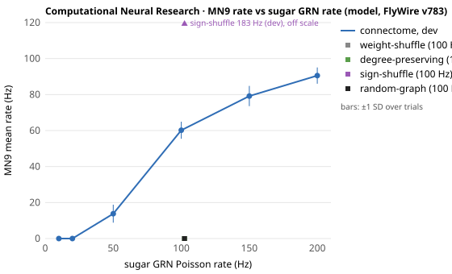

# Computational Neural Research: fly-neural results

Written by `python -m fly_neural report` from the sealed results in this
directory; do not edit by hand. Every number is a model output on the
FlyWire v783 connectome (terms: [LICENSE.md](LICENSE.md)). What the
results mean, and what they do not, is in
[docs/ECHO_CONNECTOME.md](../../ECHO_CONNECTOME.md).

## Against Brian 2 ([brian2-reference.json](brian2-reference.json), `7d87e82`)

| | Claim | Result | |
| --- | --- | --- | --- |
| R1 | MN9's rate is the same in both simulators | 62.1 vs 62.5 Hz (difference -0.43, SE 1.24); two-sided p = 0.73 | **pass** |
| R2 | Every neuron's mean rate agrees | r = 0.9998 over 388 neurons | **pass** |
| R3 | The same neurons respond | Jaccard 0.997 (323 shared; 323 here, 324 in Brian 2) | **pass** |

30 Brian 2 trials (seeds 20000 to 20029) from 4 run(s): `brian2-sugar100-30.json` 26 of 30 requested; `brian2-sugar100-30-rest-20026.json` 2 of 2 requested; `brian2-sugar100-30-rest-20028.json` 1 of 1 requested; `brian2-sugar100-30-rest-20029.json` 1 of 1 requested.
Brian 2: 128.2 s per simulated second; this engine: 4.35 s.

## Shiu et al. 2024 on v783, dev seeds ([shiu2024-v783-dev.json](shiu2024-v783-dev.json), `411ac53`)

10 of 12 criteria passed; failed: S6, C3.

| | Claim | Result | |
| --- | --- | --- | --- |
| S1 | Sugar GRNs at 100 Hz activate MN9 in every simulation | 30/30 trials (Wilson 95% 0.886–1.000) | **pass** |
| S2 | More neurons respond to stronger sugar GRN activation | 18 → 422 responders (sugar-10 → sugar-200) | **pass** |
| S3 | Shuffling the connectome's weights abolishes sugar-evoked MN9 activation | 0/100 trials (Wilson 95% 0.000–0.037) | **pass** |
| S4 | Bitter GRN activity inhibits sugar-evoked MN9 firing | 0.0 vs 60.2 Hz, one-sided Mann-Whitney p = 8.3e-13 | **pass** |
| S5 | Ir94e GRN activity inhibits sugar-evoked MN9 firing | 2.3 vs 60.2 Hz, one-sided Mann-Whitney p = 1.3e-11 | **pass** |
| S6 | Water GRN activation activates MN9 | 30.3 Hz | **fail** |
| G1 | JO-CE neurons drive aBN1 robustly and JO-F neurons do not, despite synapsing onto it | 68.0 vs 3.0 Hz, one-sided Mann-Whitney p = 1.1e-11, ratio 0.04 | **pass** |
| G2 | Silencing the inhibitory neurons between JO-F and aBN1 lets JO-F drive aBN1 | 29.2 vs 3.0 Hz, one-sided Mann-Whitney p = 1.1e-11 | **pass** |
| G3 | JON activation activates the antennal grooming neurons aBN1, aDN1 and aDN2 | abn1_shiu 44.1 Hz, adn1_shiu 15.7 Hz, adn2_shiu 16.3 Hz | **pass** |
| C1 | Degree-preserving rewiring abolishes sugar-evoked MN9 activation | 0/30 trials (Wilson 95% 0.000–0.114) | **pass** |
| C2 | A random graph of the same size and weights does not produce sugar-evoked MN9 activation | 0/30 trials (Wilson 95% 0.000–0.114) | **pass** |
| C3 | Permuting neuron signs disrupts sugar-evoked MN9 activation | 183.0 vs 60.2 Hz, one-sided Mann-Whitney p = 1 | **fail** |

| Condition | Wiring | Trials | MN9 (Hz) | aBN1 | aDN1 | aDN2 | Responders > 0 Hz | ≥ 1 Hz |
| --- | --- | --- | --- | --- | --- | --- | --- | --- |
| sugar-10 | connectome | 30 | 0.0 | 0.0 | 0.0 | 0.0 | 18 | 4 |
| sugar-20 | connectome | 30 | 0.0 | 0.0 | 0.0 | 0.0 | 43 | 22 |
| sugar-50 | connectome | 30 | 13.8 | 0.0 | 0.0 | 0.0 | 342 | 203 |
| sugar-100 | connectome | 30 | 60.2 | 0.0 | 0.0 | 0.0 | 384 | 325 |
| sugar-150 | connectome | 30 | 79.2 | 0.0 | 0.0 | 0.0 | 415 | 339 |
| sugar-200 | connectome | 30 | 90.5 | 0.0 | 0.0 | 0.0 | 422 | 374 |
| sugar-100-weight-shuffle | weight-shuffle | 100 | 0.0 | 0.0 | 0.0 | 0.0 | 355 | 68 |
| sugar-100-degree-preserving | degree-preserving | 30 | 0.0 | 0.0 | 0.0 | 0.0 | 1344 | 37 |
| sugar-100-sign-shuffle | sign-shuffle | 30 | 183.0 | 95.9 | 103.2 | 96.7 | 97465 | 90140 |
| sugar-100-random-graph | random-graph | 30 | 0.0 | 0.0 | 0.0 | 0.0 | 719 | 41 |
| sugar-100-bitter-50 | connectome | 30 | 31.1 | 0.0 | 0.0 | 0.0 | 374 | 288 |
| sugar-100-bitter-200 | connectome | 30 | 0.0 | 0.0 | 0.0 | 0.0 | 247 | 143 |
| sugar-100-ir94e-50 | connectome | 30 | 38.5 | 0.0 | 0.0 | 0.0 | 375 | 303 |
| sugar-100-ir94e-200 | connectome | 30 | 2.3 | 0.0 | 0.0 | 0.0 | 8805 | 5358 |
| bitter-200 | connectome | 30 | 0.0 | 0.0 | 0.0 | 0.0 | 69 | 63 |
| water-50 | connectome | 30 | 0.0 | 0.0 | 0.0 | 0.0 | 34 | 24 |
| water-100 | connectome | 30 | 0.0 | 0.0 | 0.0 | 0.0 | 76 | 59 |
| water-200 | connectome | 30 | 30.3 | 0.0 | 0.0 | 0.0 | 339 | 202 |
| jo-ce-100 | connectome | 30 | 0.0 | 24.8 | 0.4 | 2.1 | 245 | 157 |
| jo-ce-200 | connectome | 30 | 0.0 | 68.0 | 28.2 | 32.5 | 427 | 285 |
| jo-f-100 | connectome | 30 | 0.0 | 0.9 | 0.0 | 0.0 | 37 | 22 |
| jo-f-200 | connectome | 30 | 0.0 | 3.0 | 0.0 | 0.0 | 77 | 49 |
| jo-f-200-silence-inhibitory | connectome | 30 | 0.0 | 29.2 | 7.5 | 7.9 | 131 | 81 |
| jons-140 | connectome | 30 | 0.0 | 44.1 | 15.7 | 16.3 | 478 | 316 |

