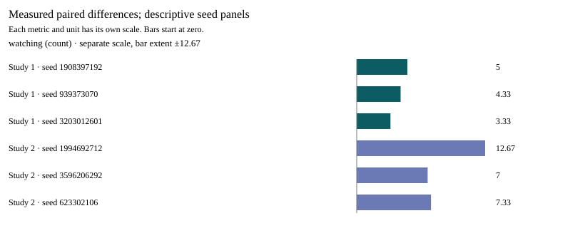

# Illustrative urban disruption and population context

**AI-assisted research draft — requires human scientific review.**

Narrative generation: scripted; model: scripted-discovery-test-double. **SCRIPTED INTEGRATION DEMONSTRATION, not a model discovery.** Numeric tables and figure are host-generated from replay-verified simulator records. Narrative and source interpretation remain model statements; reference validity does not establish entailment.

Research goal: How do different simulated urban disruptions alter collective movement patterns, and under which conditions does the same intervention produce different behavioral outcomes?

Charter SHA-256: 9d59a5d09899549aabbf46a254f35e9748f79846a4e69b55d8adca506330d3a9

Evidence bundle SHA-256: 88c87c7fe5d317ff44fa973704a4ef7931620942778ef58d0a0b60ae43d967ec

## Abstract

The paired mean differences were 4.22 and 9. These exploratory measurements motivate further investigation without establishing a general behavioral law.

Source references: P-0748c7f43070ea347062.

Measured run references: BX-d86316f79e28-Rmv2krau11, BX-2f0f9ad47d7c-Rmv2krfg52.

## Introduction

The paired mean differences were 4.22 and 9. These exploratory measurements motivate further investigation without establishing a general behavioral law.

Source references: P-0748c7f43070ea347062.

Measured run references: BX-d86316f79e28-Rmv2krau11, BX-2f0f9ad47d7c-Rmv2krfg52.

## Related work

The supplied manuscript excerpts and literature metadata motivate bounded experiments. Their reading scope does not establish empirical validation.

Source references: P-0748c7f43070ea347062.

Measured run references: BX-d86316f79e28-Rmv2krau11, BX-2f0f9ad47d7c-Rmv2krfg52.

## Methods and measured results

One no-event control and one treatment per seed. Initial states are matched, criteria are preregistered, and native replay recomputes measurements. Seed panels are small and comparisons across differing protocols are descriptive; no significance test or real-world validation is supplied.

### Study 1 — ND-33f6ad39e49c05a1c4eed727-1-b76a2eea

Operational hypothesis: The intervention will increase watching by at least 0.01 count on average, with every paired seed in the expected direction.

Intervention: fire at bethesda\_row; population 40 pedestrians, 8 vehicles and 2 buses; intensity 1; duration 300 ticks; warm-up 100; observation 300 ticks.

Purpose: exploratory. Parent: none. Native verdict: supported.

| Seed | Control | Treatment | Treatment − control |
| --- | ---: | ---: | ---: |
| 1908397192 | 0 | 5 | 5 |
| 939373070 | 0 | 4.33 | 4.33 |
| 3203012601 | 0 | 3.33 | 3.33 |

Primary metric: watching (count). Mean paired difference: **4.22**.

Run: BX-d86316f79e28-Rmv2krau11. Registry admission: V3D-EXP-0001-RUN-0001. Replay: passed.

Recorded uncertainty: Population dependence remains untested.

### Study 2 — ND-380da1099b48d6f64dde7557-2-b76a2eea

Operational hypothesis: The intervention will increase watching by at least 0.01 count on average, with every paired seed in the expected direction.

Intervention: fire at bethesda\_row; population 60 pedestrians, 8 vehicles and 2 buses; intensity 1; duration 300 ticks; warm-up 100; observation 300 ticks.

Purpose: exploratory. Parent: ND-33f6ad39e49c05a1c4eed727-1-b76a2eea. Native verdict: supported.

| Seed | Control | Treatment | Treatment − control |
| --- | ---: | ---: | ---: |
| 1994692712 | 0 | 12.67 | 12.67 |
| 3596206292 | 0 | 7 | 7 |
| 623302106 | 0 | 7.33 | 7.33 |

Primary metric: watching (count). Mean paired difference: **9**.

Run: BX-2f0f9ad47d7c-Rmv2krfg52. Registry admission: V3D-EXP-0002-RUN-0001. Replay: passed.

Recorded uncertainty: Population dependence remains untested.

## Discussion

The paired mean differences were 4.22 and 9. These exploratory measurements motivate further investigation without establishing a general behavioral law.

Source references: P-0748c7f43070ea347062.

Measured run references: BX-d86316f79e28-Rmv2krau11, BX-2f0f9ad47d7c-Rmv2krfg52.

## Limitations

The results describe illustrative simulator rules. Seed panels differ between protocols and absolute counts cannot identify a population interaction. There is no real-world validation or significance test.

Source references: P-0748c7f43070ea347062.

Measured run references: BX-d86316f79e28-Rmv2krau11, BX-2f0f9ad47d7c-Rmv2krfg52.

## Conclusion

The paired mean differences were 4.22 and 9. These exploratory measurements motivate further investigation without establishing a general behavioral law.

Source references: P-0748c7f43070ea347062.

Measured run references: BX-d86316f79e28-Rmv2krau11, BX-2f0f9ad47d7c-Rmv2krfg52.

## References and reading scope

- **P-0748c7f43070ea347062** — Resonant Dynamics of Sovereign Debt. Christopher Woodyard. Pinned author-supplied manuscript excerpt; character range 794–2594. Not independent validation.
  https://github.com/topherchris420/james_library/blob/9c8811e343d21b8c143055f9cf549abdefa862f1/papers/Resonant%20Dynamics%20of%20Sovereign%20Debt.md
  SHA-256: 0748c7f43070ea347062d86383ce9c0a478d196fc251e71cbb93b7d7f4532110. Retrieved: 2026-10-06T00:20:57.630Z.

- **P-732c235955e815158bc5** — Resonant Intelligence. Christopher Woodyard. Pinned author-supplied manuscript excerpt; character range 222–2022. Not independent validation.
  https://github.com/topherchris420/james_library/blob/9c8811e343d21b8c143055f9cf549abdefa862f1/papers/Resonant%20Intelligence.md
  SHA-256: 732c235955e815158bc5b90d816bbbef00ff0e20451c24bd0b803a56858677af. Retrieved: 2026-10-06T00:20:57.630Z.

- **P-f34bf5c23db820e84ea9** — Dynamic Resonance Rooting. Christopher Woodyard. Pinned author-supplied manuscript excerpt; character range 855–2655. Not independent validation.
  https://github.com/topherchris420/james_library/blob/9c8811e343d21b8c143055f9cf549abdefa862f1/papers/Dynamic%20Resonance%20Rooting.md
  SHA-256: f34bf5c23db820e84ea959169ead030c1e0cd2c92a40b7c1e587eb1ebb2facd6. Retrieved: 2026-10-06T00:20:57.630Z.

- **P-903638bf475060869b48** — Integrated Plasma Confinement. Christopher Woodyard. Pinned author-supplied manuscript excerpt; character range 1369–3169. Not independent validation.
  https://github.com/topherchris420/james_library/blob/9c8811e343d21b8c143055f9cf549abdefa862f1/papers/Integrated%20Plasma%20Confinement.md
  SHA-256: 903638bf475060869b48625f681458ce9a14598503c2ef89bd4549ad247452c2. Retrieved: 2026-10-06T00:20:57.630Z.

- **M-a8439c3d3d73eccde7a3** — One-tape time simulation in two-fifths-power space. . Pinned catalogue summary/abstract; status: manuscript. Applicability requires mapped assumptions; Lean was not executed.
  https://github.com/openai/math/blob/adc7f1241b42e322a6451854ab7e4b4c146bf78a/CONTENTS.md
  SHA-256: a8439c3d3d73eccde7a356cac1161ec60e12448870944c6e4f65cc6a3ddba9f1. Retrieved: 2026-10-10T15:54:19.220Z.

- **M-17cf9a8ea573f59024cd** — Optimal-order randomized \<i\>k\</i\>-server on arbitrary metrics. . Pinned catalogue summary/abstract; status: formalized. Applicability requires mapped assumptions; Lean was not executed.
  https://github.com/openai/math/blob/adc7f1241b42e322a6451854ab7e4b4c146bf78a/CONTENTS.md
  SHA-256: 17cf9a8ea573f59024cd215f2f6004ffce01bc88076d086bcb2306ca71e60d0b. Retrieved: 2026-10-10T15:54:19.220Z.

- **M-e4160f94bc92952703bf** — Classical capacity of generalized amplitude damping. . Pinned catalogue summary/abstract; status: formalized. Applicability requires mapped assumptions; Lean was not executed.
  https://github.com/openai/math/blob/adc7f1241b42e322a6451854ab7e4b4c146bf78a/CONTENTS.md
  SHA-256: e4160f94bc92952703bf97ef4aa7e23fc894c999cc65496573266cd4c859ef22. Retrieved: 2026-10-10T15:54:19.220Z.
