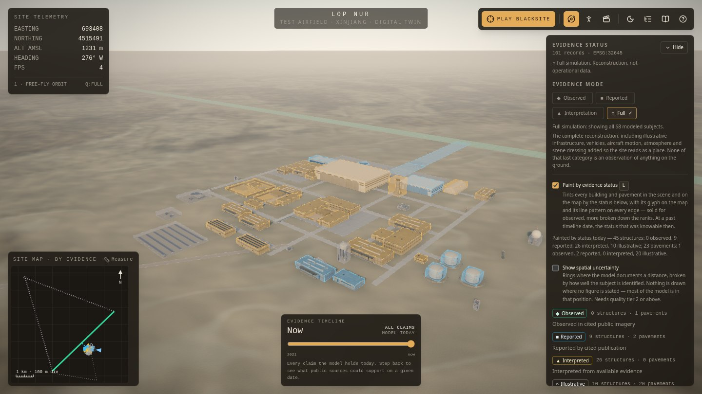
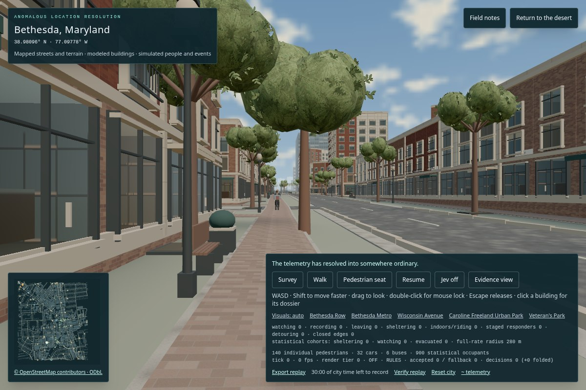
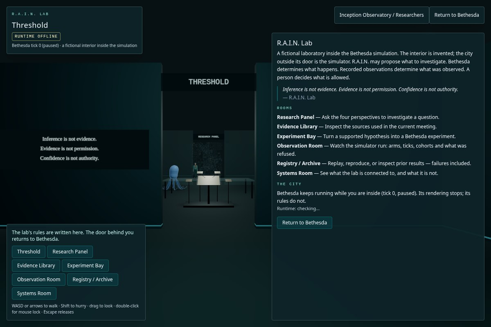
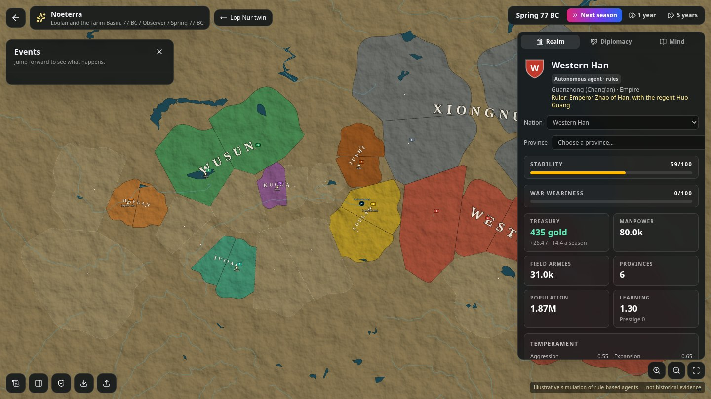
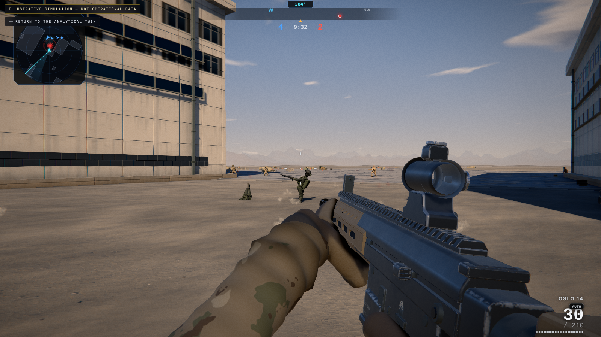
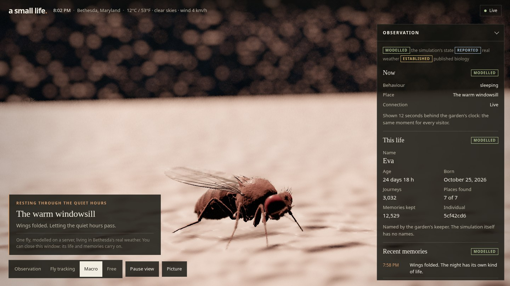
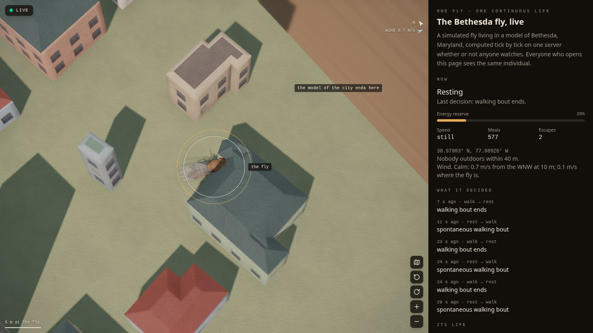
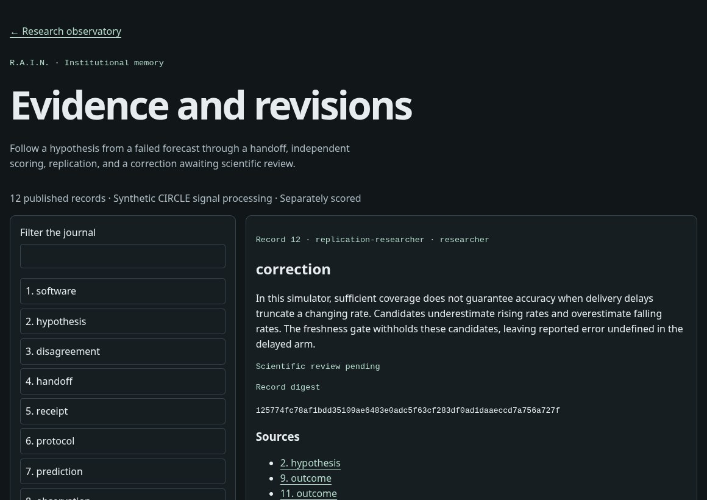
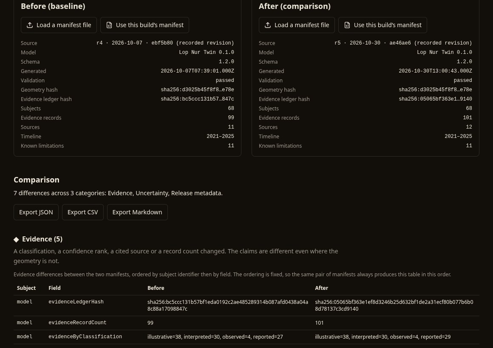

# Visual field guide

These are **screenshots of running interfaces**, not illustrations of proposed features. They document the browser view at capture time, not the quality of an experiment or the behaviour of a persistent individual at every moment. Click each image to open its source.

| Experience | Captured view | What it shows |
| :-- | :-- | :-- |
| [Lop Nur twin](https://lop-nur-twin.vercel.app/) | [](gallery/twin.jpg) | Airfield geometry with an evidence lens, not a claim that all objects are observed |
| [Bethesda](../../BETHESDA_ANOMALY.md) | [](gallery/bethesda.jpg) | Walk view and simulated streets |
| [R.A.I.N. Lab](../../RAIN_LAB_BETHESDA.md) | [](gallery/rain-lab.jpg) | In-world interface; [protocol](../../screenshots/rain-lab-protocol.png) and [replay record](../../screenshots/rain-lab-record.png) |
| [Noeterra](https://lop-nur-twin.vercel.app/noeterra) | [](gallery/noeterra.jpg) | A rule-driven civilization simulation, not historical reconstruction |
| [Blacksite](https://lop-nur-twin.vercel.app/play) | [](../../screenshot-blacksite.png) | An actual first-person **match**, not the title screen. Fictional engagements; [boundaries](../../BLACKSITE.md) |
| [Eva's garden](../../LIVE_GARDEN.md) | [](gallery/garden.jpg) | A real viewer observation. [Phone capture](gallery/garden-mobile.jpg) |
| [ECHO's observer](https://lop-nur-twin.vercel.app/live) | [](gallery/live-fly.jpg) | An observation of a persistent digital individual, not a scripted demonstration |
| [Research journal](https://lop-nur-twin.vercel.app/research-memory/) | [](gallery/research-journal.jpg) | Traceable experiment and review history |
| [Model comparison](https://lop-nur-twin.vercel.app/compare) | [](gallery/model-history.jpg) | Recorded differences between model revisions |

## Retaking the screenshots

From a working checkout, install dependencies and run the local development server in one terminal:

```bash
bun install --frozen-lockfile
bun run dev
```

In a second terminal, capture **Blacksite gameplay first**, then regenerate the gallery stills and the opening composition:

```bash
node tools/shots.mjs --only blacksite
node tools/readme-media.mjs --only gallery
node tools/readme-media.mjs --only tour
```

The gameplay frame is `docs/screenshot-blacksite.png`. The gallery derives `docs/media/readme/gallery/blacksite.jpg` from **that same frame**, so the preview does not silently regress to a menu. The screenshot tool frames an active opponent and validates the line of sight before photographing the renderer.

The gallery also reads the deployed ECHO observer, the separate Eva garden and the deployed Noeterra workbench. Those services must be reachable. A failure stops the staged capture without replacing the existing gallery. Some snapshots change naturally from one visit to the next; check that an organism is visible and the viewer reports a live observation before publishing.

Run `node tools/readme-media.mjs --only evidence` to refresh the evidence timeline, `--only bethesda` for the city discovery sequence, or `--only orbit` for the airfield loop. Animated captures require `ffmpeg` and `gifsicle`. Keep the README's capture timing notes consistent with the tool output.

## Editorial rules

- Never turn an illustrative reconstruction or game image into a claim about real-world activity at Lop Nur.
- Keep original frames discoverable. Cropping or resizing must not erase evidence labels, disclaimers or measured limitations.
- Do not call a sleeping fly active or a scripted benchmark an independent autonomous discovery. Caption what the viewer actually showed.
- Prefer readable frames from each world to a collage of tiny, illegible interfaces. Preserve descriptive alt text and direct links.
- When a world changes, recapture the affected still and inspect it on desktop and mobile before updating the README.

[Return to project README](../../../README.md) · [Capture script](../../../tools/readme-media.mjs) · [Gameplay capture script](../../../tools/shots.mjs)
